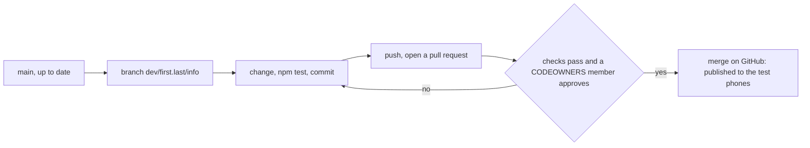

# Contributing to Trip Map

How to set up a computer to work on Trip Map, and how a change goes from your editor to the phone. The rules themselves are in [AGENTS.md](AGENTS.md), for people and AI tools alike; the design is in [docs/DESIGN.md](docs/DESIGN.md).

Use a personal computer you control. Never set up this project's GitHub account, git identity, or keys on a work machine.

## 1. Install

| Program | Version | What it is for |
| --- | --- | --- |
| [Git](https://git-scm.com/downloads) | Any recent | History, branches, commits. On Windows, *Git for Windows* also brings Git Bash and Git Credential Manager |
| [Node.js](https://nodejs.org/en/download) | **22.x LTS**, the version the GitHub checks use (`.github/workflows/tests.yml`) | Runs `npm`, the TypeScript compiler, the build, the test server, and the tests |
| [VS Code](https://code.visualstudio.com) | Any recent | Editor, git panel, terminal. Other editors work; this guide uses VS Code |

Nothing else: no Python, no global packages. Everything the project needs comes from `package.json` (step 3).

**Git for Windows installer:** keep the defaults, except choose *Use Visual Studio Code as Git's default editor*, name the initial branch `main`, and set `git pull` to *Fast-forward only* (see section 6).

**Node.js:** the nodejs.org home page offers the newest LTS; choose **v22** in its version menu. Laptop and GitHub on the same version means a test that passes on one passes on the other.

After installing Git or Node while VS Code is open, close VS Code completely and open it again, so its terminal finds them.

### Keep your email private

Every commit carries an email, and in a public repository anyone can read it. On github.com: **Settings → Emails**, turn on **Keep my email addresses private** and **Block command line pushes that expose my email**, and copy the `…@users.noreply.github.com` address shown there. Then:

```sh
git config --global user.name "Your Name"
git config --global user.email "<number>+<username>@users.noreply.github.com"
```

### VS Code extensions

Check the publisher before installing: look-alikes exist.

| Extension | Publisher | What it gives |
| --- | --- | --- |
| GitHub Pull Requests | GitHub | Create, review, and comment on pull requests inside VS Code |
| Markdown Preview Mermaid Support | Matt Bierner | Draws the Mermaid diagrams of `docs/` in the Markdown preview (`Ctrl+K` then `V`) |
| Git Graph | mhutchie | The history as a picture: branches, commits, what each changed |
| Claude Code | Anthropic | Claude next to the code (section 7). Optional |

Markdown preview, TypeScript checking, git, and the terminal are built in.

## 2. Get the code

Any of the three:

- **VS Code:** `Ctrl+Shift+P` → **Git: Clone** → **Clone from GitHub** → `projects-rs/trip-map`.
- **git:** `git clone https://github.com/projects-rs/trip-map.git`
- **GitHub CLI:** `gh auth login` once (GitHub.com, HTTPS, login with a web browser), then `gh repo clone projects-rs/trip-map`.

**Grant the organization to VS Code.** The first time VS Code signs in to GitHub (Accounts icon, bottom left → **Sign in with GitHub**), GitHub may list `projects-rs` with a **Grant** button: press it (or ask the owner to). Without it, the organization's repositories do not appear in **Clone from GitHub**.

Open the `trip-map` folder itself in VS Code (**File → Open Folder**), not a single file. The first push opens the browser once for the GitHub sign-in; Git Credential Manager keeps it in the system's credential store, never in the project.

## 3. Build and test

In VS Code's terminal (`` Ctrl+` ``), inside `trip-map`:

```sh
npm install                              # once, and after any change to package.json
npx playwright install chromium webkit   # once: the Android and iPhone test engines
npm test                                 # build, then the phone tests: before every commit
```

`npm test` compiles the TypeScript, builds `site/`, and runs every test in a simulated Android phone and iPhone, exactly as GitHub does on every pull request. To see the app in a browser:

```sh
npm run build
npm run serve                            # http://localhost:8000/, Ctrl+C to stop
```

In Chrome, press `F12` and the phone icon to see it at phone size. To watch the tests run: `npx playwright test --ui`; to see their screenshots: `npx playwright show-report`.

`node_modules/`, `site/`, and the test results are in `.gitignore`: they never go into a commit.

## 4. Make a change



1. **Start from `main`:** switch to it and pull (VS Code: the branch name at the bottom left, then **Sync**).
2. **Make a branch** named `dev/<first.last>/<descriptive_info>`, for example `dev/reuven.shefer/first_basic_app`: lowercase, words joined by `_` (AGENTS.md). Nothing is committed to `main` directly; GitHub refuses it.
3. **Change, test, commit.** One idea per commit. Run `npm test` first. The message: a first line of at most 72 characters saying what changed, a blank line, then why.
4. **Raise the version** in `package.json` if the change touches the app: a patch for a fix, the minor for a feature (DESIGN.md section 11.3). A check fails the pull request otherwise.
5. **Push and open a pull request** into `main`, with the full description AGENTS.md asks for: main changes, each file and why, the design sections behind it, how it was tested, and what is left open. One feature or theme per pull request, at most 300 to 500 lines of code.
6. **Review:** prepare the review guide (AGENTS.md, "Review"); answer every comment in its thread; every fix is a new commit.
7. **Merge** on github.com, once the checks pass and a CODEOWNERS member approves. The merge publishes the new version to the phones that try new versions first.

## 5. Review a pull request

In VS Code's GitHub Pull Requests panel, open the pull request → **Files changed**; hover a line and press **+** to comment on it, as on github.com. To run it on your computer, **Checkout** its branch (or `gh pr checkout <number>`) and `npm test`. The process is in [docs/reviews/README.md](docs/reviews/README.md); explanations for reviewers new to TypeScript and the browser are in [docs/reviews/background.md](docs/reviews/background.md).

## 6. When `main` changed under your branch

`git pull` is set to fast-forward only, so it never merges or rewrites behind your back; if both sides have new commits, it stops and tells you. When someone merged a pull request that touches files you are changing:

1. Commit what you have.
2. Switch to `main` and pull (a fast-forward).
3. Switch back to your branch and merge `main` into it (VS Code: **Branch → Merge Branch… → main**, or `git merge main`).
4. If the same lines changed on both sides, VS Code shows both: choose **Accept Current**, **Accept Incoming**, **Accept Both**, or edit by hand; then save, stage, and commit.
5. Run `npm test`, then push. The pull request updates and its checks run again.

Without a conflict, the pull request's **Update branch** button on GitHub does the same merge; then pull your branch.

## 7. Working with Claude in VS Code

The Claude Code extension (Anthropic) needs a paid Claude plan; sign in from its panel (the orange mark at the top right of the editor). It reads [CLAUDE.md](CLAUDE.md) and [AGENTS.md](AGENTS.md) by itself, so it follows the same rules.

- **Select code and ask:** the prompt box shows the selection ("15 lines selected"); `Ctrl+Esc` attaches it, `@file#10-20` names lines yourself.
- **Keep the permission mode on Manual** (bottom right of the prompt box) while you learn: every edit is shown as a diff and waits for your approval. The default, Auto, runs what it judges low-risk without asking.
- **One writer per branch.** When you commit and push from your computer, the branch carries your name, even if Claude helped. A cloud agent working alone uses `dev/claude/…`. Never edit a branch another session is pushing to.
- **Not Copilot:** `Ctrl+I` and the Copilot icons are GitHub Copilot, a separate paid product.
- Never give an AI tool a password, an authentication code, a recovery code, or a key, and never ask it to change repository settings (AGENTS.md, "Never").

## 8. Troubleshooting

| You see | What to do |
| --- | --- |
| `git`, `node`, or `npm` "not recognized" | Close VS Code completely (every window) and open it again; if still missing, reinstall with "Add to PATH" |
| PowerShell: "running scripts is disabled on this system" | Once: `Set-ExecutionPolicy -Scope CurrentUser RemoteSigned`, or use Command Prompt or Git Bash in the terminal |
| `npm install`: "Could not read package.json" | You are not in the `trip-map` folder, or on a branch that does not have the app yet |
| `npm test`: a browser executable doesn't exist | `npx playwright install chromium webkit` |
| `npm test` fails here but passes on GitHub, or the reverse | `node -v` must be 22; run `npm install` after pulling a change to `package.json` |
| The build stops: a library version disagrees with `package.json` | `npm install` |
| Push refused: "would publish a private email" | `git config --global user.email` is not the noreply address: fix it, then amend the commit |
| **Clone from GitHub** does not list the projects-rs repositories | github.com → **Settings → Applications → Authorized OAuth Apps → Visual Studio Code** → **Grant** for projects-rs |
| Push to `main` refused | Expected: make a branch, push it, open a pull request |
| Pull stops: branches have diverged | Merge on purpose (section 6), or ask before choosing |
| Git asks for a message in an unknown editor | `git config --global core.editor "code --wait"` |

## 9. Optional tips

Not needed to work on Trip Map; take what helps you.

**VS Code keys:** `Ctrl+Shift+P` every command by name · `` Ctrl+` `` terminal · `Ctrl+Shift+G` Source Control · `Ctrl+P` open a file by name · `Ctrl+K` then `V` Markdown preview beside the text.

**VS Code words and the git commands they run:**

| VS Code | git |
| --- | --- |
| Sync / Pull | `git pull` |
| **+** (Stage) | `git add` |
| Commit | `git commit` (stays on your computer until you push) |
| Publish Branch / Sync Changes | `git push` |
| Checkout / switch branch | `git switch` |

**GitHub CLI for pull requests:** `gh pr create` · `gh pr list` · `gh pr checkout <number>` · `gh pr checks` · `gh pr view --web`.

**Check what the Git installer set:** `git config --show-origin init.defaultBranch` (also `pull.ff`, `core.editor`); without `--global`, because the installer writes Git's system settings.

**One-click tests:** in the Explorer side bar, the **NPM Scripts** list (turn it on from the Explorer's `…` menu) runs `build` or `test` with ▶.

**Claude in VS Code:** `/model` chooses the model · for a bigger change, ask for a plan first and review it · `Shift+Enter` for a new line without sending · sessions from claude.ai's own workspace do not appear in VS Code's session history, so the repository, not a chat, carries decisions between them.
