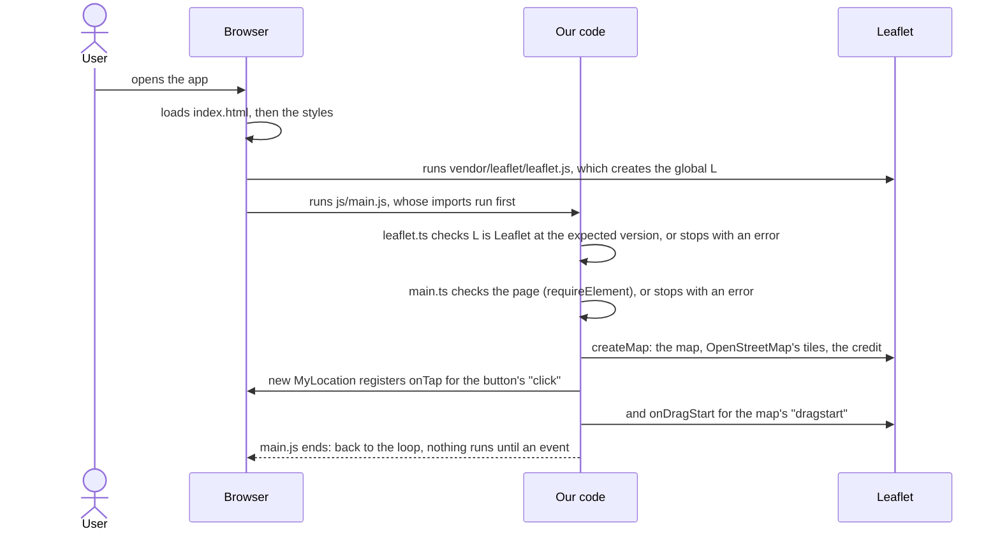
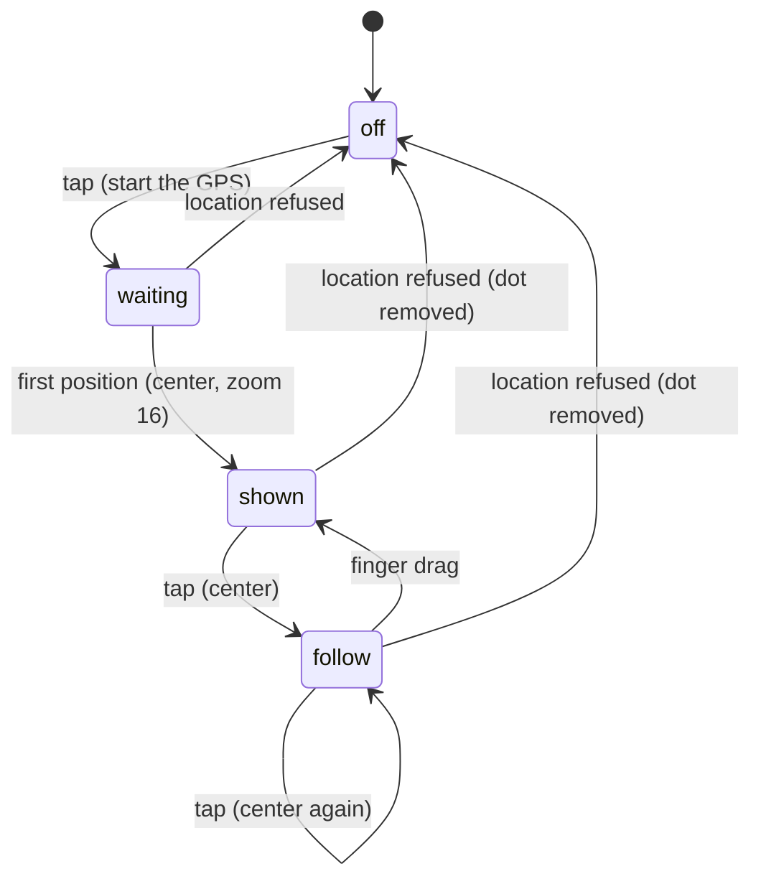
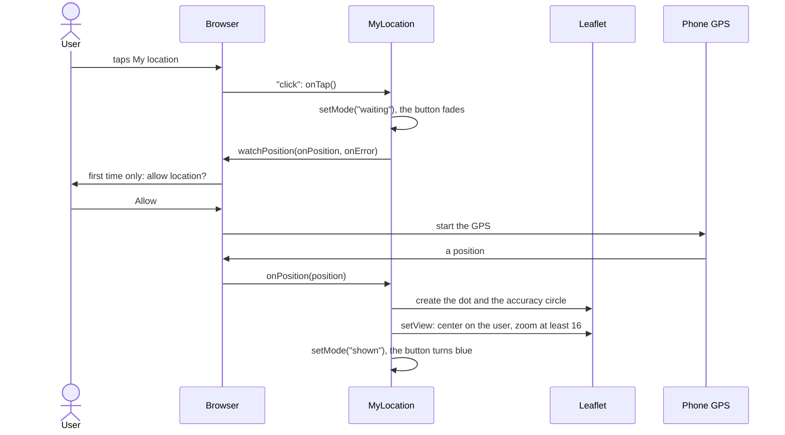
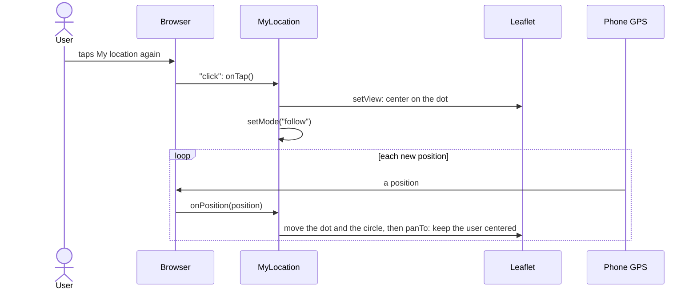
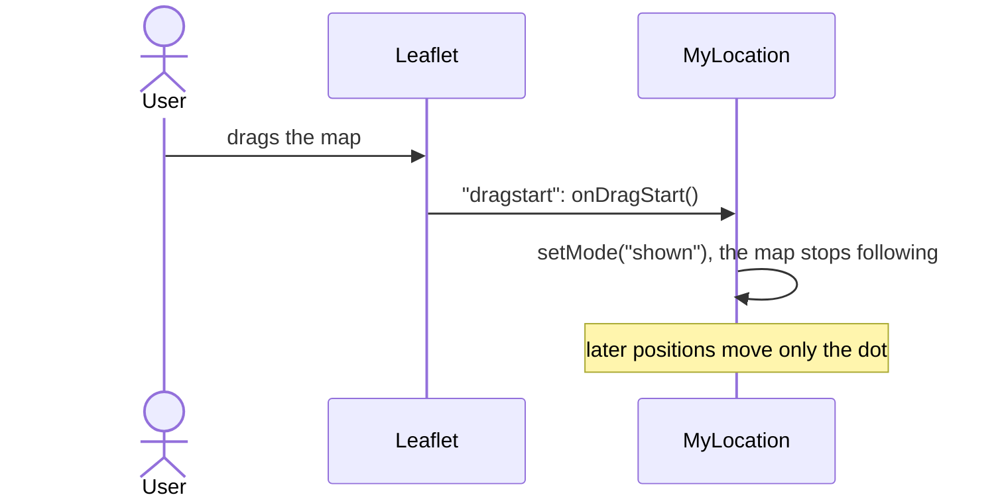
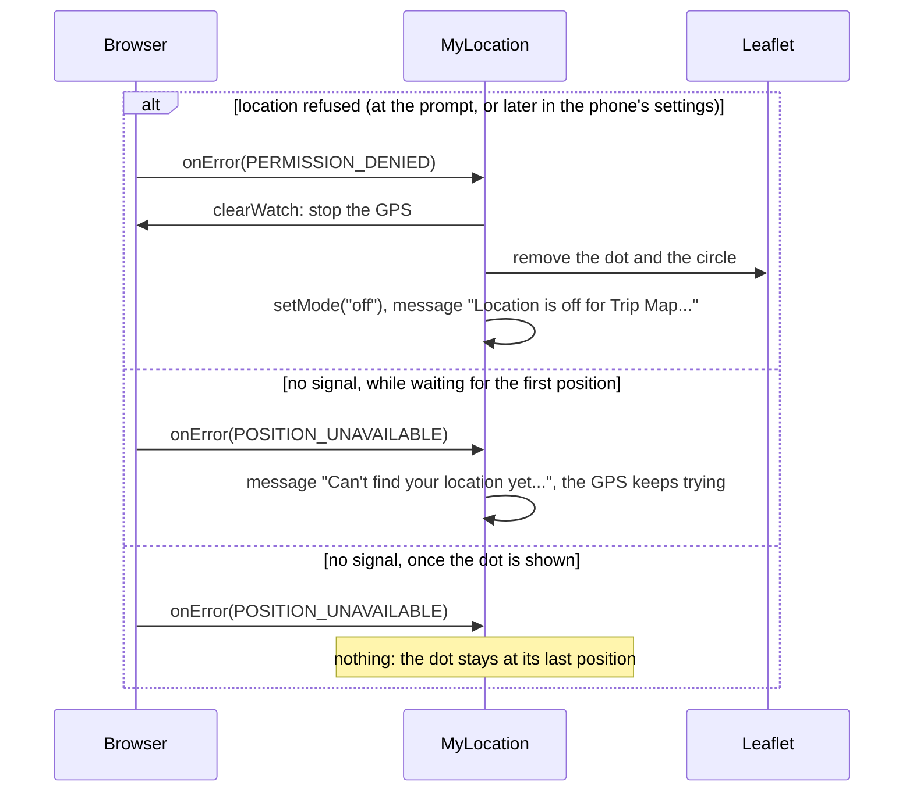

# Architecture

How the Trip Map app is built, and how its parts work together. What the app does, and why, is in [DESIGN.md](DESIGN.md). This description grows with each build step.

## Principles

- **TypeScript, compiled before publishing** (DESIGN.md section 13.7). The code in `src/` has its types in the code itself, checked by the compiler with strict settings. `npm run build` compiles it to plain JavaScript and assembles `site/`, the exact folder the phone downloads.
- **Classes for entities with state and behavior; plain objects for data; plain functions for calculations** (AGENTS.md).
- **Libraries come from their official npm packages** at exact versions, copied unchanged by the build into `site/vendor/`; never loaded from another website while the app runs.

## Files

| Path | What it is |
| --- | --- |
| `index.html` | The only page. Loads Leaflet, the styles, and the compiled `js/main.js` |
| `css/app.css` | The app's styles |
| `src/main.ts` | The starting point: checks that every element the app needs is on the page (`requireElement`), creates the map, and connects the buttons |
| `src/leaflet.ts` | The one gateway to Leaflet: checks at start-up that Leaflet, at the version in `package.json`, is loaded, and exports `L` and its types. No other file touches the global `L` |
| `src/map.ts` | `createMap()`: the full-screen map with OpenStreetMap's street map |
| `src/location.ts` | class `MyLocation`: the "My location" button and the blue dot (UI-08) |
| `tsconfig.json` | The compiler's settings: strict, every warning an error |
| `tools/build-site.ts` | Assembles `site/` after the compiler: the page, styles, and libraries; checks that every library version agrees with `package.json` |
| `docs/reviews/` | How pull requests are reviewed (`README.md`), and background for reviewers (`background.md`) |
| `.github/dependabot.yml` | Once a week, GitHub's Dependabot proposes newer stable versions of the packages and actions as pull requests (never betas, never versions younger than 14 days) |
| `icons/` | The icon set (DESIGN.md section 5.4) |
| `tests/` | Phone tests (DESIGN.md section 13.4), with `playwright.config.ts` |
| `tools/check-tests.ts` | Checks the tests themselves: description blocks and no real addresses |
| `.github/workflows/tests.yml` | On every pull request: the test check, the type check and build, and the phone tests. Read-only |
| `.github/workflows/publish.yml` | After each merge: build, test that exact build, then publish to GitHub Pages once the owner approves |

## From source to phone

```text
src/*.ts ──tsc (strict)──> site/js/*.js ─┐
index.html, css/ ──copied──────────────> site/ ──publish (owner approves)──> GitHub Pages ──> the phone
leaflet (npm, exact version) ──copied──> site/vendor/leaflet/ ─┘
```

## How the parts connect

```text
index.html
  ├─ vendor/leaflet/leaflet.js   defines the global L
  └─ js/main.js   (compiled from src/main.ts)
       ├─ js/map.js        createMap("map")  → the Leaflet map
       ├─ js/location.js   new MyLocation(map, button, showMessage)
       └─ (both import) js/leaflet.js  checks the global L once and exports it
                             → navigator.geolocation (the phone's location)
```

## Leaflet API

The app uses Leaflet at the version in `package.json` (1.9.4 on 2026-11-27, the latest stable release), only through `src/leaflet.ts`. Its API is documented in the [Leaflet 1.9.4 API reference](https://leafletjs.com/reference.html) (check that the page says 1.9.4, not 2.0). Each object there has the same four parts: Creation, Options, Events, and Methods. Other help: the [Leaflet tutorials](https://leafletjs.com/examples.html) and the [Leaflet 1.9.4 source code](https://github.com/Leaflet/Leaflet/tree/v1.9.4/src).

Every Leaflet call the app makes, with its place in the reference (update this table when a PR adds one):

| In the code | File | Reference |
| --- | --- | --- |
| `L.map(id, options)`, option `zoomControl` | `map.ts` | [Map: Creation](https://leafletjs.com/reference.html#map-factory), [zoomControl](https://leafletjs.com/reference.html#map-zoomcontrol) |
| `.setView(center, zoom)` | `map.ts`, `location.ts` | [Map: setView](https://leafletjs.com/reference.html#map-setview) |
| `.getZoom()`, `.panTo(latLng)` | `location.ts` | [getZoom](https://leafletjs.com/reference.html#map-getzoom), [panTo](https://leafletjs.com/reference.html#map-panto) |
| `map.on("dragstart", …)` | `location.ts` | [Map: on](https://leafletjs.com/reference.html#map-on). The map's `dragstart` event is fired by Leaflet 1.9.4 ([Map.Drag.js](https://github.com/Leaflet/Leaflet/blob/v1.9.4/src/map/handler/Map.Drag.js), line 115) but not listed in the reference; the test "dragging stops it" guards it |
| `map.attributionControl.setPrefix(…)` | `map.ts` | [Control.Attribution: setPrefix](https://leafletjs.com/reference.html#control-attribution-setprefix) |
| `L.tileLayer(url, options)`, options `maxZoom`, `attribution` | `map.ts` | [TileLayer: Creation](https://leafletjs.com/reference.html#tilelayer-l-tilelayer), [maxZoom](https://leafletjs.com/reference.html#tilelayer-maxzoom), [attribution](https://leafletjs.com/reference.html#layer-attribution) |
| `.addTo(map)`, `.remove()` | `map.ts`, `location.ts` | [Layer: addTo](https://leafletjs.com/reference.html#layer-addto), [remove](https://leafletjs.com/reference.html#layer-remove) |
| `L.latLng(lat, lng)` | `location.ts` | [LatLng: Creation](https://leafletjs.com/reference.html#latlng-l-latlng) |
| `L.circleMarker(latLng, options)`, `.setLatLng`, `.getLatLng` | `location.ts` | [CircleMarker: Creation](https://leafletjs.com/reference.html#circlemarker-l-circlemarker), [setLatLng](https://leafletjs.com/reference.html#circlemarker-setlatlng) |
| `L.circle(latLng, options)`, `.setRadius(r)` | `location.ts` | [Circle: Creation](https://leafletjs.com/reference.html#circle-l-circle), [setRadius](https://leafletjs.com/reference.html#circle-setradius) |
| Options `color`, `weight`, `fillColor`, `fillOpacity`, `stroke`, `className`, `interactive` | `location.ts` | Inherited from [Path](https://leafletjs.com/reference.html#path-color) |
| `L.version` | `leaflet.ts` | [version](https://leafletjs.com/reference.html#version) |

## How the app runs

The app's code never runs on its own: the browser runs it in steps, at start-up and then once per event, and each step returns to the browser's loop (the loop itself is explained in `docs/reviews/background.md`, section 4). The drawings below show the current flows, one per start-up and per interaction. **A pull request that adds a start-up step or an interaction updates them** (AGENTS.md, "Pull requests and commits").

### Start-up: runs once, when the app opens



### My location (UI-08)

The button is a state machine, the class `MyLocation` in `src/location.ts`. Its mode is kept in the field `mode` and copied to the button's `data-mode` attribute, which the CSS and the tests read.



| Mode | Meaning | The button | A tap |
| --- | --- | --- | --- |
| `off` | Location not used | White | Starts the GPS (the first time, the phone asks the user) → `waiting` |
| `waiting` | GPS started, no position yet | Faded | Nothing |
| `shown` | The blue dot is on the map; the map stays where it is | Blue symbol | Centers on the dot → `follow` |
| `follow` | The map keeps the dot in its center | Solid blue | Centers again |

**First tap, and the first position** (`off` → `waiting` → `shown`):



**Following, and walking** (`shown` → `follow`; then about once a second):



**A finger drag** (`follow` → `shown`):



**When the GPS fails** (`onError`):


