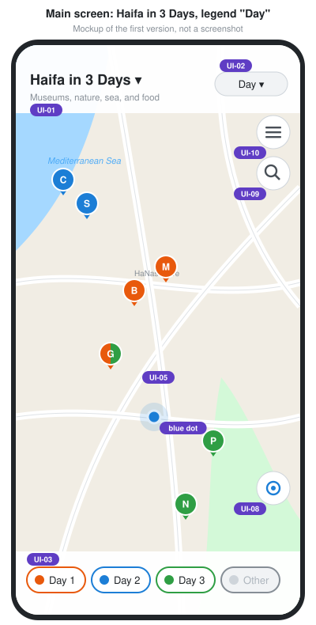
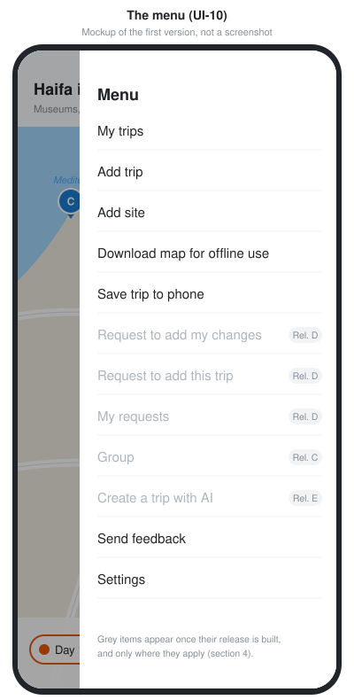
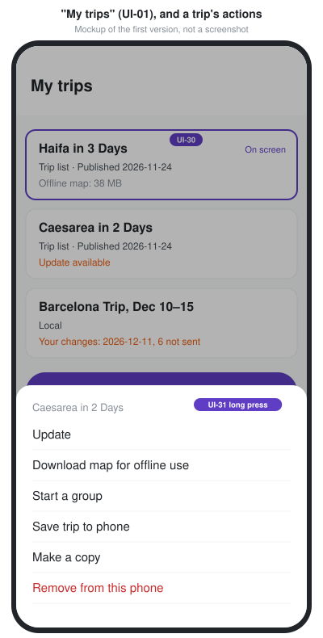
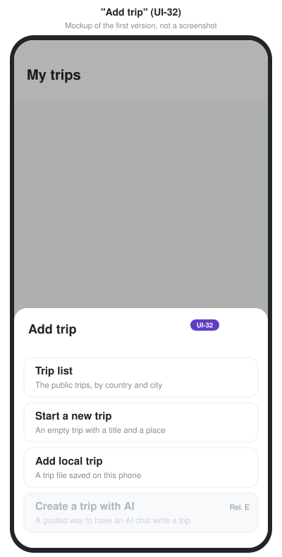
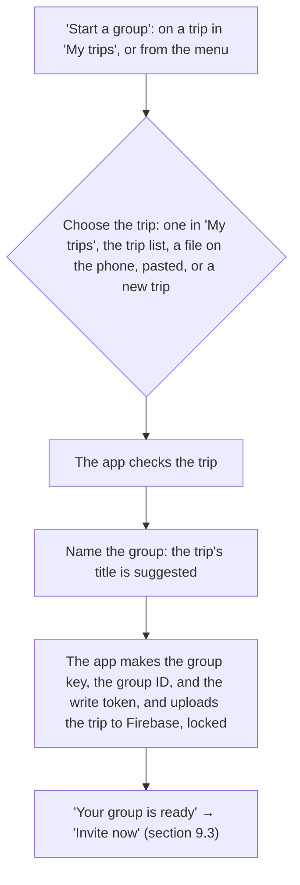
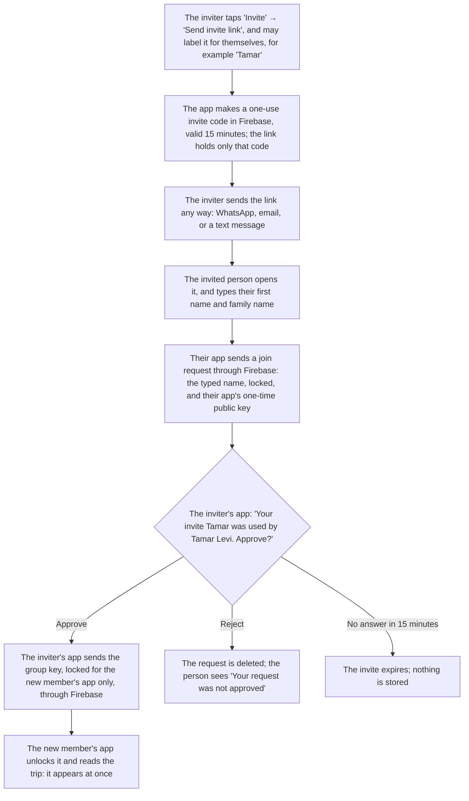
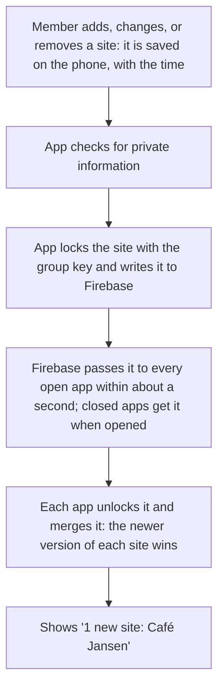

# Trip Map — App Design

"Trip Map" is a working name.

A phone-first web app that shows the sites of a trip on a real street map, with custom pins, several legends, site cards, and walking navigation. The app is not tied to any trip: each trip is a separate trip file that is shared on its own.

Status: version 1 (basic map) is built. Everything below describes the version 2 design. All proposals and assumptions were approved by the app owner on 2026-11-15. Remaining open questions are listed in section 15. The build plan is in section 13. Group trips (section 9) are built in release C, the AI toolkit in release E, and the big-screen layout (section 4.3) last, in release F: phones come first.

Last updated: 2026-11-21

---

## 1. Goals

> **Decision (2026-11-21): the trip model.** What people share is a **trip**: its sites, legends, and groups, shown on a map. All trips are public, in one Trips repository, and anyone can download any trip. A user changes a trip only locally, on their phone, and can ask for the changes to be added to the public trip; only the app owner approves. Locked (encrypted) maps are dropped. Details that only the people on a trip should see travel only inside their group (goal 12). Sections 2 to 15 are being revised to this model, section by section, in the review of 2026-11-21.

Trips on the map:

1. Show a trip's sites on a real map with every street named.
2. Group sites by more than one legend (for example Category and Day) and filter by them.
3. Tap a site to see its details and navigate to it. Do this inside the app where possible; other navigation apps are a choice, not the default.
4. Keep the app independent of any trip. Every trip is a JSON file. The app predefines no sites, legends, groups, or colors.
5. Hold several trips on one phone, and switch between them. Each trip keeps its own local changes. Plan comfortably on a laptop too, and use the trip on the phone (section 4.3). The phone always comes first.

Getting and changing trips:

6. Let anyone find and download any trip from a list of public trips, by country and city, with nothing but the phone's browser. Advanced users can also take trips directly from GitHub.
7. Let a user change a trip locally, on their phone only: add or remove sites, and add or remove legend entries.
8. Let a user ask for their local changes to be added to the public trip, without knowing GitHub. Only the app owner approves. After approval, the trip's users are offered the update, and their copy changes only when they accept it.
9. Let a user publish a trip they created to the Trips repository, from the app, with "Request to add this trip". Before anything is sent, the app checks the trip for personal data (names, phone numbers, email addresses, exact home addresses, booking codes) and shows what it found; the user must remove it first. The same checks run again on GitHub, and the app owner reviews and approves the trip before it appears in the trip list (section 14.2).
10. Let an AI agent create a new trip from scratch, or update one, as a JSON file in the exact format the app accepts. The agent learns the format from the AI toolkit, public at one fixed address: a trip guide in plain words, a machine-readable schema, the icon list, and complete examples. The user just asks any AI to plan a trip for the app and answers its questions; the app's "Copy request for AI" gives one line with that address (section 8.4). One checker verifies every trip: in the app, on GitHub for anyone, and automatically on every pull request, where a trip that fails cannot be merged.
11. Let a user move a trip file in and out of the app, to edit it with outside tools such as an AI agent or a JSON editor.

Sharing:

12. Let a small group (for example the people on the same trip) share one trip in the app: every site and change reaches all members automatically, and members can show their location, only in a safe way (section 9). What is shared inside a group stays inside the group, and never reaches the public trip.

Platform and cost:

13. Install the app once, on its own, with no trips inside. After that, every trip is downloaded from within the app (goal 6). Installing needs nothing preinstalled: only the phone's browser, with no account, no app store, and no technical steps (section 3.1).
14. Update the app with no installation steps, and only after the user accepts.
15. Cost nothing to users, and as little as possible to the app owner: no servers of our own and no paid services, only the GitHub plan. Group trips use one hosted service, Firebase, on its free plan (decided 2026-11-23; section 9.5).
16. Keep private information out of public trips, and let users send feedback and problem reports without exposing it.

## 2. Main concepts

| Concept | Meaning |
| --- | --- |
| App | The program. One public address, the same for everyone. Installed on its own, with no trips inside (goal 13). |
| App owner | The single person who owns the app and its repositories, approves every change to the app and to every trip, and publishes new versions (section 12). |
| Trip | What people share: a JSON file with a trip's sites, legends, and legend entries, shown on a map. Every trip has a permanent identity, its `uid` (section 10). |
| Trips repository | The one public place where all published trips are kept, on GitHub. Anyone can download any trip from it (goal 6). |
| Trip list | The list of published trips inside the app, by country and city. Built from the Trips repository; the user does not see GitHub. |
| My trips | The trips on one phone: downloaded from the trip list, received from a group, opened from a file, or started on the phone. |
| Local trip | A trip that exists only on one phone: opened from a file or started with "Start a new trip", and not (yet) in the Trips repository. |
| Legend | One way of grouping a trip's sites, for example Category or Day (section 5.3). |
| Legend entry | One item of a legend, with its color, for example "Architecture" in Category, or "Fri 11" in Day. A site can be in several legend entries. |
| Local change | A change a user made to a trip on their phone only: a site added, changed, or removed, or a legend entry added or removed. It stays on the phone until the user sends it (goals 7, 8). |
| Update request | A user's local changes to a published trip, sent to the app owner with "Request to add my changes", to be added to that trip (section 8.6). Only the app owner approves. |
| New trip request | A trip a user created, sent to the app owner with "Request to add this trip", to be added to the Trips repository after the personal-data check (goal 9, section 8.6). Only the app owner approves. |
| Contributor | Someone who adds a new trip to the Trips repository, or updates one, by pull request on GitHub (an advanced user, section 2.1). The app owner approves every contribution. |
| Group | A small set of people, for example the four people on the same trip, who share one trip and their location with each other in the app. The shared trip is kept in Firebase and every member's app updates it by itself (section 9). Membership is having the group's key; the app keeps no member list, IDs, or names. |
| Group trip | A trip that a group shares and works on together. What the members share inside the group, such as their apartment, stays inside the group and never reaches the published trip (section 9). |
| User | Anyone who uses the app. Simple and advanced users are described in section 2.1. |

Words that are no longer used (decision of 2026-11-21): "map" for the shared file (now "trip"), "locked map", "public map" (every trip is public), "map owner" (the app owner approves everything), "proposal" (now "update request" for changes, "new trip request" for a whole new trip), "group" for an item of a legend (now "legend entry").

### 2.1 Two kinds of user

| | Simple user | Advanced user |
| --- | --- | --- |
| Who | Anyone with a phone | Someone who uses GitHub: has an account, and knows how to make a commit and open a pull request |
| Needs | Only the phone's browser. No account, no keys. | A GitHub account |
| Downloads trips | From the trip list in the app | From the trip list, or directly from the Trips repository on GitHub |
| Makes local changes, shares in a group | Yes | Yes |
| Sends changes back | As an update request from the app (section 8.6) | As an update request, or as a pull request to the Trips repository |
| Adds a new trip to the Trips repository | Asks from the app, with "Request to add this trip", after the personal-data check (goal 9); the app owner does the rest | As a pull request (section 12.1) |
| Suggests app changes | Reports a problem from the app | As a pull request to the App repository |

- Every update request and every pull request is approved by the app owner. Nothing reaches the published trips or the app without that approval.
- Nothing in the app requires a simple user to know that GitHub exists (goal 13).
- An advanced user's rights belong to their GitHub account, not to their phone.

## 3. Platform, installation, and updates

| Item | Choice |
| --- | --- |
| App type | Web app, installable to the home screen (no app store) |
| Phones | Android and iPhone |
| Map display | Leaflet. Online: OpenStreetMap tiles. Offline: the trip's own offline map file (section 7.4) |
| Walking routes | FOSSGIS OSRM public server, foot profile |
| Hosting | GitHub Pages |
| Server of our own | None. Group trips use one hosted service, Firebase (section 9.5). Requests and feedback travel through the phone's share menu (section 8.6). |
| Cost | Free |

### 3.1 Installation

The app is a web page that can be added to the phone's home screen (a "progressive web app"). It is not installed from an app store, and it does not need to be: Android and iPhone both support adding a web app to the home screen as a standard feature of the browser, so there is nothing for the stores to block.

- Opening the app link works immediately in the browser.
- "Add to home screen" gives the app its own icon and a full-screen view. Android offers this in one tap. On iPhone it takes two taps through the Share menu, and the app shows a short picture guide the first time.

#### 3.1.1 How the app and trips reach the phone (decided 2026-11-21)

The app and the trips arrive separately: first the app, then the trips, from inside the app.

| # | What | How |
| --- | --- | --- |
| 1 | **Installing the app** | The app owner sends the app's link, `https://projects-rs.github.io/trip-map/`, through WhatsApp or another messaging app, or shows it as a QR code. Users can forward it. The user opens it and adds the app to the home screen (section 3.1.3). The app arrives with no trips inside. |
| 2 | **Downloading a trip** | After the app is installed, from the trip list inside the app (by country and city). All trips in the list are public, so no link or key is needed. |
| 3 | **Creating a new trip on the phone** | "Start a new trip", then "Add site". Sites are placed by searching for a place or an address, or by a long press on the map (section 8.2). The user does not need to be there: GPS and the current location are not needed. |
| 4 | **Adding a trip made by an AI agent** | The AI agent writes the trip as a file (section 10.1). The user saves it on the phone, then uses "Add local trip" to add it to "My trips". The app checks the file first (section 10.2). |
| 5 | **Asking to update a public trip** | "Request to add my changes": an update request to the app owner (section 8.6). |
| 6 | **Asking to add a new trip to the public trips** | "Request to add this trip": a new trip request to the app owner, after the personal-data check (goal 9, section 8.6). |
| 7 | **Sharing a trip with a group** | Members of a group trip share the trip automatically: every change reaches the others through Firebase by itself. New members join with an invite (section 9.3). |

Every way a trip can arrive, leave, or change on the phone is listed in section 3.4.

Every link is an ordinary web address that starts with the app's address. The user never sees GitHub or needs to know about it. What comes after the "#" in a link is read only by the app on the phone, and is never sent over the internet.

#### 3.1.2 Which browser

| Phone | Opens the app | Adds it to the home screen |
| --- | --- | --- |
| Android | Any up-to-date browser: Chrome, Samsung Internet, Edge, Firefox | Chrome, Samsung Internet, Edge (recommended: Chrome) |
| iPhone | Any browser (on iPhone they all use Safari's engine) | Safari; on newer iOS versions also Chrome and Edge, through their Share menu |

Laptops and desktops (section 4.3): the app opens in Chrome, Edge, Firefox, or Safari on a Mac, at the same address. Chrome and Edge can install it as a desktop app ("Install app" in the address bar), and Safari on a Mac with "Add to Dock".

- **Links opened inside WhatsApp** open in WhatsApp's own small browser, which can show the map but cannot add it to the home screen. The app detects this and shows "Open in Chrome" (Android) or "Open in Safari" (iPhone), with the menu item to tap.
- **Security and permissions:** the app runs inside the browser's security sandbox, like any web page. It cannot read the phone's files, contacts, photos, or other apps. The only permission it asks for is location, the first time the user taps "My location" or starts navigation, and the user can refuse or withdraw it in the phone's settings. Sections 14.3 and 14.4 cover the app's own security rules.

#### 3.1.3 What "installed" means, step by step

Adding the app to the home screen does three things: it saves the app's files in the browser's storage on the phone (so it opens without a connection), it creates an icon on the home screen, and it lets the app open full-screen in its own window, without the browser's address bar. No app store, account, or special permission is involved, and it can be removed like any app.

Android (Chrome):

1. Open the app's link in Chrome.
2. The app shows an "Add to home screen" button. Tap it, or open Chrome's ⋮ menu → **Add to Home screen** (or **Install app**).
3. Tap **Install**. The icon appears on the home screen. Trips are then added from inside the app (section 3.4).
4. To remove it: long-press the icon → **Uninstall** (or remove).

iPhone (Safari):

1. Open the app's link in Safari.
2. Tap Safari's **Share** button (the square with an arrow) → **Add to Home Screen** → **Add**.
3. Open the app from its new icon. Trips are then added from inside the app (section 3.4). On iPhone, the home-screen app does not share saved data with Safari, so the app is always used from its icon.
4. To remove it: long-press the icon → **Remove App** → **Delete from Home Screen**.

#### 3.1.4 When the browser does not load the app

| Cause | What the user sees or does |
| --- | --- |
| No internet on the first visit | "No connection" (table below) |
| A content blocker or "data saver" blocks parts of the page | The app shows which part failed (map tiles, the trip file) and suggests allowing the app's address |
| A phone managed by an employer blocks the address | The browser shows its own block page; the user needs another phone or the employer's permission |
| A very old browser or phone | "This browser is too old for Trip Map. Please update it." |
| The link opened inside WhatsApp | Works for viewing; to add to the home screen, "Open in Chrome / Safari" (section 3.1.2) |

#### 3.1.5 Known platform limits

Adding a web app to the home screen is a standard, long-supported feature of both Android and iPhone. These limits are known, and none of them blocks the app:

| Limit | Phone | How the app deals with it |
| --- | --- | --- |
| "Add to Home Screen" is hidden in the Share menu | iPhone | A picture guide on first use (section 3.1.3) |
| The home-screen app does not share saved data with Safari | iPhone | Trips are downloaded inside the installed app (goal 13), so nothing has to be carried over |
| A website's saved data can be deleted after weeks without use; apps added to the home screen are exempt | iPhone | The app asks to be added to the home screen |
| No work in the background: no tracking or syncing while the app is closed | Both | Not needed: updates are checked when the app opens, and "Share my location" is a single tap |
| Not listed in the app stores | Both | People get the app's address by link or QR code |
| Blocked on some employer-managed phones, like any website | Both | Section 3.1.4 |

#### First use: from the app's link to the first trip

1. The user receives the app's link from the app owner, or from a friend, in WhatsApp or as a QR code, and taps it (section 3.1.1).
2. The phone's browser opens, and the app loads in a few seconds. If the link opened inside WhatsApp, the app shows "Open in Chrome" or "Open in Safari" first (section 3.1.2).
3. The app suggests adding itself to the home screen, with a picture guide on iPhone (section 3.1.3). After that, the user opens it from its icon.
4. The app asks the browser to keep its data permanently (section 3.3).
5. "My trips" is empty, and offers the ways to get a trip (below).
6. The user downloads a trip from the trip list. The app checks it (section 10.2), saves it in "My trips", and opens it.
7. The app offers "Download map for offline use" for the trip's area (section 7.4).
8. A short welcome note explains the basics: tap a pin for details, tap a chip to filter, and use the menu for more.
9. The first time the user taps "My location" or starts navigation, the phone asks for permission to use location. The app does not ask earlier.

The user needs no account and no password at any step. Installing comes first, so on iPhone nothing has to be carried from Safari into the home-screen app.

#### Ways to get a trip

"My trips", when empty, and the "Add trip" item in the menu, offer:

| Choice | What it does | Release |
| --- | --- | --- |
| **Trip list** | The public trips, by country and city, each with its title, place, and a short description. The chosen trip is downloaded into "My trips". The user does not see that the list and the trips come from GitHub. | A |
| **Start a new trip** | A new, empty local trip with a title and a place, ready for "Add site" (section 8.2). | A |
| **Add local trip** | A trip file saved on the phone, for example one made by an AI agent (sections 8.4, 3.4) | A |
| **Create a trip with AI** | A guided way to have any AI chat write a trip (section 8.4) | E |

A group trip arrives through the group itself, after joining with an invite (section 9.3).

#### Receiving a trip from a group

A trip shared inside a group reaches a new member right after joining with an invite: the app reads it from Firebase (section 9.3).

#### What happens on later visits

1. The user opens the app from its home-screen icon.
2. The app opens with the trip that was last used. Other trips are in "My trips".
3. **Trip updates, asked first.** For each trip from the trip list, the app checks for a newer version. If the app owner approved changes, it shows "Update available for <trip>" with the list of what changed, and **Update** and **Not now**. The trip on the phone changes only after the user taps Update. The user's local changes are kept on top of the update.
4. **Every trip update is checked before it is applied.** The app runs the checker on the new version (section 10.2). If it fails, the saved version stays, and the app shows "This update could not be checked; your current trip is unchanged."
5. **App updates, asked first.** If a new version of the app is available, it shows "New version of Trip Map available" with what is new, and **Update** and **Not now** (section 3.2).
6. The app, each trip, and each offline map are updated separately.

#### When something goes wrong the first time

| Situation | What the user sees |
| --- | --- |
| No internet connection | "No connection. Connect to the internet and open the app again." |
| The trip list cannot be loaded | "The trip list is not available right now. Try again later." "Start a new trip" and "Add local trip" still work. |
| A trip needs a newer app | "This trip needs a newer version of the app", with an Update button. |
| A trip file fails the check | The checker's report, in plain words, and the trip is not added (section 10.2). |

#### When something goes wrong on a later visit

| Situation | What the user sees |
| --- | --- |
| No internet connection | The trips on the phone open, with their offline maps if downloaded (section 7.4). A small "No connection" note is shown. |
| A trip was removed from the trip list | The copy on the phone stays and keeps working, together with the user's local changes. The app shows "This trip is no longer in the trip list. You are viewing your copy from <date>." From then on it behaves as a local trip. |
| A newer version of a trip needs a newer app | The copy on the phone opens. The app shows "An update of this trip needs a newer version of the app", with an Update button. |
| The app's data was wiped | The recovery screen of section 3.3. |

### 3.2 App updates

- The app downloads a new version in the background, but uses it only after the user accepts. When a new version is published at the app's address, the app shows "New version of Trip Map available" with a short list of what is new, and **Update** and **Not now**. "Not now" asks again the next time the app is opened.
- Nothing changes during a walk: the question is never shown during navigation.
- A user opening the app for the first time always gets the newest version.
- If a trip needs a newer app than the one on the phone, the app says so and offers the update (section 3.1).
- An update replaces only the app. The user's trips, local sites, and settings stay on the phone, and the app saves an automatic backup on the phone just before updating (section 3.3).
- **"Try new versions first"** (decided 2026-11-24). There is no separate test address: new versions are tried in the real app. A phone with this setting on (the app owner's, and the testers') is offered a new version as soon as it is published. Every other phone is offered it only after the app owner marks the version ready, once it has been tried (section 13.2).
- The app's version number is shown in Settings.
- Each trip file records its format version. Newer app versions continue to read older trip files (section 11).
- Publishing a new version is the app owner's task. Claude can prepare a version, but only the app owner publishes it (section 12.4). Users do nothing.

### 3.3 Your data on the phone

Decision (2026-11-21): downloaded trips and changed trips must be safe from easy deletion. A web app cannot be fully protected from a user who deliberately wipes its data, but it can be safe from automatic cleanup and from common mistakes, and recoverable after a wipe.

Where the app keeps its data:

| Storage | What it holds | Cleared by "clear browser cache"? |
| --- | --- | --- |
| The app's database in the browser (IndexedDB) | Trips, local changes, groups, settings (what exactly, below) | No |
| The app's private folder (Origin Private File System) | Each trip as a file, and the latest backup | No |
| The app's program files (Cache Storage) | The app itself, so it opens without a connection | No; and if lost, they reload from the app's address |

What is kept, and for how long (decided 2026-11-24). Rule: the app keeps only what a feature needs, for only as long as it needs it; anything temporary lives only in memory and is gone when the app closes.

| Data | Kept | Until |
| --- | --- | --- |
| Trips, local sites, local changes | Stored | The user removes them |
| Group key, write token, group ID; manager token (manager's phone only) | Stored | Leaving the group, renewing the key, or handing over |
| Invite labels; the private names list (section 14.2) | Stored, on this phone only | The invite is used or expires; the group is left |
| Latest backup | Stored, locked with the backup password | The next backup |
| "My requests" | Title, date, and result only | The last 20 |
| Copy kept during a format conversion (section 11.1) | Stored | 30 days after a successful conversion |
| Own GPS position, members' shared locations, names typed when joining or asking to join, search words, routes, error details | **Memory only**; Firebase's offline copy of locations and invites also in memory only | The task ends or the app closes |

Settings has **"Delete everything on this phone"**, with the warnings and the backup offer of protection 6 below.

What can delete the data:

| Action | Trips and local changes |
| --- | --- |
| Clearing the browser's cache ("cached images and files") | Kept |
| The browser cleaning up space by itself | Kept, once persistent storage is granted (below) |
| Clearing "cookies and site data", or "Clear storage" / "Clear data" for the browser in the phone's settings | Deleted |
| Removing the app from the home screen | Deleted |

Protections:

1. **Persistent storage.** When the app is installed, it asks the browser to keep its data permanently ("persistent storage"), so the browser never deletes it on its own to free space. Settings shows whether this was granted.
2. **Never in the cache.** Trips and changes are stored only in the database and the private folder, never in the browser's cache.
3. **Restore link for the trips list.** Every published trip can be downloaded again by its `uid`. Settings offers "Save my restore link": a short link listing the user's trips, which the user can send to themselves, for example in WhatsApp. Tapping it re-downloads every trip on the list.
4. **Copies inside the group.** A group trip is also kept in Firebase. After a wipe, a fresh invite from any member brings the whole trip back (section 9.6).
5. **One-tap backup of local changes.** A phone browser does not let a web app save a file by itself, so backup is offered, not silent: when a trip has unsent local changes, the app reminds the user ("You have 6 unsaved changes on Barcelona. Save a backup?"), and one tap saves a backup file to the phone's files or the user's own cloud drive. "Open trip file" restores it. The backup is private: it is not sent to the app owner.
    - **Locked with a backup password** (decided 2026-11-23, section 14.3, threat row 6). A backup can hold a group's key and the manager token, and backup files end up in Downloads, in chats, or on a computer. So every backup is locked (AES-GCM, with a key made from the password by PBKDF2 with many rounds). The user chooses the password once, in Settings, with "Write it down: without it the backup cannot be opened". The app remembers it on this phone and asks for it on restore. A forgotten password cannot be recovered.
6. **Warnings.** "Remove from this phone" warns about unsent changes and offers a backup first. Each trip in "My trips" shows the number of its unsent changes.
7. **After a wipe.** If the app finds its data gone, it opens with "Your trips are not on this phone any more" and three ways back: "Open my restore link", "Open a backup file", and "Download from the trip list".
8. **Permanent safety.** Changes sent as an update request and approved by the app owner are kept in the Trips repository, and can always be downloaded again.

### 3.4 How trips move: getting, saving, and sending (decided 2026-11-23, narrowed 2026-11-25)

Every way a trip can arrive in the app, leave it, or change on the phone, in one place. **Trips are shared with other people only inside a group** (decided 2026-11-25): the app has no way to send a trip or a site to someone else. A trip leaves the phone only to the group, to the public trips as a request, or as a file the user saves on their own phone. Each row points to the section with the details. All of them work on both Android and iPhone; the last column shows where iPhone needs an extra step.

**Into the app**

| # | Way | From | How the user does it | Described in | iPhone difference |
| --- | --- | --- | --- | --- | --- |
| 1 | Download from the trip list | The public Trips repository (`trip-db`) | "Add trip" → "Trip list" → country → city → trip → Download | 3.1 | – |
| 2 | Update a downloaded trip | `trip-db` | "Update available" → "Update"; local changes are kept | 3.1, 8.3 | – |
| 3 | Add local trip | A trip file in the phone's storage: for example one an AI agent wrote, or one the user saved earlier (row 9) | "Add trip" → "Add local trip" → pick the file | 8.4 | The file must be in Files |
| 4 | Paste trip | Text copied from an AI chat | "Paste trip" | 8.4 | – |
| 5 | Start a new trip | The app itself, possibly empty | "Start a new trip" → name and place | 8.1 | – |
| 6 | Join a group trip | Firebase, after an invite | Scan the QR code, or open the invite link and wait for approval | 9.3 | An invite link: Copy, then "Paste invite" in the app |
| 7 | Restore from a backup | The user's backup file | "Restore" → pick the backup | 3.3 | – |
| 8 | Advanced users: a file from GitHub | `trip-db` on GitHub | Download the file, then "Add local trip" | 3.1 | – |
| 8a | Plan on a laptop, then use it on the phone | A laptop, as one more device | Start a group on the laptop, and join it from the phone | 4.3, 9.3 | – |

**Out of the app**

| # | Way | To | How | Described in | iPhone difference |
| --- | --- | --- | --- | --- | --- |
| 9 | Save trip to phone | A place the user chooses in the phone's own storage | "Save trip to phone" → the trip only, or with my local sites → warning → choose the place | Below, and 14.2 | Saved through "Save to Files" |
| 10 | Update request | The trip owner, who may publish it to `trip-db` | "Request to add my changes". Not possible for a group trip | 8.6 | – |
| 11 | New trip request | The trip owner, who may publish it to `trip-db` | "Request to add this trip". Not possible for a group trip | 8.6 | – |
| 12 | Group trip sharing | The group's members, through Firebase | Automatic: every change | 9.4, 9.5 | – |
| 13 | Backup file | The user's own keeping | "Make a backup" | 3.3 | – |
| 14 | Advanced users: a pull request to `trip-db` | The trip owner, on GitHub | Outside the app; the same checks apply | 12.1 | – |
| 15 | An AI agent changes a public trip | The AI agent, which gives back a new file (row 3) | The user asks the AI, which reads the trip through the AI toolkit | 10.1 | – |

**Within the phone**

| # | Way | What happens | Described in | iPhone difference |
| --- | --- | --- | --- | --- |
| 16 | Saved automatically | Every change is kept at once in the app's storage; there is no Save button | 3.3 | Kept safely only once the app is on the home screen |
| 17 | Duplicate a trip | "Make a copy": a new local trip with a new `uid`, independent of the original. Also used by "Use a copy for the group" | 4.1, 9.2 | – |
| 18 | Leave a group | The group trip becomes a local trip, marked as a former group trip | 9.6 | – |
| 19 | App update converts old trips | Trips are converted to the newer file format automatically | 11 | – |
| 20 | Delete a trip | Removed from "My trips", after a confirmation | 4.1 | – |
| 21 | A new phone | Local trips through backup and restore; group trips through a fresh invite | 3.3, 9.6 | – |

Rules for trip files (rows 3, 9, and 13):

- **A saved file** follows the format in section 10, so an AI tool or a JSON editor can work on it directly. The user chooses what to include: the trip only, or the trip together with their local sites. Before saving, the app shows the warning "This file holds the whole trip, including your own sites. Anyone who gets the file can read it." (section 14.2).
- **A saved file never includes** the group's key, ID, write token, or manager token, even for a group trip.
- **An added file is checked first** (section 10.2). A file with errors is not added, and the app lists what is wrong.
- **A file whose `uid` is already in "My trips"**: the app asks "Replace your copy, keep both, or cancel?". "Keep both" adds it as a copy with a new `uid` (row 17).
- **A trip added from a file is a local trip**: stored on that phone only, and separate from every other copy. It gets no updates, unless it is a trip from the trip list, recognized by its `uid`.

## 4. Screen layout

The user interface is described across sections 4 to 7.1:

| Section | Part of the interface |
| --- | --- |
| 4 | Screen layout, the menu, and "My trips" |
| 5 | Pins and legends: what is drawn on the map |
| 6 | Site card: what it shows, and how it reacts to taps and long presses (section 6.1) |
| 7.1 | Navigation panel |

Each part's interactions are described next to the part itself.

Decision (2026-11-21): the interface in sections 4 to 7.1 is a first version, to be improved in several iterations. This applies to the layout below and to every screen, card, and interaction in those sections. Each iteration is tried on real phones (section 13.2), Android and iPhone; the app owner's feedback leads to the next one, and this section is updated when a layout is settled. Before an iteration, Claude can show the screens as mock-ups to compare options without building them.

First version:

- Full-screen map.
- Top: the trip's title, which opens "My trips" (section 4.1), and a switch that chooses the active legend.
- Bottom: the active legend's entries as chips. Tapping a chip shows or hides that entry's sites.
- Side: "My location" button, a "Search" button (section 8.5), and a menu.
- Site card: slides up from the bottom when a pin is tapped.

The menu, in the first version:

| Item | What it does | Release |
| --- | --- | --- |
| My trips | The trips on the phone (section 4.1) | A |
| Add trip | Trip list, Start a new trip, Add local trip (section 3.1) | A |
| Add site | Add a site to the current trip (section 8.2) | A |
| Download map for offline use | The trip's offline map (section 7.4) | A |
| Save trip to phone | Save the trip with its local changes as a file on the phone; also the backup (section 3.3) | A |
| Request to add my changes | An update request to the app owner (section 8.6). Not shown for a group trip | D |
| Request to add this trip | A new trip request to the app owner (goal 9). Not shown for a group trip | D |
| My requests | The requests sent from this phone and their results (section 8.6) | D |
| Group | Start a group, invite, share my location, leave (section 9) | C |
| Create a trip with AI, Copy request for AI | Section 8.4 | E |
| Send feedback | Section 13.5 | A |
| Settings | Includes Offline maps, the restore link, and About (sections 3.3, 7.4, 14.1) | A |

Each item appears only once its release is built (section 13.3), and only where it applies.

Mockups of the first version (2026-11-25), drawn with the Haifa test trip (section 13.3, step 0b). They are drawings of this design, not screenshots, and will change with each iteration. The purple labels are the control IDs of section 4.2.

| Main screen | The menu |
| --- | --- |
|  |  |

| "My trips" and a trip's actions | "Add trip" |
| --- | --- |
|  |  |

### 4.1 Several trips: "My trips" and switching

A phone can hold several trips (goal 5). The app shows one trip at a time.

Switching:

1. The user taps the trip's title at the top of the screen, or "My trips" in the menu.
2. The "My trips" list opens. The trip on screen is marked.
3. The user taps another trip. The app switches to it.

Each entry in "My trips" shows:

| Item | Example | Notes |
| --- | --- | --- |
| Title and subtitle | Barcelona Trip, Dec 10–15 | |
| Where it came from | "Trip list", "Local", or "Group: Barcelona Dec 2026" | All trips in the trip list are public. A local trip is not (yet) in the trip list. A group trip also shows its group. |
| Published version date | "Published 2026-11-21" | For a trip from the trip list: the date of its last approved change in the Trips repository, or of its first publication if never changed. Not shown for a local trip. |
| Last local change | "Your changes: 2026-12-11, 6 not sent" | The date of the user's last change on this phone, and how many local changes are not yet sent. Not shown when there are none. |
| Update available | "Update available" | A newer approved version exists in the trip list (section 3.1) |
| Offline map | "Offline map: 38 MB" | When the trip's offline map is downloaded (section 7.4) |

Behavior:

- The list is ordered by last use, with the most recent first.
- The app opens with the trip that was used last.
- Each trip remembers its own view: the active legend, which legend entries are switched on, and the map position. Returning to a trip shows it as the user left it.
- Local changes belong to the trip they were made on. They do not appear on other trips.
- Adding a trip that is already on the phone, recognized by its `uid` (section 10): from the trip list, the app switches to it, and it is not added twice; from a file, the app asks "Replace your copy, keep both, or cancel?" (section 3.4).
- **"Make a copy"** (decided 2026-11-23), in a trip's menu in "My trips": adds a new local trip with the same content and a new `uid`, independent of the original, for example to have one's own version of a trip, or to use for a group (section 9.2). The copy gets no updates from the trip list.
- Switching trips during navigation first asks whether to stop the navigation.
- "Remove from this phone" takes a trip off the list. If the trip has local changes that were not sent, the app warns first and offers a backup (section 3.3).

### 4.2 Controls and what they do

On a big screen, some controls behave differently with a mouse and keyboard (section 4.3).

Every control in the interface, with what a tap or a long press does. Each has an ID. The architecture description (ARCHITECTURE.md) maps each ID to the code that handles it, and each automated test names the IDs it checks. A new control gets a new ID here first.

Main screen:

| ID | Control | Action | What happens |
| --- | --- | --- | --- |
| UI-01 | Trip title (top) | Tap | Opens "My trips" (section 4.1) |
| UI-02 | Legend switch (top) | Tap | Shows the trip's legends. Choosing one replaces the chips at the bottom with its entries, and redraws every pin in that legend's colors (section 5.1) |
| UI-03 | Legend entry chip (bottom) | Tap | Shows or hides that entry's sites on the map. A hidden entry's chip is greyed out. A site stays visible while any of its entries in the active legend is shown |
| UI-04 | Legend entry chip | Long press | A small menu: "Show only this entry" (a second long press shows all again) |
| UI-05 | Pin | Tap | Opens the site card (section 6), and moves the map so the pin is not hidden by the card |
| UI-06 | Map | Drag, pinch | Moves and zooms the map. Without a connection, the offline map is used in the trip's area (section 7.4) |
| UI-07 | Map | Long press | Starts "Add site" at that point (section 8.2) |
| UI-08 | "My location" button | Tap | The first time, the phone asks for location permission. Then the map centers on the blue dot. A second tap keeps the map following the user while walking |
| UI-09 | "Search" button | Tap | Opens search (section 8.5) |
| UI-10 | Menu button | Tap | Opens the menu (section 4) |
| UI-11 | Phone's Back button or gesture | Back | Closes the top panel (card, search, menu, list). On the main screen, asks before leaving the app |

Site card (section 6):

| ID | Control | Action | What happens |
| --- | --- | --- | --- |
| UI-20 | Card | Swipe down | Closes the card |
| UI-21 | Card | Swipe up | Shows the full card: weekly hours, all legend entries, the whole description |
| UI-22 | Any text | Long press | The phone's own text selection, to copy all or part (section 6.1) |
| UI-23 | Address | Tap | Opens the navigation panel (UI-40) |
| UI-24 | Web link | Tap | Opens the page in the phone's browser |
| UI-25 | Web link | Long press | The phone's own link menu: copy, open |
| UI-26 | Legend entry label on the card | Tap | Switches to that legend and shows only that entry (as UI-04) |
| UI-28 | "Edit" (local sites, and sites of the user's own trips) | Tap | Opens the site form (section 8.2) |

My trips (section 4.1):

| ID | Control | Action | What happens |
| --- | --- | --- | --- |
| UI-30 | A trip in the list | Tap | Switches to that trip, asking first if navigation is running |
| UI-31 | A trip in the list | Long press | The trip's actions: update, offline map, start a group, save to phone, remove from this phone |
| UI-32 | "Add trip" | Tap | Trip list, Start a new trip, Add local trip (section 3.1) |
| UI-33 | "Download map for offline use" (menu, or a trip's actions in UI-31) | Tap | Shows an adjustable rectangle around the trip's sites, with its size live ("12.4 km² · 38 MB", at most 150 MB) and "Best on Wi-Fi". **Download** fetches it, with a progress bar and **Cancel**; it continues if the user goes back to the map, and the trip shows "Offline map ready". If 2 areas are already stored, asks first which to delete. If no region covers the area, offers to request one (section 7.4) |
| UI-34 | Settings → **Offline maps** | Tap | Shows the 2 slots, each with its trip, size in km² and MB, and date. Tapping one shows its area on the map. **Change area** reopens UI-33 for that trip; **Delete** frees the slot after asking. An area with a newer version shows **Update** (asked first, section 3.1) |

Navigation panel (section 7.1):

| ID | Control | Action | What happens |
| --- | --- | --- | --- |
| UI-40 | Navigation panel | Opens | Shows the walking distance and time, and two choices of equal size |
| UI-41 | "In this app" | Tap | Starts in-app navigation (section 7.2); without a connection, shows direction and distance instead (section 7.4) |
| UI-42 | "In another app" | Tap | Opens Google Maps or Apple Maps with the site as the destination |

The menu items are listed in section 4. Group controls are added with the review of section 9.

### 4.3 Big screens: laptop and tablet (decided 2026-11-23)

The same app also works on a laptop, a desktop, or a tablet held sideways, so that a trip can be planned comfortably on a big screen and used on the phone. It is not a separate app: the same address, the same trips format, and the same code, with a layout made for a wide window.

**Phones come first** (decided 2026-11-23). Every feature is designed, built, tested, and verified on phones first. The big-screen layout is added afterwards (section 13.3, release F), and never changes how the app works on a phone.

| # | Part | On a big screen |
| --- | --- | --- |
| 1 | **When it is used** | Automatically, when the window is wide enough. A narrow window shows the phone layout |
| 2 | **Layout** | The trip on the left (legends, the list of sites, the site card), the map on the right |
| 3 | **Mouse and keyboard** | Click on the map to add a site; drag a site from one legend entry to another; type comfortably; keyboard shortcuts for search and undo; hovering over a pin shows its name |
| 4 | **Files** | Drag a trip file, for example from an AI agent, into the window, or open it from Downloads ("Add local trip") |
| 5 | **Hidden** | In-app navigation, "Share my location", and offline maps: they are for walking around, not for a desk |
| 6 | **Getting the trip to the phone** | The laptop is simply one more device: start a group on the laptop and join it from the phone, and both stay in step automatically (section 9) |
| 7 | **Installing** | Optional: Chrome and Edge "Install app", Safari on a Mac "Add to Dock" (section 3.1.2) |

## 5. Pins and legends

### 5.1 Pin icon and pin color

Decision: the icon comes from the site, and the color comes from the legend.

- Each site has its own location and icon. The icon says what the place is, and it is the same whichever legend is active.
- A pin has no color of its own. It takes the color of the legend group it is displayed under.
- Each legend group has a color, chosen by whoever defines the legend. The colors mean what the legend's author wants them to mean. A church can sit in "Architecture", or in a new "Famous buildings" group with its own color.
- Switching the active legend recolors the pins.
- A site that is in no group of the active legend shows a neutral grey pin, under an automatic "Other" chip.

A site in more than one displayed group (decision: pie-chart pin):

- The pin is divided like a pie chart, with one equal segment per displayed group, in each group's color.
- Up to three segments are shown. With four or more displayed groups, the pin shows the first three in legend order, plus a small count for the rest, such as "+2".
- Only groups of the active legend that are switched on are counted. When only one of the site's groups is displayed, the pin shows that group's color alone.
- The site card lists every legend entry the site belongs to, in every legend, each with its color, for example "Architecture" and "Music" from Category, and "Sun 13" from Day. The pin shows only the colors of the legend chosen at the top; the card shows them all.
- The "Add site" form shows a hint, without blocking, when a site is ticked into more than three entries of one legend, because its pin can show only three colors and a "+N" mark: for example "This site is in 4 Category entries. Its pin will show 3 colors and +1." The user can keep it that way.

### 5.2 Closed sites

- A site that is closed right now shows a red X mark on its pin.
- A site that closes within the next 30 minutes shows a yellow X mark, as a "closing soon" warning.
- In both cases the pin keeps its icon and its group color, so the site is still recognizable.
- Sites that are open, always open, or have unknown hours show the normal pin.
- The mark follows the same automatic open / closed status as the site card (section 6).

### 5.3 Legends

All the rules in sections 5.1 to 5.4 are also rules for AI agents that write trips, and are packaged in the trip-author skill (section 10.1).

Principle: a trip's legends and their groups are decided by the trip's author, not by the app. The app has no built-in legends, groups, or colors. It displays whatever a trip defines. "Category" and "Day" in this document are examples only.

| Decided by the app | Decided by each trip's author |
| --- | --- |
| The icon set (section 5.4) | Which legends exist, and their names |
| How pins, chips, and cards look and behave | The groups in each legend, and their names |
| | Each group's color |
| | Which sites belong to which groups |

Designing a trip's own legends and groups is part of designing the trip. It is done outside the app, in the trip file, by the trip's author, usually together with an AI tool (section 10.1). Users can add local legends and groups of their own on top (below).

- A legend is a named list of groups, for example Category (Art, Architecture, …) or Day (Thu 10, Fri 11, …).
- Each group lists the sites it contains.
- A site can appear in several legends, and in more than one group of the same legend.
- A trip can define any number of legends.
- A legend chip shows its group's color, the group name, and the number of sites in it. The chips are the color key of the map.

#### Adding legends and groups in the app

Decision (2026-11-15): users can also add legends and groups in the app, in the same way as they add sites.

- A user can add a new group to one of the trip's legends, with a name and a color, for example "Famous buildings".
- A user can add a new legend of their own, with its groups, for example "Who wants to go", with a group per person.
- These are **local legends and groups**, like local sites (section 8.3). They stay on the user's phone and do not change the trip itself. The user can rename, recolor, or delete them.
- They are included in "Save trip to phone" if the user chooses, and in update requests to the trip owner (section 8.6).
- In a group trip, they are shared with the other members like any other change. Each member decides whether to take a new legend or group (section 9).

### 5.4 Icon set (version 1.0: 31 icons, maximum 50)

| # | Icon | Name | ID | Example |
| --- | --- | --- | --- | --- |
| 1 |  | Breakfast | `breakfast` | café, bakery |
| 2 |  | Lunch | `lunch` | restaurant |
| 3 |  | Dinner | `dinner` | restaurant |
| 4 |  | Architecture | `architecture` | notable building |
| 5 |  | Music | `music` | concert hall, jazz club |
| 6 |  | Market | `market` | food market, flea market |
| 7 |  | Shopping mall | `shopping-mall` | department store |
| 8 |  | Shopping | `shopping` | shopping street |
| 9 |  | Viewpoint | `viewpoint` | hilltop lookout |
| 10 |  | Sea | `sea` | boat trip, harbor |
| 11 |  | Promenade | `promenade` | seaside walk |
| 12 |  | Holy place | `holy-place` | church, cathedral |
| 13 |  | Museum / art | `museum` | art museum |
| 14 |  | History / monument | `history` | ruins, castle, archaeological site |
| 15 |  | Park / garden | `park` | city park |
| 16 |  | Bar / drinks | `bar` | cocktail bar |
| 17 |  | Airport | `airport` | airport |
| 18 |  | Tickets / booking | `tickets` | reminder pin |
| 19 |  | Ski lift | `ski-lift` | cable car, chairlift |
| 20 |  | Winery | `winery` | winery, wine cellar |
| 21 |  | Parking | `parking` | car park |
| 22 |  | Home / accommodation | `home` | where the group stays: apartment, hotel, or one's own home |
| 23 |  | Underground station | `underground` | metro stop (a train in a tunnel, so it differs from the railway station) |
| 24 |  | Bus station | `bus` | bus terminal, bus stop |
| 25 |  | Railway station | `railway` | train station |
| 26 |  | Beach | `beach` | beach |
| 27 |  | Gym | `gym` | gym, fitness club |
| 28 |  | Stadium / arena | `stadium` | football stadium, sports arena |
| 29 |  | Hospital | `hospital` | hospital, emergency room |
| 30 |  | Police station | `police` | police station |
| 31 |  | Ferry | `ferry` | ferry terminal, ferry crossing |

The icon set belongs to the app, so all trips share it.

Icon style (decision): solid, filled symbols in one uniform style, shown in white on the pin. The symbols come from the Material Design Icons collection by Pictogrammers, which is free and open source. The pictures in the table above are the files in the `icons` folder next to this document. The ID column is the value a trip file uses in a site's `icon` field.

The icon set can be extended:

- The icon set is kept as its own file in the app's repository, `icons/icons.json`, with its own version number (section 11.4). It is not built into the app's code. The pictures are in `icons/`, one SVG file per icon, named by the icon's ID.
- Each icon has a fixed ID (for example `market`), a display name, a symbol, and the icon set version in which it was added (`since`). One icon file therefore holds the whole history, and no old icon files need to be kept.
- New icons are added by the app's owner and arrive with an app update.
- An icon's ID is never reused or deleted. A retired or renamed icon keeps working through an alias, so old trips are not broken.
- Each trip file states the icon set version it was written for (`iconSetVersion`).
- Version 1.0 has 31 icons. The icon set has an upper limit of 50 icons.
- Decision: a trip cannot carry private icons of its own, for now. Trips use only the shared icon set. If this is added later, a trip would pick its extra symbols from a built-in symbol library.

## 6. Site card

The rules for what goes on a site card are also rules for AI agents that write trips, and are packaged in the trip-author skill (section 10.1).

A short tap on a pin opens the card. It shows these details:

1. **Icon title:** the name of the site's icon, for example "History / monument".
2. **Address:** or GPS coordinates when the site has no street address.
3. **Description:** free text.
4. **Webpage link:** the line is hidden when the site has no link.
5. **Opening hours:** for any site that has them, not only markets. The card shows the current status ("Open now, closes 19:00", "Closing soon, closes in 25 min", or "Closed, opens Tue 10:00") and the weekly hours. A site that never closes shows "Always open". The line is hidden when the hours are unknown.

Open or closed is worked out automatically from the site's hours and the current time at the trip's location, not the time zone of the phone.

The card also lists the legend entries the site belongs to, in every legend, each with its color (section 5.1).

### 6.1 Interactions

| Action | Result |
| --- | --- |
| Long press on any text | Native phone behavior: select and copy all or part of the text |
| Long press on the link | The phone's own link menu (Copy link, Open, …) |
| Short tap on the address | Opens the navigation panel (section 7.1) |
| Short tap on the link | Opens the page in the phone's default browser |

Decision: copying uses the phone's native behavior. Each field is copied on its own.

## 7. Navigation

### 7.1 Navigation panel

A short tap on the address opens a panel inside the app:

**"Navigate to <site>"**

- **In this app:** route, turn-by-turn directions, and voice on the app's map.
- **In another app:** Google Maps, Apple Maps (iPhone), or any installed navigation app (Android).
- **Cancel**

Both choices have equal prominence. The panel appears every time. There is no "Remember my choice" (decided 2026-11-15).

### 7.2 In-app navigation

- Walking route from the user's position, with distance and time.
- Follow mode: the map keeps the user centered while walking.
- Turn-by-turn banner ("In 80 m, turn left onto …") and a list of all steps.
- Spoken directions, with an on/off button.
- Re-routing when the user leaves the route.
- Arrival message, after which the site card opens.
- The screen stays on during navigation.

### 7.3 Limits of a web app

A web app runs only while it is on screen. When the phone is locked, or another app is in front, the browser pauses it: it cannot follow the user's position or speak directions in the background. Native navigation apps can.

What happens to navigation:

| Situation | What happens |
| --- | --- |
| The app is on screen | Full navigation: follow mode, turn banner, spoken directions. The screen stays on by itself (the browser's "keep screen awake" feature), so the phone does not lock while walking |
| The user switches to another app, or locks the phone | Navigation pauses: no spoken directions and no position updates. The route, the destination, and the walked part are kept |
| The user comes back to the app, or unlocks the phone with the app on screen | Navigation continues at once: the app shows "Finding your position…" for the few seconds the GPS needs, then shows "Navigation resumed", and, if the user has left the route, works out a new route (this needs a connection; without one, the app shows the direction and distance to the site, section 7.4) |
| The phone closed the app in the background, for example after a long lock (more common on iPhone) | While navigating, the app saves the destination, route, and progress on the phone. When it opens again, it offers "Continue navigation to <site>?", and one tap resumes |
| The user wants guidance with the phone in a pocket | Use "In another app" (section 7.1): Google Maps and Apple Maps keep speaking directions in the background |

Other limits:

- New routes need a connection. The map itself works offline in the trip's area (section 7.4).
- Navigation uses more battery than a native navigation app, mostly because the screen stays on. Section 7.3.1 describes how the app reduces this.

#### 7.3.1 Saving battery during navigation

The app reduces battery use during navigation as far as a web app can, and suggests further savings to the user:

| # | Measure | Saves battery because |
| --- | --- | --- |
| 1 | **Dark map, suggested:** when navigation starts, the app offers "Use the dark map to save battery?" The user can also switch it on or off at any time in the navigation banner | Most phones have OLED screens, where dark pixels use far less power |
| 2 | **"Keep screen on" switch** in the navigation banner, on by default. The app suggests turning it off on long walks. When off, the screen may turn off; on waking, navigation resumes at once (section 7.3), and the next turn is shown large | The screen is the biggest consumer |
| 3 | **Less drawing:** the map is redrawn only when the position changes noticeably, without animations | Less work for the processor |
| 4 | **Offline map in use** (section 7.4) | No mobile data for map images |
| 5 | **Battery hints:** after 30 minutes of navigation, the app suggests "Dim the screen to save battery". When the phone reports low battery, it suggests more: "Use the dark map, turn off Keep screen on, dim the screen, or continue in another app" | Gives the user the choice, without interrupting too often |

Each hint is shown once per walk, as a small banner that closes by itself and never covers the turn directions. A web app cannot change the screen's brightness itself, so dimming is only suggested.

### 7.4 Offline maps (decided 2026-11-21, release A)

A trip's map works fully without an internet connection, in an area the user downloaded for it. This is very important for travelers without a data plan.

What works without a connection:

| Part | Without a connection |
| --- | --- |
| Trips, pins, site cards, legends, opening hours, local changes | Works (stored on the phone, section 3.3) |
| Your position (the blue dot) | **Always works**: with or without a connection, inside or outside a downloaded area. GPS does not need the internet. Outside the offline area, without a connection, the dot and the pins are shown on a blank background, with the direction and distance to the chosen site |
| The map, with streets and street names | **Works in the downloaded area**, after "Download map for offline use" |
| Direction and straight-line distance to a site | Works: "850 m, north-east", with the blue dot |
| Walking route line and turn-by-turn | Needs a connection (section 7.2). Offline, the app shows the direction instead, and "In another app" can use Google Maps' own offline areas |
| Searching new places and addresses | Needs a connection. Searching within the trip works |

Offline regions:

- The app owner keeps a catalog of **offline regions**, for example "Barcelona and surroundings". Each is one map file, built from OpenStreetMap data in the PMTiles format (one file holding the map of the region, with an index of where each part is stored, read directly by the app), and published next to the app.
- A region is added when the app owner approves it. A user can ask for one from the app: "No offline map here yet – request it" reaches the app owner like an update request.
- Any trip can use a region that covers it, whether published, local, made on the phone, or received in a group.
- OpenStreetMap data may be copied and used offline, with credit (section 14.1). The offline files do not use OpenStreetMap's tile servers, whose rules forbid bulk downloading.
- GitHub Pages allows about 1 GB for the whole site, with files up to 100 MB each, so the catalog holds about 10 to 20 regions. If more are needed, region files can move to larger free storage later.

How the download works:

The app never downloads from OpenStreetMap's own tile servers, whose rules forbid bulk downloading for offline use. It uses OpenStreetMap's data, which may be copied with credit, packed into the project's own files.

1. **OpenStreetMap data.** The raw map of the world (streets, names, buildings), free to use under the Open Database License, with the credit "© OpenStreetMap contributors".
2. **A region file is built.** When the app owner approves a region, the automatic check on GitHub cuts that region out of a ready-made OpenStreetMap extract, as one PMTiles file.
3. **Inside the file.** The map is cut into many small square pieces ("tiles"), for each zoom level, from the whole region down to street level. At the start of the file, an index says where each tile sits in the file and how big it is.
4. **Published next to the app,** on GitHub Pages, at an ordinary web address.
5. **On the phone,** when the user chooses the rectangle:
    - the app first downloads only the index, which is small;
    - from the index, it knows exactly which tiles fall inside the rectangle at every zoom level, and their total size, which is the exact size shown;
    - on **Download**, it asks the web server for only those parts of the file. Web servers can send just bytes X to Y of a file ("range requests").
6. **Stored in the app's private folder** (section 3.3), and read by the map display when there is no connection.

So the phone never downloads the whole region, only the chosen rectangle, and nobody else's servers are loaded. The technical details are in ARCHITECTURE.md.

Choosing the area, as with Google Maps offline:

1. On a trip, **"Download map for offline use"** (UI-33) shows the map with an adjustable rectangle, starting around the trip's sites.
2. The user drags and zooms to change it. Live, below it: "12.4 km² · 38 MB". The size is exact: the app reads the region file's index before downloading.
3. **Download** fetches only the parts inside the rectangle, over Wi-Fi if possible, with a progress bar and **Cancel**. It is stored in the app's private folder (section 3.3), safe from clearing the browser's cache.
4. An area can be at most 150 MB. Above that, the app asks for a smaller rectangle.
5. If no region covers the rectangle, the app says "No offline map here yet" and offers to request it.

At most 2 offline areas on the phone (decided 2026-11-21):

- Each downloaded area belongs to one trip, and the trip shows it in "My trips" ("Offline map: 12.4 km², 38 MB").
- When 2 areas are already stored, a third download first asks which one to delete. The list shows each area's trip, size, and date.
- A trip whose area was deleted keeps working online. The freed slot can be used for a new trip, or for a new area of the same trip.
- Settings → **Offline maps** (UI-34) shows the 2 slots, with **Delete** and **Change area** for each.

Using it:

- Without a connection, the app shows the downloaded area at street level with street names. With a connection, it uses whichever is faster.
- A site outside the downloaded area shows "This site is outside the offline map".
- When a region has a newer version, the app offers to update the downloaded area, like any update, and asks first (section 3.1).
- The blue dot and the pins are always shown, even where there is no map behind them, so the user can always see where they are relative to the trip's sites.

To check before building it (build step 5a): a source of OpenStreetMap data in PMTiles form that the automatic check on GitHub can reach and is allowed to use, and its license terms.

## 8. Adding sites and changing trips

### 8.1 Start a new trip

A user can start a trip from scratch, from anywhere: GPS is not needed, and the user does not need to be at the place.

1. "My trips" → **Add trip** → **Start a new trip**.
2. A short form:
    - **Title** (required), for example "Lisbon, spring 2027".
    - **Place:** the user types a city, for example "Lisbon, Portugal", and picks it from the search (section 8.5). This sets where the map opens and the trip's time zone, which opening hours use.
    - **Dates** (optional), shown as the subtitle.
    - **Starting legends** (optional, all suggested and editable): "Day", with one entry per date if dates were given ("Thu 10", "Fri 11", …), each with its own color; "Category", empty, with entries added as sites are added; or no legends at all.
3. **Create.** The app makes a new trip with its own permanent `uid` (section 10), adds it to "My trips" as a local trip, and opens the map at the chosen place, with the hint "Long press on the map, or search, to add your first site".
4. From there, the trip works like any other: add sites (section 8.2), add legend entries, share it with a group (section 9), download an offline area (section 7.4), and later "Request to add this trip" to the public trips (goal 9).

### 8.2 Add site

- Choose the place: search for a place or address (section 8.5), long press on the map, or use the current location.
- Fill a short form: name, icon, description, link, opening hours, and the legend groups the site belongs to. A new group or legend can be added from the same form (section 5.3). The pin's color follows from the groups. The address is filled in from the location.

### 8.3 Local sites

- A site added in the app is stored on that phone only.
- The map shows the shared sites and the user's local sites together.
- The user can add, change, and remove any site on their phone, including the trip's own sites (goal 7). Changes stay on that phone only. A trip's own site that was changed or removed is marked, so that "Request to add my changes" can send it (section 8.6), and "Undo my change" restores the published version.
- Local sites survive closing the app and app updates.
- **Local changes are kept when the trip is updated** (section 3.1). A local site that was approved into the trip is replaced by the published one, matched by its ID, so there are no duplicates. A local change to a site that the update also changed is shown as "changed on both sides", and the user picks which to keep.
- Saving: local sites can be saved on the phone as a small JSON file, or together with the trip (section 3.4). This is the backup. Clearing the browser's data, or opening the app in another browser, removes local sites.

### 8.4 Create a trip with AI

Creating a trip with AI is mainly for the person who organizes a trip; the others in the group receive the result (section 9). The user does only a few simple things. All the know-how is hidden in the public AI toolkit (section 10.1), which the AI reads by itself, and the app checks the result (section 10.2).

**Three steps** (decided 2026-11-21):

1. **Ask any AI** (ChatGPT, Claude, Gemini, Copilot, or another): "Plan a trip for the Trip Map app." To make sure the AI finds the toolkit, the app has a **"Copy request for AI"** button that copies one line with the address in it: "Plan a trip for the Trip Map app: projects-rs.github.io/trip-map/ai".
2. **Answer the AI's questions.** The toolkit tells the AI to ask the user where, when, and what they like, then to build the trip and check it. The user just chats, as with any AI. The app asks no questions of its own.
3. **Bring the trip into the app:** copy the AI's answer and tap **"Paste trip"**, or save the AI's file and use **"Add local trip"**.

The app finds the trip in what was pasted, checks it, adds its `uid`, and adds it as a local trip. If anything is wrong, the app says what, in plain words, with a ready "please fix" text to paste back to the AI.

The plain request works only if the AI can search the web and the search finds the toolkit. "Trip Map" is a common name, so until the app has a distinctive name (open question 1), the "Copy request for AI" line with the address is the reliable way.

**Ask for a trip** (for users who do not use AI): "Add trip" → **"Ask for a trip"**, a short form with the place, the dates, and interests. It is sent to the app owner like a new trip request (section 8.6), and the user is told when the trip is ready in the trip list. Users can also start a trip by hand (section 8.1).

Checking what the AI made:

- An AI can get locations, addresses, and opening hours wrong. Every site made by AI is marked "not yet verified" on its card.
- The user can fix a location by dragging the pin or by searching the address (through OpenStreetMap's search, within its usage terms), and mark the site as verified.
- The request asks the AI to write descriptions in its own words and to leave out private information (section 14).

A built-in AI, where the user types into the app itself, is possible later. Someone must pay for every request, which conflicts with goal 15, so it is not part of this version.

### 8.5 Search

Decision (2026-11-15): the app can search the user's own trip, and OpenStreetMap for places, streets, and addresses. The main use is choosing the place for a new site.

Two sources:

| | Search my trip | Search OpenStreetMap |
| --- | --- | --- |
| Finds | Sites, groups, and addresses already in the trip, including local sites | Any place, street, or address: "Sagrada Família", "pharmacy", "Carrer de Mallorca 401" |
| Works offline | Yes, on the phone | No, needs a connection |
| Service | None | OpenStreetMap's search service (Nominatim) |

#### Searching when adding a site (main use)

1. The user taps "Add site". The form opens with a field "Search a place or address".
2. The user types, for example "Sagrada Família", and taps Search.
3. The app shows a list of results, each with its name, address, type of place, and distance. Results near the area shown on the map come first.
4. The user taps a result. The map moves to it and shows a temporary pin.
5. The user taps "Use this place". The form is filled in with the name, address, and location, and, where OpenStreetMap has them, the website and opening hours. The app suggests an icon from the type of place.
6. The user checks the details, chooses the legend groups, and saves. The site becomes a local site (section 8.3).

If the place is not found, the user can still long press on the map or use the current location (section 8.2).

#### Searching from the map

- The "Search" button opens a search field over the map.
- Results from the user's own trip come first. A "Search OpenStreetMap" line below them searches more widely.
- Tapping a result moves the map to it. A site from the trip opens its card. A place from OpenStreetMap shows a temporary pin with a small card: name, address, "Add as site", and "Navigate" (section 7.1).

#### Rules for the OpenStreetMap search service

- **No search on every letter.** The user types and taps Search. The free service does not allow search-as-you-type.
- **At most one search per second** for the whole app. Without a server, the app cannot count across phones, so each phone waits at least one second between searches and keeps recent results so that the same search is not sent twice. With light use (a few groups), the total stays far below the limit. The app's own address is sent with each search, so the service can contact the app owner.
- **The app identifies itself** to the service, as its usage policy requires.
- **Credit:** search results show "Search by OpenStreetMap".
- **Larger use:** if the app grows beyond light use, another search provider is needed (section 13.6).

#### Data taken from OpenStreetMap

- Name, address, location, and, when present, website and opening hours.
- Fields filled from OpenStreetMap are marked "from OpenStreetMap" in the form, and the user can change them. Descriptions are written by the user (section 14.1).
- Opening hours in OpenStreetMap's format are converted to the app's format (section 10) when they are simple. Complex hours are shown to the user to enter by hand.
- A site added this way carries the OpenStreetMap credit (section 14.1).

#### Privacy

- The words searched, and the area shown on the map, are sent to OpenStreetMap's search service. Nothing else is sent (section 14.2).
- Searching the user's own trip sends nothing.

### 8.6 Asking to add your changes or your trip to the public trips

Decided (2026-11-21): for now, the app owner approves every change to a public trip and every new trip.

There are two kinds of request:

| Request | Button | What it carries |
| --- | --- | --- |
| **Update request** | "Request to add my changes", on a downloaded trip that has local changes (section 8.3) | The local changes: sites added, changed, or removed; legend entries added or removed; and notes on existing sites ("Report a problem with this site", for example "closed for renovation") |
| **New trip request** | "Request to add this trip", on a local trip | The whole trip |

**No requests from a group trip** (decided 2026-11-22). A trip that is, or has been, in a group cannot be sent in an update request or a new trip request, by any member: the two request buttons are not shown for it. What the group made together is never published, because the app cannot ask every member for approval (it keeps no member list). This also holds after a member leaves the group: the trip stays marked as a former group trip. To suggest a site to the public trip, a member downloads the public trip again from the trip list, as a separate trip, adds the site there, and sends the request from that copy.

For the user:

1. The user taps the button. The app runs the checker (section 10.2) and the personal-data check (section 14.2), and shows what it found, with the warning "This may become public" (section 14.2, "Before anything leaves the phone"). Errors and personal data must be removed first.
2. The app removes what must never leave the phone: sites marked "Group only", and any group details. (Group trips cannot be sent at all; see above.)
3. For a new trip request, the user chooses how to be named in the trip's `credits`, or "anonymous" (section 10).
4. The app shows everything that will be sent. The user confirms.
5. The phone's share menu opens with the request ready, addressed to the app's own email address for requests: a dedicated address for the app, not the app owner's personal email (section 13.5). The user can also choose WhatsApp or another app. A request too large for a link is sent as a small file.
6. The user's local changes stay on the phone, marked "sent", until the app owner decides.

#### 8.6.1 How a request finds the right trip

Every trip carries a permanent identity, so a request always reaches the right trip and the right version, even if the trip was renamed or updated in the meantime.

What the app remembers about each downloaded trip:

| Item | Example | Used for |
| --- | --- | --- |
| The trip's `uid` (section 10) | `6f1c2a9e-…` | Recognizing the trip, wherever it came from |
| The revision the user has | 7 | Knowing which version the user's changes are based on |
| A fingerprint of that version | the first characters of its SHA-256 hash | Proving that the base version is exactly the published one, not an edited copy |

An update request carries the trip's `uid`, the revision it was made on, that version's fingerprint, and the changes: new sites with their own new IDs, changed or removed sites by their existing IDs, and notes on existing sites. It carries no group details.

What the app owner's app does with it:

1. Finds the trip by its `uid`. A request for a trip that is not in the Trips repository is shown as "unknown trip" and cannot be approved.
2. Checks the fingerprint. If it does not match the published revision, the app warns that the request was made on an edited copy.
3. If the request was made on an older revision, the app compares site by site: a site the owner did not change since then is applied normally; a site both changed is marked "changed on both sides", and the owner picks one.
4. On approval, the trip's revision goes up by one (section 11.2).

A new trip request has a `uid` that the Trips repository does not have yet. The app owner's app checks that no published trip already uses it.

#### What happens next

The trip's owner decides whether to accept the request. Today that is the app owner, for every trip in `trip-db` (section 12.1). Once an accepted change is published, every user of the trip is offered the update the next time their app checks (section 3.1, "What happens on later visits").

**Telling the user the result** (decided 2026-11-21). Without a server, the result is published in `trip-db`, and the app reads it:

1. Each request gets a random request number when it is sent, for example `r-7f3a9c`. It reveals nothing about the user. The app keeps it on the phone, with the request.
2. When the trip owner decides, the result is written to a small public file in `trip-db`, `requests.json`: the request number; accepted, partly accepted, or not accepted; the date; and optionally a short reason, such as "already in the trip" or "closed permanently". It never holds names, email addresses, or other personal data.
3. The app checks `requests.json` whenever it checks for trip updates (section 3.1), and shows the result:

| # | Result | The app shows | The local changes |
| --- | --- | --- | --- |
| 1 | Accepted | "Your changes to *Barcelona* were accepted. Update available." | Replaced by the published ones when the user updates, so there are no duplicates (section 8.3) |
| 2 | Partly accepted | The same, and which sites were not accepted, with the reason | The accepted ones are replaced; the others stay local |
| 3 | Not accepted | "Your changes to *Barcelona* were not accepted", with the reason | Stay on the phone, marked "not accepted". The user can keep them or undo them |
| 4 | New trip accepted | "Your trip *Lisbon* is now in the trip list." | The local trip becomes the published one, matched by its `uid` |

- **"My requests"** in the menu lists every request sent from this phone, with its status: waiting, accepted, partly accepted, or not accepted.
- Since requests arrive by email, the trip owner can also reply directly, but the app does not depend on it.

## 9. Group trips

### What a group trip is (decided 2026-11-21; Firebase only since 2026-11-23)

A group trip is **one trip that a few people travelling together share on their phones**, for example four friends in Barcelona, December 10–15. Everyone sees the same map, the same sites, and the same legends. When one person adds something, the others see it within a second or two, by themselves.

**Why it is needed.** People on a trip plan together and change plans on the way. Without a group trip, each person has their own copy, and the copies drift apart ("where is that restaurant Noa found?"). A group trip keeps everyone on the same map.

**What the group can do together:**

| # | What | Example |
| --- | --- | --- |
| 1 | **Start from a trip** | A public trip from the trip list, a file from an AI agent, or a trip built in the app, even an empty one (section 9.2) |
| 2 | **Add private places** | The apartment, a friend's home, the car park: seen only by the group, never sent to the public trips |
| 3 | **Change the trip together** | Every site added, changed, or removed reaches the others automatically (section 9.4) |
| 4 | **Show where I am** | One tap shows my current position to the group, as a pin on the map: once, never tracked (section 9.4) |
| 5 | **Navigate** | Everyone navigates to the same sites (section 7) |

**Who and when.** A small group of people who know each other, about 8 at most (a recommendation; the app does not count members), for the length of one trip. After the trip, each member keeps the trip on their phone.

**Basic principles:**

- **One way of sharing: Firebase** (decided 2026-11-23). The group's trip is kept in Firebase, a ready-made database run by Google, and every member's app reads and writes it by itself (section 9.5). An earlier design that sent everything through WhatsApp by hand was discarded as too clumsy.
- **Users never see Firebase.** It is set up once by the app's maker (section 9.5). Group creators and members just tap Start, Invite, and Join: no accounts, no sign-in, no settings.
- **No WhatsApp group is needed.** An invite link for someone who is not there in person can be sent any way, because it holds no key; the inviter approves each join (section 9.3).
- **Membership is simply having the group key** (decided 2026-11-21). Only apps that hold the key can read the group's data. The app keeps **no member list, no member IDs, and no names**.
- **What the group makes stays in the group** (decided 2026-11-22): for now, a group trip cannot update the public trips. It can never be sent in an update request or a new trip request, by any member, also after leaving the group (section 8.6). How a group could publish its trip later is an open question (section 15, question 2).
- **Simple for everyone:** joining is scanning a QR code on another member's phone, or opening an invite link, and tapping Join.
- **A member's device can be a phone or a laptop** (decided 2026-11-23). To plan alone on a laptop and use the trip on the phone, start a group on the laptop and join it from the phone: a group of one person on two devices (section 4.3).

Release: group trips are scheduled in release C (section 13.3). Until then, members pass trips as files (section 13.3, release A).

### 9.1 What a group trip stores

On each member's phone, in the app's internal database:

| # | Item | Example | Leaves the phone? |
| --- | --- | --- | --- |
| 1 | The group's name | "Barcelona Dec 2026" | Yes, inside invites, and locked in Firebase |
| 2 | The trip | The Barcelona trip, with every site the group added | Yes, site by site, locked, in Firebase (section 9.5). Each site has its own ID and the time it was last changed; who changed it is not stored |
| 3 | The group's ID | A long random code | Yes, inside invites; it names the group's space in Firebase |
| 4 | The group key, and the write token made from it | (hidden) | Only inside invites. The key never goes to Firebase. The browser keeps it so that it can be used but not read out of the app |
| 5 | The manager token, on the manager's phone only (section 9.5) | (hidden) | Never in invites. Only its fingerprint is in Firebase. It can be moved to another member with "Hand over manager" |
| 6 | The group's offline area | A rectangle: four numbers | Yes, locked in Firebase, so every member can download the same offline map (section 7.4) |

Not stored anywhere: members, member IDs, names, phone numbers, email addresses, or any other contact details.

The internal database:

- It is the app's own storage on the phone, separate from trip files.
- "Save trip to phone", update requests, new trip requests, and feedback never read the group key, the write token, or the group's ID from it.
- A group trip is never included in a request (section 8.6).

### 9.2 Starting a group trip

**A group always starts with a trip** (decided 2026-11-23): the trip is either already in "My trips", or is brought in as the first step of starting the group. A group is never created without one. "Start a group" can be tapped on a trip in "My trips", or from the menu; from the menu, the first screen is "Choose the trip", with these choices:

| # | Where the trip comes from | How |
| --- | --- | --- |
| 0 | **A trip already in "My trips"** | Picked from the list |
| 1 | **The public trip list** (the Trips repository) | Downloaded from the trip list (section 3.1) |
| 2 | **A file stored on the phone**, for example one an AI agent made | Added as a local trip (section 8.4) |
| 3 | **Pasted from an AI chat** | Pasted (section 8.4) |
| 4 | **A new trip**, possibly still empty | Created with a name and a place (section 8.1). To plan together from scratch, the group then adds the sites |

A trip brought in this way is also added to "My trips".

**Every trip is checked before it is used**, whatever its source: the app runs the checker (section 10.2) on its format and contents when the trip is added, and again when the group is started. A trip that fails the check cannot start a group; the app says what is wrong, in plain words.



1. Tap **"Start a group"**, and choose the trip if asked.
2. **When the trip is already in "My trips"**, the app asks first (decided 2026-11-23): "Turn *Barcelona* into a group trip? Everything in it will be shared with the group, including the sites you added. Group trips can't be sent as requests to the public trips." with **"Use a copy for the group" (recommended)**, **"Use this trip"**, and **Cancel**. "Use a copy for the group" makes a copy (section 4.1) and starts the group with it, so the user's own trip stays as it is, with its requests still possible.
3. The app checks the trip, and suggests its title as the group's name. The member can change it. Before the group is created, the app shows the warning "Everything in this trip will be shared with the group, including the sites you added", with the personal-data check's findings (section 14.2).
4. The app does the rest by itself: it makes the group key, a long random group ID, and the write token, creates the group's space in the app's Firebase project, and uploads the trip into it, one locked entry per site, in one batch (section 9.5). Nobody signs in.
5. **"Invite now"** (section 9.3).

Rules:

- A trip can have only one group on each phone.
- A public trip that becomes a group trip still gets the trip owner's updates, offered as usual (section 3.1). The group's own sites, such as the apartment, are kept on top of it and are never replaced by an update.
- **The member who starts the group is its manager** (decided 2026-11-23). The manager's only extra right is **"Delete the group"**: removing the group and all its content from Firebase. In everything else, all members are equal. Nothing extra is needed to set this up: since the manager's app creates the group, it also makes a **manager token**, a long random secret kept only on the manager's phone, and stores only a fingerprint of it in Firebase (section 9.5).
- If the starter is offline, the upload waits on the phone and is sent as soon as there is internet (section 9.5).

### 9.3 Inviting and joining

Any member can invite, at any time. Both ways work the same: the invite holds only a one-use code, the person joining types their name, and the inviter approves (decided 2026-11-23; in person since 2026-11-23, section 14.3). Because the app keeps no member list or IDs, it does not matter who invites, how many invite at once, or in which order people join.

#### Two ways to invite

| # | Way | When | Valid | Approval | Where the group key goes |
| --- | --- | --- | --- | --- | --- |
| 1 | **In person, with a QR code (recommended)** | The members are together, for example at the airport or at a meeting before the trip | 15 minutes, while the screen is open, and only once | **The inviter approves** with one tap, seeing the person in front of them and the name they typed | **Not in the QR code.** After approval, the inviter's app sends it through Firebase, locked so that only the new member's app can open it |
| 2 | **An invite link, with approval** (decided 2026-11-23) | Someone who is not there in person | 15 minutes, and only once | **The inviter approves**, after seeing the name the person typed | **Not in the link.** After approval, the inviter's app sends it through Firebase, locked so that only the new member's app can open it |

What a QR code holds (changed 2026-11-23): **only a long random, one-use invite code**, the same as an invite link. A photo of the screen therefore gives nothing usable: the code works once, for 15 minutes, and only after the inviter approves.

What an invite link holds: **the same one-use invite code**. No group name, no group ID, no key, and no name of the person invited. The trip itself is never in an invite: the new member's app reads it from Firebase after joining.

#### Inviting in person, with a QR code

1. A member taps "Invite" → **"Show QR code"**. The app draws the QR code on the spot, with the warning "Show this only to the person joining". It is valid for 15 minutes, once, and shown only while that screen is open.
2. The new member opens the app and taps **"Join with QR code"**. The app's own scanner opens the camera. The camera is used only for scanning; no picture is kept.
3. The new member types their first name and family name and taps **Join**. The inviter's screen shows "Tamar Levi wants to join. Approve?"; the inviter checks it is the person in front of them and taps **Approve**. The key is then sent through Firebase, locked for the new member's app, as for a link (below). Both phones need the internet at that moment.
4. If the new member does not have the app yet, the inviter's screen first shows a second QR code, **"Get the app"**, with only the app's address. The new member scans it with the phone's camera, adds the app to the home screen (section 3.1.3), opens it, and then scans the invite QR code from inside the app.

Why in person is safer: the inviter sees who is joining, so a wrong person cannot be approved by mistake. In both ways the group key never appears in a QR code, a chat, a chat backup, or the browser's history.

The QR code is free, with no outside service: making it uses a small open-source library (for example *qrcode-generator*, MIT), and scanning uses the browser's built-in barcode reader where there is one (Android) or a small open-source library (for example *jsQR*, Apache 2.0) on iPhone. Both are included in the app and listed in the notices file (section 14.1). The app asks for camera permission the first time someone scans.

#### Inviting with a link, with approval

Decided (2026-11-23): an invite link holds no key, so a link that reaches the wrong person, is forwarded, or is found later in a chat backup cannot let anyone in by itself. The inviter approves each request, after seeing the name the person typed. This follows the way other apps handle invites: links with an expiry and a use limit, approval by the person who invited, and the key handed over only after approval.



1. **The inviter taps "Invite" → "Send invite link".** The app may ask for a label for the inviter's own use, for example "Tamar". The label stays only on the inviter's phone; it is not in the link and is never sent anywhere.
2. **The app makes a one-use invite code**, a long random code, and creates a waiting place for it in Firebase. The link holds only that code. It is valid for 15 minutes, and can be used once.
3. **The inviter sends the link any way:** WhatsApp, email, or a text message (decided 2026-11-23). This is safe because the link holds nothing secret: no key, and nothing about the group.
4. **The invited person opens the link** (on iPhone: Copy, then "Paste invite" in the app; on Android, tapping it opens the app). The app asks for their **first name and family name**. Both are required.
5. **Their app sends a join request** through Firebase: the typed name, locked so that only the inviter's app can read it, and a one-time public key made by their app for this request. Their screen shows "Waiting for approval…".
6. **The inviter's app shows the request:** "Your invite **Tamar** was used by **Tamar Levi**. Approve?", with the warning "Tamar Levi will see the whole trip and future changes. Approve only if you know them." (section 14.2) After sending a link, the inviter's app keeps a "Waiting for Tamar…" screen open, so the request appears at once. If the inviter's app was closed, the request is shown as soon as it is opened, within the 15 minutes.
7. **Approve:** the inviter's app locks the group's name, ID, key, and write token so that only the new member's app can open them (with the one-time public key from step 5), and sends them through Firebase. The new member's app unlocks them, joins, and reads the trip.
8. **Reject**, or no answer within 15 minutes: the request is deleted, and the person sees "Your request was not approved" or "This invite has expired". Nothing about them is kept.

Rules:

- **One use:** once someone has sent a request with an invite, the same link cannot be used again. If someone else used it first, the right person's attempt shows "This invite was already used", so the mistake shows up within minutes; the inviter rejects the wrong request, or, if it was approved by mistake, the members start a new group.
- **The typed name** is shown only on the inviter's approval screen. It is locked in Firebase, and deleted with the request as soon as it is approved, rejected, or expired. It does not become a member list.
- **Only the inviter approves.** A request that the inviter does not answer within 15 minutes expires; the person asks for a new invite.
- Someone who declines, or who is rejected: nothing about them is stored, on any phone, and the app sends nothing on their behalf.

#### After joining

1. **The trip:** the new member's app reads the group's data from Firebase straight after Join, and has the whole trip at once, with everything the group added. A public trip keeps its `uid`, so the new member also gets the trip owner's updates later (section 3.1).
2. **The offline map:** if the group chose an offline area, the app offers "Download the group's offline map: Barcelona centre, 12.4 km², 38 MB. Wi-Fi recommended." The map itself is downloaded from the offline region catalog (section 7.4), not from Firebase: it is far larger than the trip.
3. **Nobody else needs to do anything.**

Someone who joins late simply gets an invite like everyone else; the app reads the current trip from Firebase.

### 9.4 Sharing in the group

Decided (2026-11-23): **everything is shared automatically.** There is no "Share" button for the trip: every site a member adds, changes, or removes reaches the other members by itself, within about a second when their app is open, or the next time they open it. What is shared reaches only the group's members, and never the public trips or GitHub.

How a change travels:

1. A member adds, changes, or removes a site, or a legend entry. The change is saved in the trip on their phone, with the time (section 10).
2. The app runs the privacy checks (section 14.2), locks the changed site with the group key, and writes it to the group's space in Firebase (section 9.5).
3. Every other member's app receives it, unlocks it, merges it into their copy (rules below), and shows, for example, "1 new site: Café Jansen". Who made the change is not stored.



Merging rules:

- **Site by site, by the site's own ID** (not a user ID; there are none). When two versions of the same site meet, the one with the later `changed` time is kept. Firebase's transactions make sure that a newer version is never overwritten by an older one (section 9.5).
- **A removed site** is kept as a short "removed" note with its time (section 10), so that a phone that was offline can tell that it was removed. A removed note newer than the site removes it; a site changed after the note brings it back.
- **New sites added on a phone** get an ID from OpenStreetMap when found by search, so that two members adding the same place get the same ID, or otherwise an ID made from the name and a short random part (section 10).
- **The times come from each phone's clock.** If two phones' clocks differ by minutes, an older change can win. Phones set their clocks automatically, so this is rare.
- A new or changed legend entry is offered to each member, who takes it or skips it. If a member skips it, its sites appear under that legend's "Other" chip.
- **What is shared in the group stays in the group.** A group trip can never be sent in an update request or a new trip request (section 8.6). The "Group only" mark (`groupOnly`, section 10), for a site such as the group's apartment, stays as an extra safeguard: such a site is never sent in a request even from a trip that is not a group trip.

#### What happens when several members change things (decided 2026-11-21, updated 2026-11-23)

| # | Case | What happens | Why |
| --- | --- | --- | --- |
| 1 | Two members change **different sites** at the same time | Both changes land | Each site is its own entry in Firebase |
| 2 | Two members **add** sites at the same time | Both land | Two new entries |
| 3 | Two members change **the same site** at the same time | The newer version is kept, on every phone | Firebase's transaction: "write mine only if it is newer" |
| 4 | One member removes a site while another changes it | Whichever happened later wins: removed, or kept with the change | The removed note has a time, like a change |
| 5 | A member is offline, or the phone is off | Their changes wait on the phone and are sent later; they receive everything they missed when they open the app | Firebase keeps changes made offline |
| 6 | Two members add the same place by searching | Kept once | Both get the OpenStreetMap ID, for example `osm-n123456789` |
| 7 | Two members add the same place by a long press, or by hand | The app asks: **"Looks like the same place: Café Jansen. Merge or keep both?"** | A similar name within about 30 m. "Merge" keeps the newer details under one ID, and the other becomes a removed note |
| 8 | A new legend entry arrives, for example "Tapas night" | Each member takes it or skips it | A personal choice |

#### "Share my location"

Decided (2026-11-21, updated 2026-11-23): "Share my location" is shown only in a group trip, and reaches only the group.

How it works:

1. The user taps "Share my location" in the group trip.
2. The app shows the user's current position on the map, with the text "This shows where you are now", and asks to confirm.
3. The app locks the position (with its time and accuracy, and nothing else) and writes it to the group's space in Firebase. Every member's open app shows a temporary pin within about a second, labeled with the time, for example "Shared location, 14:05". **After 15 minutes** (decided 2026-11-23), every app removes the pin by itself, and Firebase deletes the entry soon after (section 9.5). A location is never part of the trip: it is kept in a separate list in the group's space, not with the sites, and never in the trip file on any phone.

How it fits sections 14.2 and 14.3:

- It only happens when the user taps it and confirms. It is never automatic and never repeated.
- It is a single position at one moment, not live tracking.
- The position is never stored in a trip file, in local changes, in "Save trip to phone", in update requests, or in feedback. A member who receives it can choose "Add as site".
- The real risk is sharing from a private place, such as home: the group sees where it is. The confirmation screen shows the spot before sending, with the warning in section 14.2 ("Before anything leaves the phone"), and notices when the position is near a "Group only" site such as the apartment.

### 9.5 How group trips work with Firebase

Firebase is a ready-made database run by Google. It does the hard parts of sharing by itself: safe updates when several phones write at the same time, passing every change to every open app within a second, keeping changes made offline until the phone is back online, and deleting old data by date. Users need no account and set up nothing: the app signs in to it by itself, anonymously.

#### One-time setup by the app's maker

Done once, before group trips are built, with the app's own Google account (a dedicated address, not a work or personal one), with two-step sign-in. About 30 minutes, with a step-by-step guide; recorded in section 12.5 when done. Users never see any of it; every group trip, by every user, lives inside this one project. Claude never gets access to it.

| # | Step | What it is |
| --- | --- | --- |
| 1 | Create the Firebase project | On Firebase's free plan ("Spark"): no credit card |
| 2 | Add a web app | Gives the app its settings; its key is restricted to the app's address, `projects-rs.github.io` |
| 3 | Turn on anonymous sign-in | Each phone gets a random, hidden number; nobody signs in |
| 4 | Create the database (Firestore) | Where groups are stored |
| 5 | Set the security rules | Who may read and write what (below) |
| 6 | Set automatic deletion | Locations after 15 minutes; a group 30 days after its last change |
| 7 | Turn on App Check | Helps make sure only the real app talks to the project; before opening to the public |

No Google consent screen or brand check is needed, because users never sign in to Google.

#### What Firebase holds

```
groups/{group ID}                  the group: the check for its write token, and when it was last changed
groups/{group ID}/sites/trip       the trip itself: its title, legends, legend entries, offline area
groups/{group ID}/sites/{site ID}  one entry per site: { "data": "TM1.…locked site…", "changed": "…" }
groups/{group ID}/locations/{ID}   a shared location, locked: hidden by the apps after 15 minutes, then deleted
invites/{invite code}              a waiting place for one invite link: the join request (the typed name and a public key, locked)
                                   and the inviter's answer (the group's details, locked for the requester); deleted after 15 minutes
```

- **The group ID** is a long random code, known only to the members' apps; it travels inside invites. Each group lives under its own ID, so groups never mix.
- **Every site is one entry, locked with the group key:** the site as JSON, compressed, locked and sealed (AES-GCM, with a fresh random number for each write), and turned into plain letters and digits (Base64), starting with `TM1.` for the format's version. Google stores it but cannot read it. The `changed` time is also kept unlocked next to it, so that the safe update below can compare versions.
- **A removed site** stays as an entry marked removed, so a phone that was offline sees the removal later.
- **Never in Firebase:** the group key, names, phone numbers, email addresses, or anything readable about the trip.
- **Each phone keeps its own full copy** of the trip, as an ordinary trip file (section 10), in the app's storage. It is the copy the member uses, also without internet. Firebase is only the meeting point.

#### How changes travel

1. **The first upload.** "Start a group" writes the whole trip in one batch: the trip entry and one locked entry per site, about 35 for Barcelona. If the starter is offline, Firebase's library keeps the upload on the phone and sends it as soon as there is internet; a member who joins meanwhile receives the trip as soon as it arrives.
2. **A member changes a site.** The app saves it in the phone's copy, locks it, and writes that site's entry with a **transaction**: "write mine only if it is newer than what is there". Firebase guarantees that nothing slips in between reading and writing; if someone wrote first, the app repeats the step with their version. So the newer version always wins.
3. **Every open app listens** to the group's entries. Firebase sends each change to them within about a second; the app unlocks it and merges it (section 9.4).
4. **Offline:** Firebase's own library keeps changes on the phone and sends them when the internet is back. A phone that was off or offline receives everything it missed when it opens the app.

#### Security rules (summary)

- A group can be read or written only by an app that knows its long random ID. Listing or searching groups is not allowed, so no one can find other groups.
- **Deleting the group** needs the **manager token** (decided 2026-11-23). The manager's app makes it when the group is created: a long random secret, kept only on the manager's phone. Firebase stores only its fingerprint (a one-way hash), so no one who reads the group, not even a member, can learn the token itself. To delete the group, the manager's app presents the token, and the rules check it against the fingerprint. Other members cannot delete the group.
- Writing also needs the group's **write token**, which is made from the group key and travels only in invites. An app without it cannot change a group, even if it learned the ID.
- An invite's waiting place accepts **one** join request, only before it expires; only the app that created it can write the answer.
- Every entry must have the expected shape and size; anything else is refused.
- The rules are reviewed in the security review before group trips are released (section 14.3).

#### Deleting after the trip

| # | What | When |
| --- | --- | --- |
| 0 | Invite waiting places, with any join request and its typed name | Automatically, 15 minutes after the invite was made |
| 1 | Locations | Each app removes the pin 15 minutes after it was shared; Firebase's automatic deletion then removes the entry, usually within a day (it is not instant). Until then the entry stays locked and is no longer shown |
| 2 | The whole group | When the group's **manager** taps **"Delete the group"** (only the manager can) |
| 3 | A safety net | Automatically, 30 days after the group's last change |

After deletion, each member keeps their own copy of the trip on their phone, as a local trip.

#### Free plan limits

As far as known on 2026-11-23, Firebase's free plan allows about 50,000 reads and 20,000 writes a day, and 1 GB of stored data, for the whole app (to be checked before release C, section 13.3). A group of four on a busy trip day uses a few hundred reads and writes, so about 100 busy groups fit on the same day, and the stored data has room for thousands of groups. When the free limits are reached, requests stop for the rest of the day: the app says so, and every member's phone keeps its full copy and its changes, which are sent once sharing works again. A paid plan, with small prices per 100,000 operations, can be chosen later if the app grows.

One group using up the limits for all (decided 2026-11-23, section 14.3): the daily limits are shared by every group of the app, and App Check does not stop someone using the real app, or a phone with a bug that writes in a loop. Before the app is opened to the public: the security rules limit how often one group can write (for example one write per site per few seconds, and a daily number of writes per group), the app itself never writes the same entry more than once in a short time, and when Firebase refuses, the app shows "Group sharing has paused" and offers "Save trip to phone".

#### Privacy

- Google stores the group's entries, but every entry is locked with the group key, so Google cannot read the trip or the locations.
- Google sees when phones connect, from which internet address, and the random hidden number of each phone. It sees no names, phone numbers, or email addresses.
- The data is deleted after the trip, as above.

#### Tests before release

| # | Test | Passes if |
| --- | --- | --- |
| 1 | The security rules: an app without the group ID, or without the write token, tries to read or write | Every attempt is refused |
| 2 | Offline: change sites with the internet off, then on | Every change reaches the other phones |
| 3 | The same site changed on four phones at once, many times | Every phone ends with the newest version |
| 4 | Twenty simulated groups on one day | Usage stays well within the free plan |

Most tests run against Firebase's free emulator on a laptop, without touching the real project.

#### Limits

- Firebase is one hosted service that all groups share. If it is down, or the free limits are reached, members can still pass the trip as a file until it is back.
- A member whose app is closed sees a shared location only when opening the app, within its 15 minutes: the app cannot show notifications while it is closed.
- Firebase belongs to Google, which runs it under its own terms; the terms are checked before group trips are built (section 13.3, release C).

### 9.6 Leaving, a new phone, and after the trip

- **Leaving:** a member taps "Leave group". The group, its key, and its ID are removed from that phone; the trip stays as a local trip, marked as a former group trip, so it still cannot be sent in a request (section 8.6).
- **"Renew the group key"** (decided 2026-11-23, section 14.3, threat row 5; release C, step 13). Leaving relies on the person's own phone, so someone who left, kept an old backup, or lost an unlocked phone may still hold the key, and could go on reading the trip and every shared location without anyone noticing. The manager taps "Renew the group key" after someone leaves or a phone is lost. Each member's app that is still in the group answers with a one-time public key; the manager's app makes a new key, write token, and ID, locks the new key separately for each of those apps, sends it through Firebase, and re-locks the trip under the new ID. The old ID and its data are deleted, and the old key opens nothing new. A member whose app was not open gets a fresh invite.
- **A new phone:** the member gets a fresh invite from any member; the app reads the trip from Firebase.
- **After the trip:** the group's manager taps **"Delete the group"** and confirms, with the warning "This removes the group and all its content for everyone. Each member keeps the trip on their own phone." The app deletes the group's sites, locations, and pending invites from Firebase. The other members' apps notice and show "The group was deleted by its manager. Your copy of the trip is kept."; the trip stays on each phone as a local trip, marked as a former group trip.
- **Keeping the manager token safe:** it is kept in the app's storage, with the protections of section 3.3, and included in the user's backup file if they make one. After a reinstall, restoring the backup brings the manager's right back.
- **"Hand over manager":** the manager can give the role to another member, for example before leaving the group. In person, the manager's app shows a QR code holding only a one-use code; the other member scans it and the manager taps Approve, as for an invite. The new manager's app makes a new token, replaces the fingerprint in Firebase, and the old token stops working.
- **If the manager token is lost** (the phone is lost and there is no backup), nobody can delete the group, since nobody can prove they are the manager. Firebase then deletes it by itself, 30 days after its last change (section 9.5).

How the invite travels, and its limits (checked against section 14.2):

- **In person,** the QR code passes the invite from screen to camera; it is never sent anywhere.
- **An invite link holds no key** (decided 2026-11-23), only a one-use code, so it can be sent any way, and a link found later in a chat or a backup is useless. The key is handed over only after the inviter approves, through Firebase, locked for the new member's app.
- **A QR code holds the same one-use code** as a link, never the key, so a photo of the screen is useless (section 14.3).
- **The 15-minute limit** applies to both. Leaving the group does not take the key away. If someone was approved by mistake, or should no longer see the trip, the manager uses "Renew the group key" (above).
- **Sealed:** every entry is locked and sealed (AES-GCM). An entry that was altered, or not made with the group's key, is rejected (section 14.3).

### 9.7 Decided items

Decided on 2026-11-15, and updated on 2026-11-21, 2026-11-22, and 2026-11-23:

1. ~~Phone numbers~~: decided, none are stored.
2. ~~Invites~~: decided, valid for 15 minutes and once. Both ways (decided 2026-11-23) hold only a one-use code, never the key: in person a QR code, at a distance an invite link sent any way (WhatsApp, email, or a text message). The person types their first name and family name, and the inviter approves before the key is sent through Firebase.
3. ~~Removing a member~~: replaced on 2026-11-21, and on 2026-11-23. There is no vote and no member list; to shut someone out, the manager uses "Renew the group key" (section 9.6).
4. ~~The starter's role~~: changed on 2026-11-23. The starter is the group's manager, whose only extra right is deleting the group from Firebase; in everything else all members are equal. The manager is recognized by a manager token kept on their phone, with only its fingerprint in Firebase; the role can be handed over in person by QR code.
5. ~~Ending a group~~: decided, each member keeps the trip, or leaves whenever they like. The group's data in Firebase is deleted by its manager, or by Firebase 30 days after its last change.
6. ~~Group size~~: about 8 members, as a recommendation. The app does not count members.
7. ~~Checking that copies match~~: replaced on 2026-11-23. Every app reads the same data in Firebase, so a match code is no longer needed.
8. ~~Locked maps~~: no longer applies; locked maps were dropped on 2026-11-21.
9. ~~Release~~: decided, group trips are built in release C (section 13.3; moved before the AI toolkit on 2026-11-23).
10. ~~Signed changes~~: replaced on 2026-11-21. There are no member keys or signatures; the group key, its seal (AES-GCM), and the write token show that data came from the group.
11. ~~New group key~~: replaced on 2026-11-21. A new key comes with a new group.
12. ~~Member IDs and names~~: decided on 2026-11-21, none.
13. ~~WhatsApp group~~: replaced on 2026-11-23. No WhatsApp group is needed. Invite links can be sent any way; "Share my location" goes only through Firebase.
14. ~~What a change carries~~: decided on 2026-11-23, one locked site at a time, merged by each site's ID and last-changed time.
15. ~~One way of sharing~~: decided on 2026-11-23, Firebase only. The two-stage plan (WhatsApp first, then a hybrid) and the shared Google Sheet were discarded.
16. ~~Requests from a group trip~~: decided on 2026-11-22, none. A trip that is or has been in a group cannot be sent in an update request or a new trip request, by any member (section 8.6).
17. ~~Starting a group~~: decided on 2026-11-23, always with a trip, chosen or brought in as the first step, and checked.

## 10. Trip file format

One JSON file per trip.

```json
{
  "formatVersion": "2.0",
  "iconSetVersion": "1.0",
  "revision": 7,
  "uid": "6f1c2a9e-4b7d-4e21-9a3f-2c8d5e7b1a40",
  "id": "barcelona-2026",
  "title": "Barcelona Trip",
  "subtitle": "Dec 10–15",
  "timezone": "Europe/Madrid",
  "copyright": "© 2026 The Trip Map authors",
  "license": "CC-BY-4.0",
  "credits": ["The Trip Map authors"],
  "start": { "lat": 41.3905, "lng": 2.1735, "zoom": 14 },
  "sites": [
    {
      "id": "sagrada",
      "name": "Sagrada Família",
      "lat": 41.4036,
      "lng": 2.1744,
      "icon": "architecture",
      "address": "Carrer de Mallorca 401, 08013 Barcelona",
      "desc": "Booked Fri Dec 11 at 11:15, tower included.",
      "url": "https://sagradafamilia.org",
      "hours": {
        "mon": "09:00-18:00", "tue": "09:00-18:00", "wed": "09:00-18:00",
        "thu": "09:00-18:00", "fri": "09:00-18:00", "sat": "09:00-18:00",
        "sun": "10:30-18:00",
        "closedDates": ["2026-12-25"]
      }
    }
  ],
  "legends": [
    {
      "id": "category",
      "name": "Category",
      "groups": [
        { "id": "arch", "name": "Architecture", "color": "#7F77DD", "sites": ["sagrada"] }
      ]
    },
    {
      "id": "day",
      "name": "Day",
      "groups": [
        { "id": "d11", "name": "Fri 11", "color": "#E8590C", "sites": ["sagrada"] }
      ]
    }
  ]
}
```

Rules:

- `formatVersion`, `iconSetVersion`, and `revision` follow section 11.
- `uid` is the trip's permanent identity: a random code (a UUID) made once, when the trip is first created, and never changed, even when the trip is renamed, moved, or published (section 8.6.1). Two trips never share a `uid`.
- `id` values are unique, lowercase, with no spaces. The trip's own `id` is a readable short name; it is not used to recognize the trip, because two people can choose the same name.
- `icon` must be an icon ID from the icon set version named in `iconSetVersion` (section 5.4).
- Every legend group has a `color`. Sites have no color of their own.
- Every site listed in a legend group must exist in `sites`.
- `address` empty: the card shows `lat, lng`.
- `url` empty: the card shows no link line.
- `hours` is optional for every site. A day left out means closed that day. Two periods in one day are written `"09:00-13:00, 16:00-20:00"`. A period that ends earlier than it starts runs past midnight: `"19:00-02:00"` on Friday means open until 02:00 on Saturday morning. `closedDates` lists single closed days. `"hours": "always"` marks a site that is always open, such as a viewpoint or a promenade, and the card shows "Always open". Without `hours`, the hours are unknown and the card shows no hours line.
- `timezone` is the time zone of the trip's location. Open or closed is worked out in that time zone.
- **Copyright, license, and credits** (decided 2026-11-21). They are kept inside the trip file, because a JSON file cannot carry a comment line like the notice at the top of a code file (section 14.1).
    - `copyright` is the notice exactly as it is shown, for example `"© 2026 The Trip Map authors"`. For trips in the Trips repository today it is always "The Trip Map authors".
    - `license` is the license's standard short code (SPDX). Today it is always `"CC-BY-4.0"`. A trip built mostly from OpenStreetMap data may need `"ODbL-1.0"` (section 14.1).
    - `credits` lists who made the trip, including people whose update requests were approved, if they chose to be named. Anyone can stay anonymous.
    - All three are optional in a local trip. The checker refuses a trip for the Trips repository without `copyright` and `license`.
    - "Request to add this trip" fills them in; the user chooses how to be named, or "anonymous". An AI agent that writes a trip fills them in too (section 10.1).
    - The app shows them on the trip's info screen.
- `verified` is optional. `false` marks a site whose details were made by AI and not yet checked; the card shows "not yet verified" (section 8.4). Left out, the site counts as checked.
- `source` is optional. `"osm"` marks a site whose details came from OpenStreetMap; the card shows the OpenStreetMap credit (sections 8.5, 14.1).
- The order of sites inside a group is the display order. In a Day group it is the visiting order.
- **Fields for group trips** (decided 2026-11-21; section 9.4). All are optional, and none of them names a person:
    - `changed` on a site: when the site was last added or changed, in UTC, for example `"2026-12-11T14:05:00Z"`. Used to keep the newest version when copies are merged.
    - A **removed site** stays in `sites` as a short note, `{ "id": "cafe-jansen-7k2m", "removed": "2026-12-12T09:30:00Z" }`, so that a merge can tell a removed site from one the sender never had. The map and the lists do not show it. Notes older than the trip's last published revision may be cleaned up.
    - `groupOnly: true` on a site: seen only by the group, such as the apartment. It is never included in an update request or a new trip request (section 8.6), and the checker refuses it in a trip for the Trips repository.
    - `offlineArea` on the trip: the group's offline area, as a rectangle, `{ "south": 41.37, "west": 2.14, "north": 41.42, "east": 2.20 }` (section 7.4).
    - **Site IDs for sites added on a phone or by an AI agent** (decided 2026-11-21): a site found through OpenStreetMap's search gets an ID built from its OpenStreetMap number, for example `osm-n123456789`, so that two members who add the same place get the same ID and a merge keeps one site. Any other new site gets an ID made from its name and a short random part, for example `cafe-jansen-7k2m`, so that two different places with the same name never share an ID. An AI agent uses the OpenStreetMap number when it knows it.

### 10.1 AI toolkit

The App repository contains an AI toolkit: the files that let an AI tool help with trips and with the app.

Requirements:

- **Any AI tool.** Creating and editing trips with AI works with any AI tool, not only Claude.
- **Public, at a fixed address.** Everything an AI tool needs is public and can be reached by one address.
- **A trip guide** that explains the trip format in plain words, with examples and common mistakes. It is written for people and AI tools alike, and states the current format version.
- **A machine-readable description of the format** (a schema), so that editors and AI tools can check a file while writing it.
- **The icon set** as a file, with each icon's ID, name, and the version it was added in (section 5.4).
- **Complete example trips.**
- **The trip checker** (section 10.2) and **the format converter** (section 11), usable by people, AI tools, and the automatic checks.
- **An entry point for AI coding tools** in each repository, stating what the repository is, where things are, and the working rules: changes arrive only as change requests, the checks must pass, and only the owner merges and publishes (sections 12.2, 12.3).
- **A description of how the app is built,** for anyone changing it. This document says what the app does. That one says how.
- **The agent does the work, the user only answers.** The toolkit's first instruction to an agent is: ask the user where, when, and what they like (and, if they want, how to group the sites: by day, by type of place, or both); then build the trip, run the checker, fix every error, and give the user the finished file. The user never needs to know the format (section 8.4).
- The app's **"Copy request for AI"** button copies one line with the toolkit's address, for pasting into any AI chat (section 8.4).
- **Every rule for trips, written for agents** (decided 2026-11-21). Every rule in this document about trips, pins, and legends must be followed by an AI agent that writes or changes a trip. Among them:
    - each legend entry has a color, and sites have none of their own (section 5.1);
    - a site in more than three entries of one legend gets a "+N" pin, and the agent says so (section 5.1);
    - every icon is an ID from `icons/icons.json` at the trip's `iconSetVersion` (section 5.4);
    - every site listed in a legend entry exists, and IDs are unique (section 10);
    - every site card's details (section 6): a name; a correct position; the street address when the site has one; a short description written in the agent's own words, never copied from websites or from Google Maps (section 14.1); a link only to an official `https` page; and opening hours only when known from a reliable source, otherwise left out;
    - opening hours in the exact written form, in the trip's time zone (section 10);
    - the trip's `uid` is kept, never changed or invented anew for an existing trip (section 10);
    - the trip has `copyright`, `license`, and `credits`, and the agent keeps the existing ones when it changes a trip (section 10);
    - no personal data in a trip meant for the public trips (section 14.2).
- **A skill for agents.** These rules are packaged as a skill, `skills/trip-author/SKILL.md`, that any agent which supports skills loads before working on a trip (Claude among them), and that other agents can read as plain text. The skill tells the agent to run the checker and fix every error before handing the trip over.
- **One source for the rules.** The rules are written once, in the trip guide and the schema. The skill points to them and summarizes them; it does not keep its own copy, so the guide, the schema, the skill, and the checker never disagree. When a rule in this document changes, the guide, the schema, the skill, and the checker change in the same pull request.
- **Built early.** The trip guide, the schema, and the skill are built in build step 2, together with the checker, so that Claude follows them from the first trip it writes (section 13.3).

#### For advanced users and the app makers: the trip skill

The skill (`ai/skill/`, the same as `skills/trip-author/` in the repository) is not needed for the simple way in section 8.4. It is for:

- **The app makers,** who use it while building and testing, for example to make example trips or to check that the rules still work after a change.
- **Advanced users of Claude,** who can upload it once in Claude's settings (a short picture guide comes with it). After that, Claude knows the trip rules without reading the toolkit from the web, and the user can simply ask, for example, "make me a trip for Lisbon, 4 days, art and food". The user adds Claude's file with "Add local trip".

Both ways give the same kind of trip file, checked by the same checker.

#### The toolkit's public address (decided 2026-11-21)

Everything an AI agent needs to build a trip is public at one address, **`https://projects-rs.github.io/trip-map/ai/`**, served by GitHub Pages from the folder `ai/` of the `trip-map` repository. Gemini, Claude, ChatGPT, and any other AI that can read web pages can use it.

```
trip-map/                 (repository; published at https://projects-rs.github.io/trip-map/)
├── index.html, …         the app
├── llms.txt              a standard "for AI" pointer file at the site's root, pointing to ai/
├── .nojekyll             makes GitHub Pages serve every file exactly as it is
├── icons/                the icons, used by the app (section 5.4)
├── ai/                   the AI toolkit
│   ├── index.md          "Read me first": what a trip is, the steps, and links to the rest
│   ├── trip-guide.md     the rules in plain words
│   ├── trip.schema.json  the exact structure of a trip file
│   ├── icons.json        the allowed icon IDs, copied automatically from icons/icons.json
│   ├── example-trip.json a complete, valid trip
│   ├── skill/            SKILL.md, the same rules as a skill, and a zip file for uploading it to Claude
│   └── checker/          the checker as small scripts (section 10.2)
├── check/                the checker page for people (section 10.2)
└── docs/                 DESIGN.md and other documents for people
```

- **Plain files.** The files are served exactly as they are, not wrapped in web pages, which is what AI agents read best.
- **Short entry page.** `ai/index.md` is short and links to the details, because agents sometimes read only part of a long page.
- **One source.** The rules are written once, in the trip guide and the schema (section 10.1 above). `ai/icons.json` and the summaries in `index.md` and the skill are generated from them by the automatic checks on every merge, so they never go out of step.
- **Stable addresses.** `ai/` is always the latest version. `ai/v2/` stays fixed for format version 2.0, so instructions given for older trips keep working (section 11.1).
- **Where the address is published:** the README of `trip-map`, `llms.txt`, the app's "Copy request for AI" line, the trip list page, and `AGENTS.md` for AI coding tools.

Making the toolkit easy to find for search engines and AI agents (decided 2026-11-21):

- **A real web page.** Besides `ai/index.md` for agents, the toolkit has `ai/index.html`, generated from the same text, with a clear title ("Trip Map: how to make a trip file with AI"), a short description, and structured data that tells search engines what the page is.
- **`robots.txt`** at the site's root allows all search engines and AI crawlers (for example Google, Bing, OpenAI's, Anthropic's, Perplexity's) to read the app's public pages and the toolkit.
- **`sitemap.xml`** lists the toolkit's pages and the trip list, so search engines find them.
- **`llms.txt`** at the site's root, the emerging standard file that AI agents look for, points to the toolkit.
- **The GitHub repository** has a clear description, topics such as "trip-planner", "travel", "ai", and "json-schema", and links to the toolkit in its README.
- **Registered with search engines:** the app owner adds the site once to Google Search Console and Bing Webmaster Tools (free), which also shows whether the pages are found.
- Being found depends on the search engines; these steps make it likely, but cannot guarantee it.

The rest of the toolkit's file layout is described in the repository's README and architecture description, so that it stays in step with the files.

How an AI tool gets a trip's readable JSON:

| Situation | How |
| --- | --- |
| A trip from the trip list | Read it directly from the Trips repository |
| A user's own trip, with local changes | "Save trip to phone" in the app, then give the file to the AI tool |
| A new trip | The AI tool writes it from the trip guide and the skill, and runs the checker. The user adds it with "Add local trip". |

### 10.2 Checking a trip file

One set of rules is used everywhere, so that a file accepted in one place is accepted in all.

What is checked:

- The file is valid JSON and has a format version the app can read.
- Required fields are present and of the right kind.
- IDs are unique.
- Every icon ID belongs to the icon set version the trip names in `iconSetVersion`.
- Every site listed in a legend group exists.
- Every group has a valid color.
- Coordinates, opening hours, time zone, and links are well formed.
- Every link passes the link check (section 14.3.2).
- No private information appears in text fields or links, and in a public trip, "Home / accommodation" sites have an approximate location. What blocks and what only asks is in section 14.2; `trip-db`'s automatic check runs the same rules.

The report lists each problem with its location in the file and a plain explanation, for example: group "Fri 11" lists site "sagarda", which does not exist.

Where the check runs (decided 2026-11-21: no server is needed, and no trip file is ever uploaded or stored):

| Place | Who uses it | How |
| --- | --- | --- |
| **In the app** | Everyone | Automatically, whenever a trip is added (trip list, group, "Add local trip", "Paste trip") and before any request is sent. A trip that fails is not added; the app shows the report in plain words and, for a trip made by AI, a ready "please fix" text to paste back to the AI |
| **Checker scripts**, `https://projects-rs.github.io/trip-map/ai/checker/` | AI agents that can run code (ChatGPT and Claude, for example), and advanced users | `check-trip.py` (Python) and `check-trip.mjs` (JavaScript). The agent downloads one and runs it on its own file: nothing is sent anywhere |
| **Checker page**, `https://projects-rs.github.io/trip-map/check/` | People | Paste or open a trip file; the check runs inside the person's own browser. Nothing is uploaded |
| **The schema** | JSON editors and AI agents | Part of the AI toolkit (section 10.1), to check a file while writing it |
| **Automatic check on GitHub** | The Trips repository | Every pull request that adds or changes a trip is checked before it can be merged (goal 10) |

All of them use the same rules, generated from the schema and the trip guide, so a trip accepted in one place is accepted in all.

How AI agents are directed to the check: the toolkit's entry page (`ai/index.md`) and the skill both end with this step:

> **Final step: check the trip before you give it to the user.**
>
> 1. **If you can run code:** download `https://projects-rs.github.io/trip-map/ai/checker/check-trip.py` (Python) or `check-trip.mjs` (JavaScript), and run it on your file, for example `python check-trip.py trip.json`. Fix every error it lists and run it again, until it prints **"OK: the trip is valid"**.
> 2. **If you cannot run code:** go through the checklist below yourself, line by line. Then tell the user: "Add this file in Trip Map with **Add local trip**. The app will check it, and if anything is wrong, it gives you a text to paste back to me." People can also paste it into `https://projects-rs.github.io/trip-map/check/`.
>
> Checklist: every legend entry has a color · every site in an entry exists in `sites` · every `icon` is in `icons.json` · hours written like `09:00-18:00` · `timezone` set · no `uid` (the app adds it) · descriptions in your own words · no names, phone numbers, emails, or exact home addresses.

The checklist is generated from the same rules as the checker, so the two never disagree.

Possible later, only if many agents without code tools need it: an upload address where any agent sends a trip and gets the report back. It would need a small server (for example a free "serverless" function), and would store nothing. It is not part of this version.

## 11. Versioning

Four separate numbers are used. Each answers a different question.

| Number | Where | Answers | Changes when |
| --- | --- | --- | --- |
| Format version | `formatVersion` in each trip file | Can this app read this file? | The file format changes |
| Icon set version | In the app's icon set file, and as `iconSetVersion` in each trip file | Does this app know all the icons this trip uses? | Icons are added or changed |
| Trip revision | `revision` in each trip file | Has this trip's content changed? | A change to the trip's content is published |
| App version | Shown in the app's Settings | Which app release is this? | Every app release |

### 11.1 Format version

Written as `major.minor`, for example `"2.0"`.

- **Major** (2.0 → 3.0): a breaking change. An app that does not know the new format would show the trip wrongly or fail. Examples: a field is renamed or removed, the legend structure changes, a field's meaning changes.
- **Minor** (2.0 → 2.1): an addition that older apps can safely ignore. Example: a new optional field.

New icons do not change the format version. They change the icon set version (section 11.4).

The test for deciding: would an app that does not know about this change show the trip wrongly? If yes, the change is major. If no, it is minor.

How the app behaves:

| Trip file compared with the app | Behavior |
| --- | --- |
| Same major, same or older minor | Opens normally |
| Same major, newer minor | Opens. Unknown fields are ignored. |
| Older major | Opens. The app converts the file to the current format when loading (below, "How conversion works"). |
| Newer major | Does not open. Shows "This trip needs a newer version of the app", with an Update button. |

Process:

- The format changes only when an app feature needs it. The change is decided as part of designing that feature.
- Every change is recorded in the format history below.
- The trip guide (section 10.1) states the current format version. An AI tool always writes the current format.

#### How conversion works (decided 2026-11-23)

An older file is converted by a chain of **small conversion steps**, one for each major format change. Each step is written at the time the breaking change is made, by whoever makes it, so it knows exactly which fields changed and how. Nothing is guessed.

Where everything is kept, in the App repository:

| # | What | Where | Example |
| --- | --- | --- | --- |
| 1 | **The steps** (code), one small file per major change | `src/format/convert/` | `2-to-3.js`: converts a 2.x file to 3.0 |
| 2 | **What each step means**, in plain words | The format history below (one row per version), and the same text at the top of each step's file | "3.0: each legend's `groups` renamed to `entries`" |
| 3 | **The rules of every version**, kept forever | `schema/` | `trip-2.0.json`, `trip-3.0.json` |
| 4 | **The tests of every step**: an old file, and the exact file it must become | `tests/format/` | `2.0-barcelona.json` → `3.0-barcelona.json` |

The flow, whenever a trip is opened or added (a file, a download, or a trip saved on the phone before an app update):

1. **Read** the file's `formatVersion`, for example "2.0".
2. **Same major as the app:** go to step 5.
3. **Newer major than the app:** stop, and show "This trip needs a newer version of the app", with an Update button.
4. **Older major:** run the steps in order until the file is current. A 2.0 file opened by an app for format 4.0 goes through `2-to-3`, then `3-to-4`. Each step also sets the new `formatVersion`.
5. **Check** the result with the trip checker (section 10.2), which knows only the current format.
6. **Save** the converted trip. The original is kept until the converted trip has been checked and saved, so a failed conversion never loses a trip. If it fails, the app keeps the original as it was and says what went wrong.

The converter and the checker are separate: convert first, then check. The checker scripts and the checker page in the AI toolkit (section 10.1) include the same steps, built from the same files, so a file outside the app, for example on GitHub or in an AI chat, is converted exactly as the app would convert it. This is the "format converter" of section 10.1.

What a step can do, for each kind of breaking change:

| # | Kind of change | What the step does | Example |
| --- | --- | --- | --- |
| 1 | A field is **renamed** | Moves its value to the new name | `groups` → `entries` |
| 2 | A field **moves** | Takes it from the old place and puts it in the new one | `timezone` moving into `place` |
| 3 | A **new required field** | Fills in a sensible default | `"license": "CC-BY-4.0"` |
| 4 | A field is **removed** | Drops it; if it held something the user may care about, the step keeps it in the site's description, or the app tells the user what was dropped | An old note field |
| 5 | A value's **meaning changes** | Converts the value | Opening hours written in a new way |

Example of a step, the planned `groups` → `entries` rename (shown in Python for readability; the app's steps are in JavaScript):

```python
def convert_2_to_3(trip):
    for legend in trip["legends"]:
        if "groups" in legend:                        # the old name
            legend["entries"] = legend.pop("groups")  # moved to the new name
    trip["formatVersion"] = "3.0"
    return trip
```

Why it works:

- **Every file says exactly which format it is in** (`formatVersion`), so the app always knows where to start, and never has to guess from the file's contents.
- **Each step does one known change**, from one version to the next. It was written together with that change, by someone who knew exactly what was renamed, moved, added, or removed. So each step is exact, not a guess.
- **Steps join into a chain.** If 2 → 3 is right, and 3 → 4 is right, then running them one after the other turns any correct 2.0 file into a correct 4.0 file. No step ever needs to know about versions other than its own two.
- **Each step is proven by its tests**: a known old file must come out as exactly the expected new file. The tests run with every change to the app, so a step cannot break later without the tests failing.
- **The result is checked** with the current rules (step 5 of the flow) before it is used, so even an unexpected file cannot slip through as a broken trip.
- **Nothing is lost on failure:** the original is kept until the converted trip is checked and saved.

Rules:

- **Steps are never changed after release**, so an old file always converts the same way. A mistake is fixed by a new step.
- **Every step has its own tests**, run with every change (section 13.4).
- **Light to run:** a step is a few lines, and runs once per trip; the converted trip is saved, so it never runs again for that trip. A trip of 35 sites converts in a few thousandths of a second.
- **Major changes are rare.** A change is made as a minor one whenever possible: a new **optional** field instead of renaming or moving one. Older files then simply lack it, and no step is needed.
- **Before the first public release, no steps are needed:** changes such as renaming `groups` to `entries` are made directly in the format, the example trips, and the schema, because no trip files exist yet in users' hands.

Format history:

| Version | Date | Change | Why major or minor |
| --- | --- | --- | --- |
| 1.0 | 2026-11-14 | First format: sites carry `category` and `day`; legends hold colors | First version |
| 2.0 | 2026-11-14 | Sites own an `icon`; legends are lists of groups, each with a `color`, that refer to site IDs; `id`, `iconSetVersion`, `revision`, `timezone`, `start`, `address`, `url`, `hours` added | Major: the legend structure changed |

### 11.2 Trip revision

- A whole number that starts at 1 and goes up by one with every change to the trip's content.
- The app compares it with the revision it last saw, to detect "this trip was updated" and show what changed.
- When the trip owner approves a proposal, the newest file is fetched, the approved sites are added, and the revision is raised by one.
- It describes the trip's content only. It is unrelated to the format version.

### 11.3 App version

- Written as `major.minor.patch`, for example `2.1.0`.
- Major: a redesign, or a new format major. Minor: a new feature. Patch: a fix.
- Each app release states the highest format version it reads and the icon set version it carries.

### 11.4 Icon set version

Written as `major.minor`, for example `"1.0"`.

- **Minor** (1.0 → 1.1): icons are added. Existing trips are not affected.
- **Major** (1.0 → 2.0): an icon's meaning changes, or the set is reorganized. This should be rare, because icon IDs are never reused or deleted.

A trip's `iconSetVersion` is the icon set version the trip was written for. The trip may use any icon that existed in that version.

Example: an old trip written for icon set 1.2 and a new trip written for icon set 2.6 are both opened in an app that carries icon set 2.6.

- The old trip shows correctly. Every icon from 1.2 still exists in 2.6, directly or through an alias. The old trip does not need to be changed.
- The new trip can use every icon up to 2.6.
- If the old trip is later edited to use an icon added after 1.2, its `iconSetVersion` is raised at that time. The checking tool reports an icon that is newer than the version the trip names.

| Trip's icon set version compared with the app's | Behavior |
| --- | --- |
| Same or older | Opens normally. Retired icons are shown through their aliases. |
| Newer minor | Opens. An icon the app does not know shows a default pin, and the app suggests an update. |
| Newer major | Opens with default pins for unknown icons, and the app asks for an update. |

Icon set history:

| Version | Date | Change |
| --- | --- | --- |
| 1.0 | 2026-11-15 | First set: 31 icons |

The checking tool (section 10.2) checks a trip's icons against the icon set version the trip names.

## 12. Repositories, roles, and access

### 12.1 Repositories

Decision (2026-11-21, updated 2026-11-24): two public repositories and one private test repository in the `projects-rs` organization on GitHub. Locked maps and the separate Public maps repository were dropped (section 9).

| # | Repository | Name | Contains | Who approves changes |
| --- | --- | --- | --- | --- |
| 1 | App | `trip-map` | The app, the icon set, the checker page, the AI toolkit (section 10.1), this document | The app owner only |
| 2 | Trips | `trip-db` | All public trips, one file per trip, and the registry for the trip list (below). Content under CC BY 4.0 (section 14.1). | The app owner only |
| 3 | Test | `trip-map-test`, **private**, never published | Test trips and test data for the automated tests | The app owner; Claude |

- All three use the same settings: squash merging only, and a ruleset on the main branch that requires a pull request and lets only the app owner merge (section 12.5). `trip-db` is also left out of GitHub's long-term archive ("Preserve this repository" off), so that a trip removed for privacy reasons is not kept in an archived copy (section 14.2).
- The app owner's access key, used by the app owner's app to open pull requests with approved trips, is limited to `trip-db`. It gives no access to the app.
- Claude's GitHub app is installed on these three repositories only.
- **Only the App repository and `trip-db` are published** (decided 2026-11-24). A browser keeps data per website, and every repository published by an organization shares its website (`projects-rs.github.io`), so:
    - Nothing else in `projects-rs` turns on GitHub Pages; the test repository is private and never published (section 13.2).
    - **`trip-db` checks every link** before publishing and every week (section 14.3.2, layers 1 and 2). The keys for the harmful-site services are GitHub secrets set by the app owner.
    - **`trip-db` holds only trip files**, as it was designed: its automatic check accepts only `.json` files in `trips/`, the registry, and `requests.json`, and refuses any other file.

How `trip-db` is organized:

- Each trip is stored as one file named by its `id`, a short readable name such as `trips/haifa-3-days.json` (decided 2026-11-25). The `id` never changes, even if the trip's title does, so the file keeps its name and its history. The `uid` inside the file stays the trip's permanent identity for the app (section 3.1).
- **A file with the same name as an existing one is accepted only as an update to that trip:** its `uid` must be the same as the existing file's, and its revision must go up by one. A new trip whose name is already taken is refused, and the contributor chooses another name.
- A registry file lists each trip's `uid`, title, country, city, and dates. The trip list in the app is built from it (section 3.1). The automatic checks update it on every merge.
- `requests.json` lists the result of each request by its random request number: accepted, partly accepted, or not accepted, the date, and an optional short reason. No personal data (section 8.6).
- The repository is published with GitHub Pages at `https://projects-rs.github.io/trip-db/`, where the app downloads trips from.

### 12.2 Who can change the app

Decision: the app has a single owner. Only the owner approves and merges changes, and only the owner publishes a new version. There are no other maintainers.

| Role | Who | Can do |
| --- | --- | --- |
| Owner | The app's owner | Approve and merge changes, publish a new version |
| Anyone else | Any person, including advanced users and trip contributors | Propose a change as a change request. Cannot merge. |
| AI agent (Claude) | Works for the owner | Prepares a change and opens a change request. Does not merge (section 12.4). |

Rules for the app's repository:

- Nothing is changed directly. Every change arrives as a change request (a GitHub pull request).
- A change request is merged only after the owner approves it (section 12.3).
- Automatic checks must pass before merging: the app's tests, and the check of the example trip and the icon set.
- Merging is not publishing. The version that users receive is published separately, by the owner, as a deliberate step. A merged change therefore cannot reach users by accident.

### 12.3 Access control

Access is controlled in two places: GitHub's own settings on each repository, and the automatic checks. There is no server of our own.

| Who | App repository | Trips repository (`trip-db`) |
| --- | --- | --- |
| App owner | Approve, merge, publish | The only one who merges: approves update requests and new trip requests (section 8.6), and hides or removes a trip that breaks the rules |
| Contributor (advanced user) | Propose (pull request) | Propose (pull request); the automatic checks must pass |
| Simple user | Report a problem from the app | Download trips; send update requests and new trip requests from the app (section 8.6); "Report this trip" |
| Claude | Prepare changes and propose (pull request). Review. | Run the checks, prepare example trips, and propose |

Settings on GitHub:

- **Merging needs the app owner's approval** (decided 2026-11-24), in the App repository and in `trip-db`:
    - A `CODEOWNERS` file names the app owner as the owner of every file (`* @sheferreuven`).
    - The `Protect-main` ruleset requires a pull request, **one approval**, **review from a code owner**, and **approval of the most recent push**, so nothing can be changed after the approval. Later, the required checks are added to it. Direct changes, deletions, and force-pushes are blocked. "Restrict updates" is not used.
    - Others may get Write access: they push their own branches and open pull requests, but nothing is merged without the app owner's approval.
    - **The app owner's own pull requests**, including Claude's, which GitHub shows under the app owner's account because Claude works through the app owner's GitHub connection: GitHub does not let anyone approve their own pull request, so the app owner is on the ruleset's bypass list, "For pull requests only", and merges them with "bypass rules" after reviewing them the same way.
- **Test repository:** private; deletions and force-pushes are blocked. Nothing in it is ever published.
- **Trips repository:** the same approval rules. Contributors send pull requests from their own copy. The automatic checks must pass: the trip checker, the personal-data check, an unchanged `uid`, and a revision that goes up by one. The owner then reviews and merges every pull request; nothing is merged automatically.
- **Access keys and tokens** are limited to the one repository they are for, and to the permissions they need.
- **The owner's GitHub account** uses two-step sign-in, with recovery codes kept safe.

### 12.4 Claude as a working tool

- Claude is connected through the Claude GitHub App, installed on the organization with access to the selected repositories only (today `trip-map`, `trip-map-test`, and `trip-db`). Its commits carry a "Co-Authored-By: Claude" line, and its pull requests say they were made with Claude, so its work is always recognizable.
- Claude can prepare changes on a branch, open pull requests, review pull requests, run the trip checks and the adaptation tool, and answer questions about the code.
- Claude cannot merge into the App repository's main branch or publish. The branch rule in section 12.3 lets only the owner update main.
- Claude has no access to account, organization or repository settings, and no keys or tokens.
- Emergency stop: uninstalling the Claude GitHub App in the organization's settings removes all of Claude's access at once.
- Claude is not a maintainer. It works for the owner, and the owner decides.

### 12.5 GitHub setup as built (2026-11-21)

The setup steps, with every setting and its reason, are in the separate "Trip Map: GitHub setup plan (new account)" document.

| Part | As built |
| --- | --- |
| Owner's account | A personal GitHub account on the owner's private email, used only on the owner's private laptop and phone, with nothing connecting it to work. Two-step sign-in with an authenticator app; recovery codes printed. |
| Organization | `projects-rs`, on the GitHub Team plan, owned by that account. Membership private, two-step sign-in required, members cannot create, delete or change the visibility of repositories, only GitHub's own and our own Actions may run. |
| App repository | `projects-rs/trip-map`, public, MIT. Ruleset `Protect main` (section 12.3). Squash merging only. Published at `https://projects-rs.github.io/trip-map/`. |
| Test repository | `projects-rs/trip-map-test`. Ruleset `Protect test`. **To change** (decided 2026-11-24): made private, and GitHub Pages turned off for it, so the test address is no longer published. |
| Claude | Claude GitHub App on `projects-rs`, only the selected repositories (`trip-map`, `trip-map-test`, and `trip-db`). Claude never gets access to the Firebase project. |
| Trips repository | `projects-rs/trip-db`, public, CC BY 4.0 (section 12.1): planned on 2026-11-21, created by the owner with the same settings as `trip-map`, "Preserve this repository" off, and added to the Claude GitHub App. |
| Not yet created | The app's Firebase project, for group trips (build step 11): with the app's own Google account, two-step sign-in, on the free plan; the steps are in section 9.5, "One-time setup by the app owner". |
| Optional later | "Require signed commits" on `trip-map`, kept only if squash merging still works with it. "Require status checks" once the Check workflow exists (build step 2). |

## 13. Implementation plan

This section describes how the app is built and tested, in small steps that can each be tried on a phone.

### 13.1 Roles while building

| Who | Does |
| --- | --- |
| Claude | Writes the code, the automated tests, the trip guide, and the documentation. Converts the Barcelona data to the trip format. Fixes reported problems. Opens a change request for every step. **Takes part in reviews:** explains each change in plain words, including the code (the app owner is not a JavaScript expert), answers questions on change requests, and reviews change requests written by others. Never merges. |
| App owner | Makes the decisions, does the setup steps that need the owner's identity (accounts, repositories, keys; the Firebase project before release C), tests each step on a real phone, reviews and approves, merges, and publishes. Can also write code or documents (below). |
| Contributors | Advanced users, and the app owner too, can write code, tests, or documents themselves, and send them as change requests. The same rules apply to every change request, whoever wrote it: the automated tests must pass, Claude can review it, and only the app owner merges (section 12.3). |
| Testers | The trip group. With "Try new versions first" on, they get each new version before everyone else, try it in the real app, and report what they find. At least one Android phone and one iPhone. |

What sets the pace is not writing code but decisions, setup, and testing on real phones.

### 13.2 How each step works

Decided 2026-11-24: there is no published test version. New code is tried by automated tests on GitHub first, then in the real app by the app owner and the testers, before anyone else gets it.

1. Claude builds the step and opens a change request in the App repository.
2. The automated tests run on GitHub (section 13.4), including the **phone tests**: the app runs in simulated phone browsers (Chrome as on Android, Safari's engine as on iPhone), with touch, a phone-sized screen, and a fake GPS position. Screenshots of every screen are attached to the change request. All tests must pass.
3. The app owner reviews the change and the screenshots, and merges.
4. The app owner publishes the version (section 12.2). Only phones with "Try new versions first" are offered it (section 3.2); the app saves an automatic backup before updating.
5. The app owner, and testers where useful, try it on their phones, using the step's "Try on the phone" list with the Haifa and Caesarea test trips (step 0b), including real walks where the step needs them.
6. Problems are reported to Claude, with a screenshot where possible, and fixed in a new change request.
7. When it works, the app owner marks the version ready, and every other phone is offered it.

A step is done when its automated tests pass, it works in the real app on both an Android phone and an iPhone, and this document is updated where the step changed a decision.

### 13.3 Steps

#### Release A: trip-ready version, in three parts

Decided 2026-11-24: release A is split into three parts, each usable and testable on the phone on its own. Parts A1 and A2 and release B are targeted for the Barcelona trip (December 10, 2026); part A3 comes after it. Rough effort with Claude building, if the app owner can test every day or two: about a week for A1, a few days for A2, and about a week for release B.

#### Part A1: map and the trip (target: about December 1)

Enough to use on the trip: the Barcelona trip added from a trip file saved on the phone ("Add local trip"), with pins, legends, site cards, opening hours, and navigation in Google Maps or Apple Maps.

| Step | Build | Try on the phone |
| --- | --- | --- |
| 0. Setup (done 2026-11-21) | The app owner creates a GitHub account with two-step sign-in, the organization, the App and test repositories (section 12.5). The Trips repository, `trip-db`, was created on 2026-11-24 (section 12.1). Still to do before step 1: making the test repository private and turning off its GitHub Pages (section 12.5). The notices file (section 14.1) is added with the first code. Claude is connected to the App and test repositories, and to `trip-db`. | The test repository is private and not published. |
| 0b. Test trips (done 2026-11-24) | Two test trips in `trip-db`, made before any app code so that every step is tried against the same known trips: `trips/haifa-3-days.json` (3 days; legends Day and Kind: Museums, Nature, Fun, Restaurants, Transportation; 28 sites) and `trips/caesarea-2-days.json` (2 days; legends Day and Kind: Historical, Natural, Sports, Industrial; 8 sites). Both are places the app owner visits, so walks and opening hours can be tried for real. They include split pins, overlapping pins, and sites with no Day. All sites are marked "not yet verified" until checked on the ground. The automated tests use copies kept in the test repository (section 13.4). | Each step from step 1 on is tried with both trips on the phone. |
| 1. App, map, and updates | Full-screen map with street names, "My location", the app's icon and name for the home screen. From the start, so that every later step reaches the phones: the browser security policy (section 14.3), app updates with the "New version available" notice, "Try new versions first", and the automatic backup before updating (section 3.2) | The map loads and moves smoothly. The blue dot appears after allowing location. The app can be added to the home screen. A new version reaches a phone with "Try new versions first" and is installed after tapping Update. |
| 2. Trip files, the checker, and the trip-author skill | Loading a trip file, the checker with its report and privacy checks, the trip guide, the schema, the trip-author skill (section 10.1), an example trip. **First, the pending format changes of section 10 are made** (for example `groups` renamed to `entries`, and the fields `place`, `dates`, and `published`), while no trip files are in users' hands, so that no conversion step is ever needed for them (section 11.1). The Barcelona trip converted to that format. | "Add local trip" opens the Barcelona trip. A file with a deliberate mistake shows a clear report. |
| 3. Pins and legends | The icon set file, pin color from the legend entry, pie-chart pins, the "Other" chip, the legend switch, filtering by chips | Switching legends recolors the pins. A site in two legend entries shows a split pin. Turning a chip off hides its sites. |
| 4. Site card and opening hours | The site card (text shown only as plain text, links limited to https), opening hours with open, closing-soon, and closed marks, native copying, the navigation panel with "In another app" (Google Maps, Apple Maps). The "In this app" choice is added in release B. | Status text and pin marks are right at different times of day. Copying works. Navigation opens in Google or Apple Maps. |

#### Part A2: offline maps, my trips, and local sites (target: about December 4)

| Step | Build | Try on the phone |
| --- | --- | --- |
| 5a. Offline maps | The offline region catalog with a Barcelona region built by the automatic check, choosing the area with km² and MB, at most 2 areas on the phone, "Download map for offline use", the offline map display, Settings → Offline maps, the direction and distance to a site without a connection (section 7.4) | In airplane mode, the Barcelona trip shows streets and street names everywhere in its area, all pins and cards, and the blue dot. |
| 5. My trips and local sites | Several trips and switching between them, each trip's saved view, the data protections of section 3.3 (persistent storage, restore link, one-tap backup locked with the backup password, recovery after a wipe), Add site, search (section 8.5), local sites, local legends and legend entries, "Save trip to phone" with its warning (section 14.2), "Make a copy", "Add local trip" with "Replace, keep both, or cancel?" (section 3.4) | Searching "Sagrada Família" in Add site fills in its name, address, and location. A search of the user's own trip finds its sites. |
| 7. Feedback and field test | Settings → About with the notices list. "Send feedback" in its first form: a prepared message through the phone's share menu, with its warning (sections 13.5, 14.2). A walk-through of the whole app. | "Send feedback" reaches the app owner. The app owner walks a route in their own city with the app, on both phone types. |

Not in release A: in-app turn-by-turn navigation (release B), update and new trip requests, error reports, contributed public trips, "Create a trip with AI", the full AI toolkit, and group trips.

Fallback: part A1 is the minimum for the trip; part A2 and release B are additions. If release B is not field-tested by December 5, 2026, the trip uses navigation through "In another app" (Google Maps, Apple Maps), and release B continues after the trip. If part A2 is not ready, local sites and offline maps wait until after the trip. If part A1 is not field-tested by December 5, the trip uses version 1 and the trip already published for it.

On the trip, each member adds their own sites locally (part A2), on their own phone. Sites from several members come together in one shared trip with group trips (release C).

#### Release B: in-app navigation

Target: about December 9, field-tested before the Barcelona trip (see the fallback above).

| Step | Build | Try on the phone |
| --- | --- | --- |
| 8. Route | Walking route on the app's map, with distance and time, from the "In this app" choice | A route is drawn from the blue dot to a site. |
| 9. Turn by turn | Follow mode, the turn-by-turn banner and step list, re-routing, the arrival message, keeping the screen on | On a real walk, the banner gives the right turns, and leaving the route triggers a new one. |
| 10. Voice | Spoken directions with an on/off button | Directions are spoken on both phone types, with the screen on. |

#### Part A3: the trip list (after the trip)

Not needed for Barcelona, where the trip is added from a file saved on the phone.

| Step | Build | Try on the phone |
| --- | --- | --- |
| 6. The trip list | The registry and trip list built from `trip-db`, by country and city; Download; updates offered and accepted (section 3.1); "Start a new trip" (empty) | The Barcelona trip is downloaded from the trip list on each tester's phone, also in the home-screen app on iPhone. It opens without a connection afterwards. |

#### Release C: group trips

Decision (2026-11-15, confirmed by the app owner; order changed 2026-11-23 and 2026-11-24): group trips (section 9) are built right after releases A and B, as release C. Requests, reports, and contributed trips (release D), the AI toolkit (release E), and the big-screen layout (release F) come after them. Release C starts only after releases A and B are published.

Checks before release C starts (decided 2026-11-23): Claude checks by web search, and the app owner confirms, (1) Firebase's current free-plan limits and what happens when they are reached (section 9.5), and (2) Firebase's terms of service and data-processing terms, including where the data is stored. The results are written into section 9.5.

| Step | Build | Try on the phone |
| --- | --- | --- |
| 11. Firebase, starting, and joining | The app maker's one-time Firebase setup (section 9.5), anonymous sign-in, "Start a group" with "Choose the trip" and the check, the group key, ID, write token, and manager token, "Use a copy for the group", the first upload, QR invites and one-use invite links, both holding only a one-use code, with the typed name and the inviter's approval, the key sent through Firebase locked for the new member, joining, declining and rejecting, the security rules | A group of four is started. Members join by QR code and by an invite link sent by email, each approved by the inviter, and see the trip at once. A photo of the QR code, used by another phone, is refused. A second use of the same link is refused. An app without the write token cannot change the group. A person who declines leaves no trace. |
| 12. Sharing in the group | Automatic sharing of every change through Firebase, transactions, live updates, offline queueing, merging, "Looks like the same place?", taking or skipping new legend entries, "Share my location" (15 minutes), privacy checks | Four phones, two of them offline for a while, end with the same trip. Two phones changing the same site at once keep the newer version. A location appears on the others' open apps within seconds and is gone after 15 minutes. |
| 13. Leaving and after the trip | "Leave group", "Renew the group key", a new phone with a fresh invite, "Delete the group" by the manager only, "Hand over manager" by QR code, the manager token in the backup, automatic deletion, each phone keeping its full copy when Firebase cannot be reached | A member who leaves keeps the trip as a local trip that cannot be sent in a request. After deletion, nothing of the group is left in Firebase. After the manager hands over, only the new manager can delete the group. After "Renew the group key", a phone with the old key can read and write nothing new. |

#### Release D: requests, reports, and contributed trips

| Step | Build | Try on the phone |
| --- | --- | --- |
| 14. Update and new trip requests | "Request to add my changes" and "Request to add this trip" (not shown for group trips), the personal-data check and the "may become public" warning (section 14.2), the share menu to the app's email address, `requests.json` and "My requests" (section 8.6) | A tester sends a request. The app owner accepts it and publishes it; the tester's app shows "accepted" and offers the update. |
| 15. Reports | Error reports with consent, sent through the share menu (section 13.5) | An error report reaches the app owner. |
| 16. Contributed trips | Pull requests to `trip-db` with the automatic checks, "Report this trip" | A second person contributes a trip by pull request; after merging, it appears in the trip list. A report of a trip reaches the app owner. |

#### Release E: AI toolkit

| Step | Build | Check |
| --- | --- | --- |
| 17. Toolkit and "Create a trip with AI" | The full trip guide, the schema, the entry-point files for AI tools, the architecture description, the Claude skill, "Copy request for AI", the format converter, "Paste trip" and the "not yet verified" mark (section 8.4) | A new trip made by an AI tool other than Claude, from the toolkit alone, passes the checker and opens in the app. A simple user makes a trip by asking a free AI chat and pasting the answer. |

#### Release F: big screens

Decided (2026-11-23): built only after the phone versions of the earlier releases work and are verified on real phones (section 4.3).

| Step | Build | Try it |
| --- | --- | --- |
| 18. Big screens | The two-pane layout for wide windows, mouse and keyboard, dragging files into the window, hiding navigation, location, and offline maps, installing on a laptop | On a laptop, plan a trip, start a group, and join it from a phone: every change appears on both. On the phone, nothing has changed |

Rough effort for releases C to F together: about four to five weeks, mostly set by testing on real phones, plus the app owner's one-time Firebase setup before release C. These are planning estimates, not promises.

### 13.4 Testing

**Rule: tests can never change or harm the app's code or any real data** (decided 2026-11-24):

- Tests use only fake data: test trips, test groups, planted values (section 13.5.1). They never open, read, or change a user's real trips, keys, or locations.
- Tests run in a clean browser profile, on GitHub or on Claude's machine, never on the real app's address and never on a user's phone.
- Tests only read the App repository; they never write to it, merge, or publish.
- Tests never write to `trip-db`: the checker's tests use test trips kept with the tests.
- Firebase tests run only against the Firebase emulator, a local copy on the test machine, never against the real Firebase project.
- There is no published test version: new versions are tried in the real app by phones with "Try new versions first", after an automatic backup (sections 3.2 and 13.2).

How the rule is enforced:

- **A skill, `writing-tests`**, kept in the App repository (`.claude/skills/writing-tests/SKILL.md`), which Claude loads before writing or changing any test. It holds this rule, the description block of section 13.4.1, the "interface tests, not obvious unit tests" rule, and examples.
- **Automatic checks** on every pull request, as required checks:
    - The test workflows run with read-only permission to the repository (`permissions: contents: read`) and without any publishing key or Firebase key, so a test could not write, merge, or publish even by mistake.
    - A scan of the test files fails if one contains the real app's address, the real Firebase project's name, or `trip-db`'s address for writing.
    - The Firebase tests fail at once if they are not connected to the emulator.

Automated tests run on every change request and must pass before merging:

- **Interface tests, not obvious unit tests** (decided 2026-11-23). Tests check the interfaces (the APIs): the public functions of each module and, above all, the calls between modules, such as "storage → merging → Firebase" or "trip file → converter → checker". Tests that only repeat what the code plainly does (for example "setting a field sets the field") are not written: they multiply, are hard to maintain, and do not help reviewers. A small internal function gets its own test only when it is easy to get subtly wrong: opening hours (time zones, daylight saving time, hours past midnight, closed dates), pie-chart segments, the icon set version rules, and locking and unlocking group data (section 9.5).
- **Browser tests** that walk through the main screens at phone size first, and, from release F, also at laptop size, in both Chrome's engine and Safari's engine: open a trip, switch legends, filter, open a card, add a site, save the trip to the phone.
- **Trip checks:** the example trips and the icon set file are checked with every change.
- **Phone tests** (section 13.2): every flow runs in simulated Android and iPhone browsers on GitHub, with touch, a phone-sized screen, and a fake GPS position, using Playwright; screenshots of every screen are attached to the change request.
- **Storage test** (section 3.3): after every flow, everything left in the phone's storage is listed and compared with the table of what is kept; planted names and locations (section 13.5.1) must not appear where they should not.
- **Security tests** (section 14.3): harmful content in every field, broken and oversized links and messages, and the browser security policy. Also, from the threat table (section 14.3): a phone with an old key reads nothing after "Renew the group key" (threat row 5); a backup does not open without its password and holds no readable key (threat row 6); `trip-db`'s check refuses any file that is not a trip file (section 12.1); each link rule R1 to R6, and Google's test address for Safe Browsing, is caught (section 14.3.2); the app never loads anything from an address inside a trip (L9).
- **Firebase tests**, from release C, against Firebase's free emulator on a laptop: the security rules (no reading without the group ID, no writing without the write token, no deleting without the manager token), offline changes, and simultaneous changes (section 9.5).
- **Conversion tests**, once a format has a conversion step: each step's old file must become exactly the expected new file (section 11.1).
- **A security review before each release** (section 14.3).

#### 13.4.1 How each test is described

Decided 2026-11-23. Every test starts with a description block. A test without one fails the automatic check, so none slips in.

| Field | For | What it says |
| --- | --- | --- |
| **What** | All tests | What it checks, in one or two sentences |
| **How** | All tests | How it checks it: the input, the action, and the expected result |
| **Interface** | All tests | Which module and which API it tests, or which cross-module call ("A → B") |
| **Specifics** | When needed | Anything unusual: fake time, fake GPS, a sample file, iPhone-only behavior |
| **Flow** | Connectivity and Firebase tests | The steps in order: who does what, when the connection is cut and restored, and what each phone should see |
| **Usability** | Firebase tests | What the user would notice if this broke, for example "a member's new site never appears for the others" |
| **Threat** | Security tests | Which attack or gap it checks, and whether it is a known kind (for example cross-site scripting) |
| **Hazard** | Security tests | What could happen if the protection is bypassed |

Example, a Firebase security test:

```js
/**
 * What: A phone without the write token cannot change a group's sites.
 * How: In the Firebase emulator, start a group, then try to write a site
 *      from a second app that knows the group ID but not the write token.
 *      Expect the write to be refused.
 * Interface: Firebase security rules <- groupSync.writeSite()  (module: group)
 * Flow: 1. Phone A starts a group.  2. Phone B is given only the group ID.
 *       3. B calls writeSite().  4. Firebase refuses.  5. A's trip is unchanged.
 * Threat: Unauthorized write; someone who saw a group ID (for example in a log)
 *         tries to change the trip. Known kind: broken access control.
 * Hazard: An outsider could delete or replace the group's sites, or add a fake
 *         address that sends members to the wrong place.
 */
test("write without write token is refused", async () => {
  // ... test code ...
});
```

Testing on real phones is required for each release, because GPS, voice, home-screen install, the camera for QR codes, the share menu, group trips through Firebase while going offline and online, and iPhone's storage rules only behave truly on a device:

- Each release has a short checklist, run on at least one Android phone and one iPhone.
- Each release is used first by phones with "Try new versions first", and offered to everyone only after the checklist passes.

Usability:

- Give the app to someone who was not involved, without explanation, and watch where they hesitate.
- Check large tap targets, text that is readable in bright sunlight, and one-handed use while walking.
- Check the app with the phone's larger text setting.

### 13.5 Feedback and error reports

- **"Send feedback" in the menu.** The user writes a message. The app adds technical details: the app version, the phone type, and the browser. The user sees everything that will be sent, with the warning "Your message goes to the app's maker. Don't include personal details." (section 14.2), before sending it.
    - The message opens in the phone's share menu, ready to send to the app owner by WhatsApp or email. The app owner's feedback address is shown in the app: a dedicated email address for the app, not the owner's personal one.
    - Advanced users can also report a problem directly as an issue in the App repository.
- **Error reports, with consent.** When something fails, the app records the error on the phone and offers to send it, through the same share menu. Without a server, sending is never fully automatic: the user sees the report and taps Send.
- **Privacy.** Feedback and error reports never include the user's location, their local sites, or the content of their trips.
- **Trip problems are not app problems.** A report such as "this restaurant has closed" is sent to the trip owner as an update request (section 8.6). The feedback screen points users to the right place.

#### 13.5.1 Testing these channels

Decided 2026-11-23. Feedback and error reports are the only channels where the app itself prepares something that leaves the phone, so both are tested before first use and security-tested.

**Before first use (part A2, step 7, and release D, step 15):**

- **Arrives intact:** on both phone types, feedback is sent by WhatsApp and by email, and reaches the app's address with the text unchanged, including Hebrew, emoji, and a very long message.
- **Shown = sent:** the text the user sees before sending is exactly what arrives, nothing more.
- **Technical details:** the app version, phone type, and browser are right.
- **Error report:** a deliberate error makes the app offer a report. The report arrives, and it is sent only after the user taps Send.

**Security tests:**

| # | Test | Threat | Hazard if it fails |
| --- | --- | --- | --- |
| 1 | **Hidden-data test with planted values.** The test phone is filled with fake secret values (a group key, write token, manager token, group ID, invite code, a location, and site names). Errors are then forced in every module. The test checks that none of these values appears in any report. | Data leak through error messages: error text often carries whatever the code was handling, such as a URL with an invite code or a site's name. Known kind: sensitive data in logs. | A group key in an email lets its reader open the whole group trip. A location reveals where someone is. |
| 2 | **Allowlist, not cleanup.** Reports are built only from a fixed list of allowed fields: the message, version, phone type, browser, error type, and the module and line of the error. A test checks that nothing outside that list can enter a report. | Leaks from new code that a cleanup filter did not anticipate | As above, and new features would leak by default |
| 3 | **Size and repetition.** A huge message, or the same error repeating in a loop, does not freeze the app, does not open the share menu again and again, and does not create a flood of reports. | Accidental denial of service | The app becomes unusable mid-trip, or the owner's inbox floods |
| 4 | **Plain text only.** The app never attaches files or trip data to feedback. | Leaks through attachments | A trip or backup file sent by mistake |

Planted values work like marked bills: the test hides known fake secrets on the phone, then searches every report for them. If one appears, something leaked, whatever the route was.

**On the receiving side (app owner, not a test):**

- Reports are treated as untrusted messages from strangers: attached files are not opened, and links are checked before clicking.
- The app's email account has two-step sign-in.
- Issues opened in the public App repository are visible to everyone, so the "Report a problem" link warns: "This page is public. Don't include personal details."

### 13.6 Documentation

Every part of the project is documented, so that the app owner, testers, contributors, and AI tools can understand it without asking.

| Document | Where | Explains |
| --- | --- | --- |
| README | App repository, first page | What the app is, who it is for, how to open it, how to make a trip, how to contribute, the license, and links to the other documents |
| This design document | App repository | What the app does, and why |
| Architecture description | App repository | How the app is built, and how its parts work together (section 10.1) |
| Dependencies and notices | App repository, and Settings → About in the app | Everything the app relies on, as listed below, with each license and credit (section 14.1) |
| Trip guide | App repository | How to write a trip file (section 10.1) |
| Contribution guide | App repository and Trips repository | How to propose a change or contribute a trip, and the rules that apply (section 12) |
| Help in the app | Inside the app | Short, plain explanations on the screens where they are needed, such as the welcome note and the iPhone install guide (section 3.1) |
| Comments in the code | Every code file | See below |

Comments in the code:

- Every code file starts with the license notice (section 14.1), and a short comment that says what the file is for.
- Every function has a short description of what it does, what it receives, and what it returns. JavaScript uses the standard JSDoc form, which editors and AI tools can read.
- Where the code follows a rule from this document, the comment names the section, for example "Pie-chart pins, DESIGN.md section 5.1".
- Comments explain why, not only what, wherever a choice is not obvious.
- The automated checks warn when a function has no description.

#### Everything the app relies on

This list is kept up to date in the dependencies document. An item marked "to be chosen" is decided in the step that first needs it.

| Kind | Item | Used for | Cost | License or terms |
| --- | --- | --- | --- | --- |
| Library | Leaflet | Showing the map, pins, and routes | Free | BSD-2, open source |
| Icons | Material Design Icons (Pictogrammers) | The icon set | Free | Apache 2.0 (a few icons under their own licenses) |
| Map data | OpenStreetMap | Streets, names, and the data behind routes | Free | ODbL, credit required |
| Online service | OpenStreetMap tile server | Map images | Free | Tile usage policy: light use only |
| Online service | FOSSGIS routing server (OSRM) | Walking routes | Free | Usage terms: one request per second, no heavy use |
| Online service | OpenStreetMap search service (Nominatim) | Searching places, streets, and addresses (section 8.5) | Free | Usage policy: at most one request per second for the whole app, no search-as-you-type, credit required. Fallback: another search provider. |
| Online service | GitHub and GitHub Pages | Storing the code and trips, hosting the app | Free | GitHub terms of service |
| Library | Firebase's JavaScript library | Talking to Firebase for group trips (section 9.5) | Free | Apache 2.0 |
| Library | A QR code maker, for example *qrcode-generator* | Showing invite QR codes (section 9.3) | Free | MIT |
| Library | A QR code reader, for example *jsQR* | Scanning invite QR codes on iPhone (section 9.3) | Free | Apache 2.0 |
| Other apps | WhatsApp, or another messaging app | Sending invite links; requests and feedback (sections 8.6, 9) | Free | Used through the phone's share menu. The app never sends anything by itself. |
| Group trips | Firebase (Google), on its free plan | Keeping each group trip and passing changes between members' phones (section 9.5) | Free, within the free plan's limits | Set up once by the app's maker; users never see it. Everything stored is locked with each group's key. |
| Other apps | Google Maps, Apple Maps, and other navigation apps | "Navigate in another app" (section 7.1) | Free | Opened by a link only. No data is copied from them. |
| Browser features | Location, speech, keeping the screen on, encryption, offline storage, the share menu | GPS position, spoken directions, navigation, group trips, saved trips, sending messages | Built in | Standard web features of the phone's browser |
| Development tool | Automated browser testing tool, for example Playwright | Browser tests (section 13.4) | Free | Apache 2.0 |
| Development tool | Firebase's emulator | Testing group trips and the security rules on a laptop (section 13.4) | Free | Apache 2.0 |
| Development tool | JSON Schema checker | The trip checker (section 10.2) | Free | To be chosen in step 2, with a permissive license |
| Development tool | Claude | Writing code, tests, and documents | Paid subscription | Anthropic's terms |

Rules:

- Nothing is added to this list without a reason, and every item has a known license or terms of use.
- Each online service has a known fallback, so that the app is not stuck if a free service changes its terms. For example, another map image provider, or running a routing server of one's own.

## 14. Licensing, rights, and privacy

This section is a design guide, not legal advice. Before the app and the Trips repository are opened to people outside the trip group, the app owner should have it checked by someone qualified.

### 14.1 Respecting other people's rights

Principle: the app uses only components and data whose licenses allow it, follows every condition of those licenses, and gives visible credit.

| Component | Used for | License or terms | What the app must do |
| --- | --- | --- | --- |
| OpenStreetMap data | The street map | Open Database License (ODbL) | Show "© OpenStreetMap contributors" on the map, with a link to OpenStreetMap's copyright page |
| OpenStreetMap tile server | Map images | OpenStreetMap tile usage policy | Light use only. No bulk downloading or pre-loading of areas for offline use; only the browser's normal caching. Heavy use may be blocked without notice. If the app grows beyond light use, switch to another tile provider. |
| FOSSGIS routing server | Walking routes | FOSSGIS usage terms | At most one request per second, no heavy use, credit with a link to report map errors. The app limits how often it asks for a new route, including when re-routing. |
| OpenStreetMap search service (Nominatim) | Searching places and addresses | Nominatim usage policy | At most one request per second for the whole app, no search-as-you-type, identify the app, show credit. Results kept on the phone to avoid repeated searches. |
| Leaflet | Map display code | BSD-2 | Keep its license notice |
| PMTiles and its Leaflet reader (Protomaps) | Reading the offline trip files (section 7.4) | BSD-3 | Keep their license notices |
| The source of the offline map data | Building each trip's offline map file | To be checked in build step 5a: OpenStreetMap data (ODbL) prepared in PMTiles form | Credit "© OpenStreetMap contributors" and the provider, on the map and in Settings → About |
| Material Design Icons (Pictogrammers) | The icon set | Icons under Apache 2.0, a few under their own licenses | Keep the license text and notice. Check the license of each icon in the set before each release. |

Rules:

- **A notices file.** The App repository has a dependencies and notices file (section 13.6) listing every outside component, its source, its license, and its license text. The app shows the same list under Settings → About.
- **New components only with a compatible license.** A new outside component is added only if its license is permissive and compatible with the app's own license. An automatic check on every change request lists the licenses of all components and stops the merge if an unknown or incompatible license appears.
- **No copied code.** Code is written for this project, or taken from a component under its license. Claude is instructed not to copy code from other projects.
- **The app's own license.** Decision (2026-11-15): the app is published under the **MIT license**. The license file is added before the App repository becomes public.
- **A license notice in every file.** Every code file of the app starts with a short notice: the copyright line, "Copyright (c) 2026 The Trip Map authors", and the license name, in the standard short form `SPDX-License-Identifier: MIT`. The automated checks stop a merge if a code file has no notice. Files from outside components keep their own notices (section 13.6).
- **Contributions to the app.** Anyone who sends a change request agrees that it is published under the app's license. This is stated in the repository's contribution guide.
- **The name.** Before the app is announced publicly, check that "Trip Map", or the final name, is not a registered trademark of someone else.

Data in trips:

- **Write in your own words.** Descriptions are written by the trip's author. They are not copied from websites, guidebooks, or review sites.
- **Never copy from Google Maps.** Its place data, descriptions, reviews, opening hours, and photos may not be copied into trips.
- **OpenStreetMap data.** Facts such as addresses and opening hours may be taken from OpenStreetMap. A trip that does so must credit "© OpenStreetMap contributors", and a public trip built substantially from OpenStreetMap data may have to be shared under the ODbL. The trip guide explains this.
- **No photos** are part of the trip format, so no image rights arise.
- **Public trip content.** When publishing, the contributor confirms that they have the right to share the trip's content, and that it is published under the **CC BY 4.0** license: anyone may reuse it, with credit to the contributor. The notice is kept in the trip file itself, in its `copyright`, `license`, and `credits` fields (section 10).

### 14.2 Privacy: keeping private information safe

#### Before anything leaves the phone (decided 2026-11-23)

Rule: before the app sends, shares, or saves anything outside its own storage, it shows **who will see it, and what**, and asks to confirm. The same screen is used every time, and the stronger the exposure, the clearer the warning.

| # | Operation | Who will see it | What could be private | The warning |
| --- | --- | --- | --- | --- |
| 1 | **Share my location** (section 9.4) | The group, for 15 minutes | Where the user is, for example their home | "Your group will see where you are now, for 15 minutes. Don't share from home or another private place." With the spot on the map |
| 2 | **Start a group** with a trip (section 9.2) | Everyone the user invites | Their own added sites and notes, such as their home or a booking | "Everything in this trip will be shared with the group, including the sites you added", with the personal-data check's findings |
| 3 | **Send an invite link** (section 9.3) | Whoever receives the link | Nothing secret, but the wrong person could ask to join | "Send it only to the person you're inviting. You'll approve them before they can join." |
| 4 | **Approve a join request** (section 9.3) | The new member | The whole trip, from now on | "**Tamar Levi** will see the whole trip and future changes. Approve only if you know them." |
| 5 | **Request to add my changes** (section 8.6) | **The public**, after the trip owner approves | Personal places or details in the changes | "These changes may become **public**", with the personal-data check's findings |
| 6 | **Request to add this trip** (section 8.6) | **The public** | The same, for the whole trip | "This trip may become **public**", with the findings, and the choice of how to be named in `credits` |
| 7 | **Save trip to phone**, as a file (section 3.4) | Anyone who later gets the file | Everything in the trip | "This file holds the whole trip, including your own sites. Anyone who gets the file can read it." |
| 8 | **Send feedback** (section 13.5) | The app's maker | Whatever the user writes or attaches | "Your message goes to the app's maker. Don't include personal details." |

How the screen looks:

- **A title that says who will see it:** "Your group will see…", "This may become public…", "Anyone with this file…".
- **What exactly**, with possible private details highlighted: an address that looks like a home, a phone number, an email address, a booking code (the personal-data check below).
- **"Confirm" and "Cancel"**, with Cancel as the default.
- **"Public" warnings** (rows 5 and 6) are the strongest, because they cannot be taken back once published.
- **Near a private place:** for "Share my location", if the position is within about 100 m of a site marked "Group only" (such as the apartment) or named "home", the warning adds "You seem to be near *Apartment*." The app cannot know where anyone lives, but it can notice this.

#### Keeping private information out of trips

Principle: no trip contains private information. The one exception, decided by the app owner, is the exact location of a "Home / accommodation" site in a trip that only the group, or only the user, sees (layer 2 below).

Private information includes:

- People's home addresses, and the exact location of someone's home.
- Phone numbers, email addresses, and names of private people. (Group trips store no phone numbers, and members' names never leave their phone: section 9.)
- Booking and confirmation codes, ticket numbers, door, key-box, and safe codes, and Wi-Fi passwords.
- Payment card numbers, bank details, and passport or identity numbers.
- Links that carry personal tokens, such as a link to a personal booking page.

No single measure can guarantee this, because descriptions are free text. The app therefore uses several layers:

| Layer | What it does |
| --- | --- |
| 1. The format | The trip format has no fields for personal data: no phone, email, or people's names. |
| 2. Home locations | A site with the "Home / accommodation" icon may have its exact location in group trips and local trips, which only the group or the user sees. In a public trip, it is always stored with an approximate location, rounded to about 150 m, and the checker blocks an exact one. |
| 3. The checker | Blocks or asks before anything leaves the phone (below). The trip checker (section 10.2) scans every text field and link for private information: email addresses, phone numbers, card and bank numbers, identity numbers, codes next to words such as "booking", "door", "code", or "password", and links with personal tokens. A finding is either an error, which blocks publishing, or a warning, which the person publishing must confirm one by one. |
| 4. Review before publishing | Before any trip is sent in a request, the app shows all of its text and the checker's findings, and the person publishing confirms. |
| 5. Proposals | Sites proposed by other users pass the same checks before they reach the trip owner, and again before approval. |
| 6. The AI toolkit | The trip guide tells AI tools never to include private information, and to run the checker before handing a trip back. |
| 7. Public trip oversight | The app owner reviews a new contributor's first trip (section 12.1). Anyone can tap "Report this trip". The app owner can hide a trip at once. |
| 8. Reports and feedback | Feedback and error reports never include the user's location, local sites, or trip content (section 13.5). |

The checker: block or ask (decided 2026-11-24). The more certain the finding and the more public the operation, the stronger the action. **Blocked**: Send stays off until the text is edited, each finding highlighted. **Asked**: each finding is shown with "Remove" or "Keep, it's public information".

| Finding | Public request (rows 5, 6 of the first table) | Group, saved trip, feedback (rows 2, 7, 8) |
| --- | --- | --- |
| Card number, bank account (IBAN), or identity number, each confirmed by its check digit | Blocked | Blocked |
| A code or password next to a keyword ("door code 4471", "wifi:", "קוד כניסה"); a link with a personal token; a name from the private names list | Blocked | Asked |
| Exact location of a "Home / accommodation" site | Rounded to about 150 m | Kept |
| A phone number or email address; a booking-like code; an apartment or floor number; a site added "where I am" | Asked | Asked |

- **The private names list:** names the user typed in the app (their own name when joining, the names of people asking to join, invite labels) are kept on this phone only and checked against every text.
- **The same checker in `trip-db`:** its automatic check runs the same rules, so a request sent outside the app, or from an older version, is stopped too. The app owner's review comes after it.
- **Its limit:** free text can never be checked perfectly; the checker catches the common mistakes, and the review the rest.

Location and other data sent to outside services:

- The user's GPS position stays on the phone, with four exceptions that the app explains when location is first used:
    - **In-app walking routes** send the start point (the user's position) and the destination to the routing server (section 14.1), which keeps the request in its log.
    - **Map images** are requested from the map image server for the area being viewed, which reveals roughly where the user is looking.
    - **Searching OpenStreetMap** sends the search words and the area shown on the map to OpenStreetMap's search service (section 8.5).
    - **"Navigate in another app"** hands the destination, and the app's own location access, to Google Maps, Apple Maps, or the chosen app, under that company's privacy terms.
- Nothing else about the user, their trips, or their group is sent anywhere, except what the user chooses to send themselves through a messaging app: an invite, a request, or feedback (sections 9, 8.6, 13.5). Group trips go through Firebase, locked (section 9.5).

Limits of removal:

- **Prevention is the main protection.** Once something is published, it may already have been seen or copied.
- **Public trips.** GitHub keeps the history of every file. Removing private information that was published means rewriting the repository's history and asking GitHub to clear its cached copies. Copies that others made cannot be recalled. The app owner has a written procedure for this.

### 14.3 Security

Principle: the app must be safe to use. Nothing a user receives, whether a trip, a link, a shared change, or an app update, may harm the user's phone or expose their data.

What the app can and cannot reach:

- The app runs inside the phone's browser, in the browser's protective sandbox. It cannot read the phone's files, photos, contacts, messages, or other apps, and it cannot install anything.
- It can reach only what the browser allows: location, after the user agrees, and its own storage on the phone.
- So the worst case of a successful attack on the app is limited to the app's own data on that phone, such as trips, local sites, group details, and keys. Harmful app code, whichever way it got in, could read and send away that data, track the location while the app is open, show fake screens, and damage trips, but still could not leave the sandbox. That data is still worth protecting, and the measures below do so.
- WhatsApp protects messages while they travel. It does not protect the app from harmful content inside a message. The app protects itself, whatever way the content arrives.

Threats and protections:

| # | Threat | Protection | Risk (now / public) | Good solution? | When |
| --- | --- | --- | --- | --- | --- |
| 1 | **Running code inside the app**, hidden in the text or in a script link (`javascript:`) of a trip, change, proposal, or search result, from any source (a file, `trip-db`, a group member, an AI chat, OpenStreetMap) | Everything received is checked against the format before use (section 10.2), shown only as plain text, never as code, and limited in size. A strict browser security policy forbids running any code that is not part of the app. **No link can run a script** (decided 2026-11-24): only `https://` links are accepted when received, checked again with the browser's own address reader just before a card shows them, and blocked by the security policy if both checks failed. The trip checker treats trips as data only (`json.load`, never `eval` or `exec`). | Medium / Medium | **Yes** | Release A |
| 2 | **A link to a harmful website** (phishing, malware, scams), for example on a site card | The trip checker's link rules and harmful-site lists, in four layers, from GitHub to the phone (section 14.3.2). The card shows the address before it is opened. | Medium / Medium | **Yes**. Only a brand-new harmful site, not yet known to any of the three lists, can pass, as with any such check | Release A; `trip-db` check at step 6 |
| 3 | Someone using an unlocked phone | The app relies on the phone's own screen lock. An optional app lock with the phone's fingerprint or face check, where the browser supports it. A lost phone that was in a group: the manager uses "Renew the group key" (section 9.6). When the phone is locked, its data is safe. When it is unlocked, the finder sees the trips and, until the manager renews the group key, the group's shared locations. Malware on the phone itself, or a phone with its protections removed, is outside what any web app can defend against. | Medium / Medium | **Partly**: depends on the phone's lock; "Renew the group key" limits the damage | Release A; "Renew the group key" in release C |
| 4 | Data lost or damaged on a phone | Saved data is checked when it is loaded. The backup and "Save trip to phone" keep a copy (sections 3.3, 3.4). | High / High | **Partly**: changes not yet backed up are lost after a wipe | Release A, step 5 |
| 5 | A former member, or whoever holds an old backup or a lost phone, keeps the group key, and goes on reading the trip and every shared location without anyone noticing | "Renew the group key" by the manager: a new key for the members still there, the old ID and its data deleted (section 9.6) | Medium / Medium | **Yes**, once built | Release C, step 13 |
| 6 | A backup file holds secrets, the group key and the manager token, and ends up in Downloads, a chat, or on a computer | Every backup is locked with the user's backup password (section 3.3) | Medium / Medium | **Yes** | Release A, step 5 |

Risk is how likely the threat is now (the Barcelona group) and once the app is public.

Process:

- **Security tests** are part of the automated tests: harmful content in every text field, broken and oversized links and messages, and checks that the security policy is in place.
- **A security review before each release,** by a reviewer who did not write the code: a separate Claude session with only this section and the code. Its findings are fixed before publishing.
- **A human security expert** reviews the app once before it is opened to the public. This may cost money (decided 2026-11-15).
- **Reporting a weakness:** the App repository says how to report a security problem privately to the app owner, and promises a reply.
- **No absolute guarantee.** No app can promise to be completely safe. These measures make an attack hard and limit the damage if one happens.

### 14.3.1 The phone's inputs and outputs (decided 2026-11-23)

What the app may do with each of the phone's inputs and outputs, so that none of them exposes the user.

| # | Channel | Risk | Rule |
| --- | --- | --- | --- |
| L1 | GPS | Reveals where the user is (section 14.2) | Used only while the app is open and only after the user agrees; never stored in trips, exports, backups, or reports |
| L2 | Camera | Low | Only while the QR scanner is open; frames are read on the phone and never kept or sent (section 9.3) |
| L3 | Voice directions | Bystanders hear the destination | Off by default; earphones suggested when it is turned on |
| L4 | Screen | Shoulder-surfing, photos | "Show this only to the person joining" on the QR screen; QR codes hold no key |
| L5 | Clipboard | Other apps can read what is copied | Keys, tokens, and group IDs are never copied; "Paste trip" and "Paste invite" read only when the user taps Paste |
| L6 | Share menu and files | Sent to the wrong person | The warnings of section 14.2; backups locked (threat row 6) |
| L7 | Screen kept on (navigation) | Battery | Only during turn-by-turn navigation |
| L8 | Microphone, contacts, photos, Bluetooth, notifications | None | The app never asks for them |
| L9 | Addresses inside trips | A trip's author learning who opened it, and from where | The app never loads anything from an address inside a trip: links open only when tapped, after showing the address, and trips hold no pictures |

### 14.3.2 Checking links (decided 2026-11-24)

Every link in a trip passes the same link check, part of the trip checker (section 10.2). It runs in four layers, so that a harmful link is caught whichever way it arrives.

#### Part 1: rules the checker applies itself

No outside service is needed for these. A link that breaks one is **rejected** (the trip or change is not accepted until it is fixed), except lookalike addresses, which are **asked** (section 14.2).

| # | Rule | Example of what is caught |
| --- | --- | --- |
| R1 | Only `https://` links | `javascript:…`, `http://…`, `intent://…` (threat row 1) |
| R2 | No bare internet addresses | `https://185.23.4.9/menu` |
| R3 | No link shorteners | `https://bit.ly/…`, which hides where the link goes |
| R4 | No hidden user names in the address | `https://booking.com@evil.com`, which really goes to evil.com |
| R5 | No unusual ports | `https://example.com:8080/` |
| R6 | Lookalike addresses are asked | `bookіng.com` written with a Cyrillic "і" (an address with international characters, shown in its real form) |

#### Part 2: lists of harmful websites

| Service | What it knows | Used in |
| --- | --- | --- |
| Google Safe Browsing (v5) | Phishing, malware, and unwanted software | All layers |
| VirusTotal | One question checks the link against more than 70 antivirus engines and lists | Layers 1 and 2 only, because its key must stay secret |
| URLhaus (abuse.ch, with Spamhaus) | Links that spread malware | Layers 1 and 2 only, because its key must stay secret |

Why these three (decided 2026-11-24): each finds new harmful sites through its own sources, so a site one list does not know yet may already be on another. PhishTank was left out because it accepts no new users; OpenPhish adds little, since VirusTotal already includes many such lists.

Terms: Google Safe Browsing and VirusTotal's free service are for non-commercial use only, which fits a free app; if the app ever earned money, both would move to paid services. VirusTotal's free service allows 500 questions a day, 4 a minute, so the weekly check is spread over the week. Warnings must say "may be harmful" and name Google Safe Browsing, with a link to its advisory.

#### Part 3: the four layers

**Layer 1. GitHub, before publishing.**
- When: every update request and new trip request to `trip-db`.
- What: rules R1 to R6, Google Safe Browsing, VirusTotal, and URLhaus.
- Result: a harmful link fails the check, so the request cannot be merged until it is fixed.

**Layer 2. GitHub, every week.**
- When: once a week, every link in every published trip, with the same three services.
- Why: a safe link can turn harmful later, for example when its domain expires and someone else buys it.
- Result: a finding opens an issue for the app owner, and the link is marked "not checked" in the trip until it is fixed.

**Layer 3. The phone, when something arrives.**
- Rule: **every time data arrives or changes and holds a link, that link is checked**: a trip opened or downloaded, a group update, a proposal, a site added or edited, a search result. Only new or changed links are checked; a link checked in the last 7 days is not asked again.
- Group sites are checked on the phones, before sending and again on arrival, never in Firebase, which cannot read them (they are locked with the group key, section 9.5).
- When: a trip is opened or downloaded, a group site arrives, a proposal arrives, a site is added (including from OpenStreetMap search or an AI-written trip).
- Why: trip files added from the phone, group trips, and the user's own sites never pass through GitHub.
- What: rules R1 to R6, and Google Safe Browsing.
- Privacy: the app sends only short hash prefixes of the links, from which Google cannot tell which link was checked, through Google's privacy relay (Oblivious HTTP), which hides the phone's internet address.
- Key: the Safe Browsing key in the app cannot be secret, so it is limited to work only from the app's own address.
- Offline, or no answer: the link is marked "not checked yet" and checked again later. Nothing is blocked only because a check could not run.

**Layer 4. The browser, when the link is opened.**
- Chrome and Safari have their own harmful-site protection. It is not ours, but it is a last layer.

#### Part 4: when a harmful link is found

When a link is on a harmful-site list, the link is **blocked at once**: it cannot be opened from the app, and the site card shows "⚠ This link may be harmful (Google Safe Browsing)" with its address. The app then asks the user what to do:

| Choice | What happens |
| --- | --- |
| **Remove the link** (recommended) | The link is deleted; the site card and the rest of the trip stay |
| **Delete the site card** | The whole site is removed from the trip (kept as a removed note, section 9.4) |
| **Delete the trip** | The whole trip is removed from the phone, after the usual warning and backup offer (section 3.3). When a trip is being opened or downloaded, this choice reads **"Don't open this trip"**. |
| **Keep it blocked** | Nothing is deleted; the link stays blocked and marked, and the app asks again next time the trip is opened |

Then, depending on where the trip came from:

- **A group trip:** removing the link or the site is shared with the group like any change, so the other members are protected too.
- **A public trip:** the app offers **"Report to the trip owner"**, which sends a report with the link (section 8.6), so it is fixed in `trip-db` for everyone.
- **A file someone sent:** the app suggests telling the sender.

Other marks: a link not checked yet has a small "not checked" mark, and before any link opens, its full address is shown (threat row 2).

#### Part 5: what is left

- A harmful site so new that no list knows it yet. Rules R1 to R6, the address shown before opening, and the app owner's review of public trips still apply. When a link is found harmful later, by the weekly check or a later check on the phone, the user is asked the same way the next time the trip is opened.
- The tests (section 13.4) include a link for each rule R1 to R6, Google's official test address for Safe Browsing, and each of the four choices above.

### 14.4 Security checklist

For the app owner, when setting up (once):

1. **GitHub account:** a strong, unique password, written down and kept somewhere safe at home, and two-step sign-in with an authenticator app, not text messages.
2. **Recovery codes:** GitHub's recovery codes kept somewhere safe and offline.
3. **Email account** linked to GitHub: two-step sign-in, since it can reset the GitHub password.
4. **Repository settings:** branch rules, security alerts for outside components, and warnings for keys pushed by mistake, turned on with Claude's step-by-step guide.
5. **Claude account:** a strong password. Every few months, check which apps have access to GitHub, and remove those no longer used.

For the app owner's devices:

6. **Phone:** screen lock with a PIN, fingerprint, or face, since it holds the app owner's two-step sign-in (section 12.5). Phone and browser kept updated.
7. **Computer** used for GitHub: updated, with a screen lock.

For every change:

8. Merge only when the automated tests pass.
9. Read Claude's summary of the change. Ask for an explanation of anything that touches security (keys, links, the security policy) before merging.
10. Never turn off the branch rules, not even once.
11. Never put a password or key in the repository.

For every release:

12. Try it first with "Try new versions first" on an Android phone and an iPhone, then mark it ready (section 13.2).
13. Run the security review (section 14.3), and fix what it finds.
14. Publish deliberately, at a time when problems can be watched and fixed.

Ongoing:

15. Act on GitHub's security alerts: ask Claude to update the component and publish a fix.
16. Answer reports of weaknesses.
17. Keep backups of the repositories and saved trips.
18. Never give anyone, including Claude, the GitHub password or the publishing key.

If something goes wrong, follow a one-page plan kept in the App repository:

19. Change the GitHub password and sign out all sessions.
20. Replace the access keys.
21. Publish the last good version again.
22. Tell the users through WhatsApp.

For users (shown in the app's help):

- Open the app only from its official address. A look-alike address may be a fake copy.
- Open invite links only from people you know.
- Turn on two-step verification in WhatsApp.
- Keep the phone locked and updated.

## 15. Open questions

Only questions still open are listed here (2026-11-23). Decided questions are recorded in the sections they concern, and in the version history (section 16).

1. **A distinctive name:** "Trip Map" is a common name, so a web search for "Trip Map app" may not find our AI toolkit. Before the app is announced, choose a name that a search finds uniquely, and check it as in section 14.1. Then "Plan a trip for the <name> app" works by itself (section 8.4).
2. **Publishing from a group trip (for a later version):** for now, a group trip cannot update the public trips: no update request and no new trip request from it, by any member (section 8.6, decided 2026-11-22). Later, a way may be found for a group to agree to send its trip, or some of its sites, to the trip owner, for example with every member's approval. Without a member list or a server the app cannot tell when everyone has approved, so this needs its own design.

## 16. Version history

| Version | Date | Change |
| --- | --- | --- |
| 1 | 2026-11-14 | Built: basic map, two legends, GPS position, walking route, buttons to Google and Apple Maps |
| 2 (design) | 2026-11-14 | Site-owned pins, icon set, site card, in-app navigation |
| 2 (design) | 2026-11-14 | App separated from trips; sharing, Add site, local sites, map sync with owner approval, automatic app updates |
| 2 (design) | 2026-11-14 | Notifications after approval; versioning (format version, map revision, app version) |
| 2 (design) | 2026-11-14 | Decided: maps readable only by the users they were shared with (locked map files) |
| 2 (design) | 2026-11-14 | Decided: nothing preinstalled for users; proposals through a relay service with one-tap approval in the app |
| 2 (design) | 2026-11-14 | Opening hours for all sites, with closed and closing-soon marks; pin color comes from the legend group, with pie-chart pins |
| 2 (design) | 2026-11-14 | Legends belong to the map, not the app; map files can be exported, opened directly in the app, and checked |
| 2 (design) | 2026-11-14 | Icon set extendable and versioned; grown to 31 icons (maximum 50) in a solid style; no private icons per map |
| 2 (design) | 2026-11-14 | First-visit and later-visit flows; switching between maps; saved copies of removed maps; single app owner |
| 2 (design) | 2026-11-14 | Repositories for the app, locked maps, and public maps; public maps controlled by their contributors |
| 2 (design) | 2026-11-14 | Two kinds of user; contributors sign in with GitHub; access control; Claude as a working tool; AI toolkit; "Map sources" removed |
| 2 (design) | 2026-11-14 | Coherence review: terms defined (locked, public, local map; app owner, map owner); goals updated; governance moved to section 13; contradictions resolved |
| 2 (design) | 2026-11-14 | Implementation plan with testable steps and a trip-ready release; testing; feedback and error reports (section 14) |
| 2 (design) | 2026-11-14 | Licensing and rights of others; keeping private information out of locked and public maps (section 15) |
| 2 (design) | 2026-11-14 | Documentation plan, code comments, and the list of everything the app relies on (section 14.6) |
| 2 (design) | 2026-11-15 | Decided: "Create a map with AI" wizard for simple users (section 9.3).  |
| 2 (design) | 2026-11-15 | Decided: group members share local sites through WhatsApp or another messaging app, with no server (section 10.8). Live group trips on the relay postponed. |
| 2 (design) | 2026-11-15 | Group trips: details stored, starting, inviting, joining, declining, sharing, leaving, with flowcharts (section 10.9) |
| 2 (design) | 2026-11-15 | Privacy check of group trips: no phone numbers in invite links, data only after the '#', author names removed when sites leave the group. Location data sent to outside services listed. Security section added (section 15.3). |
| 2 (design) | 2026-11-15 | Group trips: no phone numbers stored; members identified by member numbers, with personal names kept on each phone only; group details in the app's internal database (section 10.9) |
| 2 (design) | 2026-11-15 | Decided: no server of our own (no Cloudflare). Proposals and feedback through WhatsApp; public map contributions as pull requests; phone notifications dropped (sections 10.4, 10.5, 10.7, 13.3, 14) |
| 2 (design) | 2026-11-15 | Group trips moved to the last release (release E). Proposals to strangers' public maps and phone notifications not needed. |
| 2 (design) | 2026-11-15 | Release A keeps proposals out: members pass maps as files (Export map, Open map file). Combining members' sites left as an open gap (open question 11). |
| 2 (design) | 2026-11-15 | Decided: users can add local legends and groups in the app; in group trips each member chooses whether to take them (sections 5.3, 10.8) |
| 2 (design) | 2026-11-15 | Icons: underground station as a train in a tunnel, icon 18 renamed Airport, new icon 32 Ferry. Decided: "Share a group" through WhatsApp (section 7). |
| 2 (design) | 2026-11-15 | Decided: "Share my location"; "Home" and "Accommodation" merged into one icon, exact location allowed in maps only the group sees (sections 5.4, 7, 15.2) |
| 2 (design) | 2026-11-15 | Search added: the user's own map, and OpenStreetMap places, streets, and addresses, mainly for Add site (section 9.4). Navigation panel always asks. |
| 2 (design) | 2026-11-15 | Group trips: approved sites replace the sender's copy; first public map waits for approval; names kept on each phone; invite links valid 7 days; all members equal, removal by vote (sections 10.4, 10.7, 10.9) |
| 2 (design) | 2026-11-15 | Decided: signed changes and votes; MIT license with a notice in every code file; new group key after leaving, match code, CC BY 4.0 for public maps, latest-only locked map history. |
| 2 (design) | 2026-11-15 | Decided: security review by Claude before each release and a human expert before going public. Security checklist added (section 15.4). |
| 2 (design) | 2026-11-15 | All proposals approved by the app owner. Confirmed: group trips are the last feature (release E). Second coherence review: new group key locked per member; proposals can carry notes on existing sites; `verified` and `source` fields; every feature placed in a release step; trip fallback; search limit per phone; home-location exception stated in section 15.2; icon numbering in open question 12; hours past midnight defined (section 11). First test map: `maps/barcelona-2026.json` |
| 2 (design) | 2026-11-21 | GitHub setup as built: new private account, organization `projects-rs` on Team, `trip-map` and `trip-map-test` repositories, "Restrict updates" so only the owner merges, Claude on two repositories only (sections 13.3, 13.4, 13.5). Step 0 done. This document moves to `docs/DESIGN.md` in the App repository. |
| 2 (design) | 2026-11-21 | Review of pull request #1: new goal 2 (several maps); goal 8 (AI creates maps from scratch); goals 10, 11, 15 (user accepts map and app updates; every map update is checked first); goal 16 (cost) clarified; goal 20 (checker runs in CI); advanced user defined; installation explained in detail (sections 3.1.1–3.1.4); "Public maps" and "Start a new map" on the opening screen; one Share button with two choices; "Share my location" limited to group maps (release E); every public map change approved by the app owner (section 10.7); `icons/icons.json`. |
| 2 (design) | 2026-11-21 | Section review: goal 2 (each map keeps its own edits), goal 6 (share a map, a site, a group, my location safely), "Share this map" (section 7); map `uid` and section 10.4.1, how a proposal finds the right map and version, and where public map proposals go. |
| 2 (design) | 2026-11-21 | Decision: the trip model. All trips public in one Trips repository, downloadable by anyone; local changes only; only the app owner approves changes; locked maps dropped; sharing within predefined groups. Goals rewritten as 16 goals in four groups, including publishing a new trip with a personal-data check (goal 9). |
| 2 (design) | 2026-11-21 | Section 3.1.5 (known platform limits) and section 3.3 (your data on the phone: where it is stored, what deletes it, eight protections). |
| 2 (design) | 2026-11-21 | Section 8.4: offline maps per trip area, built automatically when a trip is approved, in release A (step 5a). Section 3.1.1 rewritten: how the app and trips reach the phone (seven ways). |
| 2 (design) | 2026-11-21 | Section 3.1: first use rewritten for install first, then the trip list; ways to get a trip; later visits and error tables for trips. |
| 2 (design) | 2026-11-21 | Section 3.1: receiving a trip shared in a group, with and without the app installed, on Android and iPhone. |
| 2 (design) | 2026-11-21 | Section 4: layout is a first version, improved in iterations; menu as a table for trips. Section 4.1 "My trips": no locked maps; each entry shows where it came from, the published version date, and the date and count of local changes. |
| 2 (design) | 2026-11-21 | Section 11.1: every trip, pin, and legend rule written for agents; the trip-author skill (`skills/trip-author/SKILL.md`), one source for the rules, built in step 2. Section 5: card lists every legend entry; the "+N" hint explained. |
| 2 (design) | 2026-11-21 | Section 9.3: two ways to create a trip with AI without knowing skills or GitHub: copy-and-paste with any AI chat (rules generated from the skill), or adding the skill to Claude once with a picture guide. |
| 2 (design) | 2026-11-21 | Section 4: the user interface map (sections 4 to 8.1) and the iteration decision for all of it. New section 4.2: every control with an ID (UI-01 to UI-42), its action, and its result; ARCHITECTURE.md maps IDs to code, tests name the IDs. |
| 2 (design) | 2026-11-21 | Sharing brought together: sharing happens only inside a group, through WhatsApp. Section 7 now covers copying only; section 10.8 points to the new "Sharing in the group" in section 10.9: what can be shared (whole trip, legend entry, site, changes, my location), how every share travels, merge rules, "Group only" sites, receiving a whole trip, "Share my location", and limits. |
| 2 (design) | 2026-11-21 | Section 7 (copying and sharing) removed: copying is in section 6.1, sharing in section 9.9. Sections 8 to 17 renumbered as 7 to 16; references updated (older rows of this table keep the numbers of their time). |
| 2 (design) | 2026-11-21 | Section 7.3: what happens to in-app navigation when the app is minimized or the phone is locked, and when the user returns. |
| 2 (design) | 2026-11-21 | Section 7.3.1 (saving battery during navigation, five measures); section 7.4: the blue dot always works, also outside the offline area; section 4.2: UI-33 (download an offline map) and UI-34 (Settings → Offline maps). |
| 2 (design) | 2026-11-21 | Section 7.4: offline regions in a catalog approved by the app owner, usable by any trip; choosing the area as with Google Maps (adjustable rectangle, km² and exact MB, at most 150 MB); at most 2 offline areas on the phone, each tied to a trip; UI-33 and UI-34 updated. |
| 2 (design) | 2026-11-21 | Section 7.4: "How the download works", six steps from OpenStreetMap data to the phone. |
| 2 (design) | 2026-11-21 | New section 8.1, Start a new trip (title, place, dates, starting legends; no GPS needed). Sections 8.1 to 8.4 renumbered as 8.2 to 8.5. Section 8.3: users can change and remove a trip's own sites on their phone, marked for update requests, with Undo. |
| 2 (design) | 2026-11-21 | Section 10.1: the AI toolkit's public address, `https://projects-rs.github.io/trip-map/ai/`, its folder layout, plain files, one source, versioned addresses, and where the address is published. |
| 2 (design) | 2026-11-21 | Section 10.3: where the check runs without a server (app, checker scripts for AI agents, checker page for people, schema, GitHub), and the final step that directs AI agents to the check, with a checklist for agents that cannot run code. |
| 2 (design) | 2026-11-21 | Section 8.4 rewritten: for organizers; way 1 opens ChatGPT or Claude with a short request pointing to the toolkit, or copies it for any AI; way 2 adds the skill to Claude; "Ask for a trip" for users without AI. Section 10.1: making the toolkit easy to find for search engines and AI agents. |
| 2 (design) | 2026-11-23 | Section 13.3: releases A and B (in-app navigation) both targeted for the Barcelona trip, with release A as the minimum fallback. Group trips moved before the AI toolkit: group trips are now release D (steps 14–16), the AI toolkit release E (step 17). |
| 2 (design) | 2026-11-23 | Section 13.4: interface tests instead of obvious unit tests; new section 13.4.1, the description block every test starts with (What, How, Interface, Specifics, Flow, Usability, Threat, Hazard). |
| 2 (design) | 2026-11-23 | New section 13.5.1: testing feedback and error reports before first use, and their security tests (planted values, allowlist, size and repetition, plain text only); the owner's receiving-side rules. |
| 2 (design) | 2026-11-23 | New section 14.3.1, risk analysis: attackers, holes H1 to H6 and their fixes, data on the phone, who can learn the user's location, and the phone's inputs and outputs (L1 to L9). Fixes: the test version moves to its own organization `projects-rs-test` (H1); "Renew the group key" (H2); QR codes hold only a one-use code, with approval (H3); backups locked with a password (H4); Firebase write limits before going public (H5); `trip-db` accepts only trip files (H6). |
| 2 (design) | 2026-11-23 | Section 15.1 (ideas raised on 2026-11-15) removed at the app owner's request; its one open idea, community trips, became open question 20. |
| 2 (design) | 2026-11-23 | Open questions 11 (answered by release D), 17 and 18 (now checks before release D, section 13.3), and 20 (community trips, not supported) removed. |
| 2 (design) | 2026-11-23 | Section 15 keeps only the questions still open: the name (now question 1) and publishing from a group trip (now question 2). The decided ones were already recorded in their sections; "archaeological site" added to icon 14. |
| 2 (design) | 2026-11-24 | Section 14.2: the checker blocks or asks, by finding and by operation; the private names list; the same checker in `trip-db`. Section 3.3: what is kept on the phone and for how long, memory-only data, "Delete everything on this phone". Section 13.4: storage test. |
| 2 (design) | 2026-11-24 | Section 14.3: threat rows 1 and 2 merged (one source, two dangers); "no link can run a script", in three layers; the trip checker treats trips as data only. |
| 2 (design) | 2026-11-24 | Section 14.3: the threat row about group messages removed; group data goes only through Firebase, covered by the next row. |
| 2 (design) | 2026-11-24 | Section 14.3: the merged first threat row split again, by danger: running code inside the app (including script links), and a link to a harmful website. |
| 2 (design) | 2026-11-24 | Section 14.3: the ways harmful app code could get in, added as rows of the threat table; signed updates before going public (section 14.3.1, hole H7). |
| 2 (design) | 2026-11-24 | Section 14.3: the threat table numbered, with a column "Good solution?" (yes, partly, or no). |
| 2 (design) | 2026-11-24 | New section 14.3.2, checking links: rules R1 to R6, Google Safe Browsing and URLhaus, four layers (GitHub before publishing, GitHub weekly, the phone, the browser), what the user sees, and what is left. Threat row 2 now "Yes". |
| 2 (design) | 2026-11-24 | Section 14.3.2: three harmful-site services chosen, Google Safe Browsing, VirusTotal, and URLhaus; PhishTank and OpenPhish left out. |
| 2 (design) | 2026-11-24 | Section 14.3.2, layer 3: every link in data that arrives or changes is checked; group sites on the phones, before sending and on arrival, never in Firebase. |
| 2 (design) | 2026-11-24 | Section 14.3: the heading row "Harmful app code" removed from the threat table; what such code could do moved to the text above it; rows renumbered 1 to 14. |
| 2 (design) | 2026-11-24 | Signed updates (threat row 4, hole H7) made open question 3. |
| 2 (design) | 2026-11-24 | New section 14.3.3, reviewing pull requests: automatic tools as required checks, an AI security review in a separate Claude session with our checklist, and the app owner's red flags. Threat row 5 now "Yes". |
| 2 (design) | 2026-11-24 | New section 14.3.4, outside libraries: Socket, OSV-Scanner, and Dependabot; the 4-week waiting rule; the library list and fingerprint check; the allowed address list; few, narrow libraries; the Firebase box, decided in release D. Threat row 6 now "Mostly". |
| 2 (design) | 2026-11-24 | Threat row 7 reworded (man-in-the-middle); signed updates needed as its second layer. Threat row 4 and hole H7: a known gap even with signed updates, because the browser updates the update script itself; open question 3 updated. |
| 2 (design) | 2026-11-24 | Section 14.3: the threat table and the holes table merged into one table of 17 rows, with columns for risk now and once public, whether there is a good solution, and when it is built. Holes H1, H3, H6, and H7 folded into rows 8, 13, and 4; H2, H4, and H5 became rows 15 to 17. References updated. |
| 2 (design) | 2026-11-24 | Section 13.4: rule that tests can never change or harm the app's code or any real data (fake data only, clean browser, read-only App repository, never writing to `trip-db`, Firebase emulator only); the test version explained as a preview, not test code. |
| 2 (design) | 2026-11-24 | Section 13.4: the test rule enforced by a `writing-tests` skill in the App repository and by automatic checks (read-only test workflows, a scan for real addresses, emulator-only Firebase tests). |
| 2 (design) | 2026-11-24 | No published test version: automated phone tests on GitHub (Playwright, simulated Android and iPhone, screenshots), then "Try new versions first" in the real app with an automatic backup, and the app owner marks a version ready for everyone (sections 3.2, 13.2). The test repository becomes private and unpublished; no `projects-rs-test` organization. Threat row 8 removed; `trip-db` holds only trip files, as designed. Rows renumbered 1 to 16. |
| 2 (design) | 2026-11-24 | Section 14.3: the threat row "a fake copy of the app" removed at the app owner's request (a fake app cannot reach the real app's data or Firebase); rows renumbered 1 to 15. |
| 2 (design) | 2026-11-24 | Section 14.3: threats whose risk is low today removed from the threat table at the app owner's request; their protections listed under it in one line each. The table keeps 4 rows: an unlocked phone, data lost on a phone, a former member keeping the key, and a backup holding secrets. |
| 2 (design) | 2026-11-24 | At the app owner's request, everything connected to the removed low-risk threats removed: sections 14.3.2 (checking links), 14.3.3 (reviewing pull requests), and 14.3.4 (outside libraries); open question 3 (signed updates); the Firebase protections table and the list of kept protections in 14.3; and their references and tests in sections 10.2, 12.1, 13.3, and 13.4. The core design of sections 9.3, 9.5, and 10.2 is unchanged. |
| 2 (design) | 2026-11-24 | Restored at the app owner's request, rated Medium: threat rows 1 (running code inside the app, including script links) and 2 (a link to a harmful website), and section 14.3.2 (checking links) with its references in sections 10.2, 12.1, and 13.4. Rows renumbered 1 to 6. |
| 2 (design) | 2026-11-24 | Section 14.3.1 reduced to the phone's inputs and outputs (rules L1 to L9). The analysis-only tables removed: who might attack, data on the phone (covered by section 3.3), and who can learn where the user is (covered by sections 14.2 and 9.5). The lost-phone paragraph moved into threat row 3. |
| 2 (design) | 2026-11-24 | Section 14.3.2, Parts 4 and 5: a harmful link is blocked at once and the user chooses: remove the link, delete the site card, delete the trip (or don't open it), or keep it blocked; group changes are shared, public trips can be reported to the trip owner. "Open anyway" dropped. |
| 2 (design) | 2026-11-24 | Section 13.3: releases C and D swapped at the app owner's request. Group trips are now release C (steps 11 to 13), built after releases A and B; requests, reports, and contributed trips are release D (steps 14 to 16). References updated. |
| 2 (design) | 2026-11-24 | Section 13.3: release A split into parts A1 (map and the trip, about December 1; now with updates and the security policy from step 1), A2 (offline maps, my trips, and local sites, about December 4), and A3 (the trip list, after the trip). Release B targeted for about December 9. Fallback updated. |
| 2 (design) | 2026-11-25 | Coherency review. Trips are shared with other people only inside a group: "Export trip" became "Save trip to phone" (the phone's own storage only, no share menu), the laptop and Barcelona file-passing routes removed (sections 3.4, 4, 13.3). Site card: the stray Share button removed (section 6). Trip files in `trip-db` named by their readable `id`, a same-name file accepted only as an update (section 12.1). Merging needs the app owner's approval through `CODEOWNERS`, with the owner on the bypass list for their own and Claude's pull requests (section 12.3). Out-of-date wording fixed: group messages, three public repositories, `trip-db` "once created" and "planned", the password manager, the test address. Step 0b added: the Haifa and Caesarea test trips. |
| 2 (design) | 2026-11-25 | Section 4: mockups of the main screen, the menu, "My trips" with a trip's actions, and "Add trip". Section 4.2: UI-27, the site card's Share button, removed, as in section 6; a group is started from the menu or a trip's actions. |
