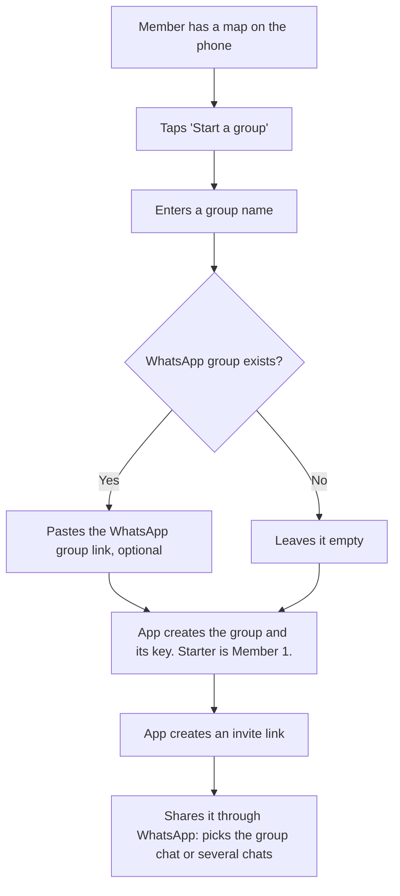
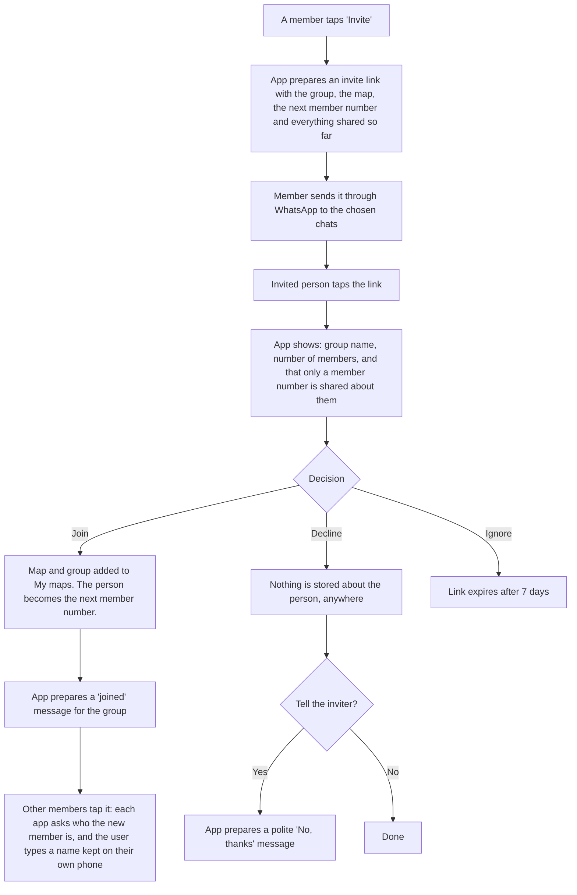
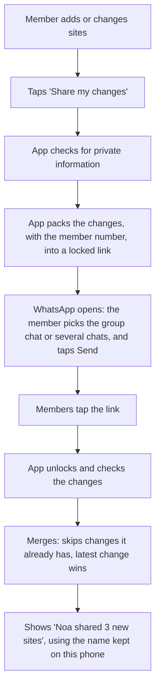
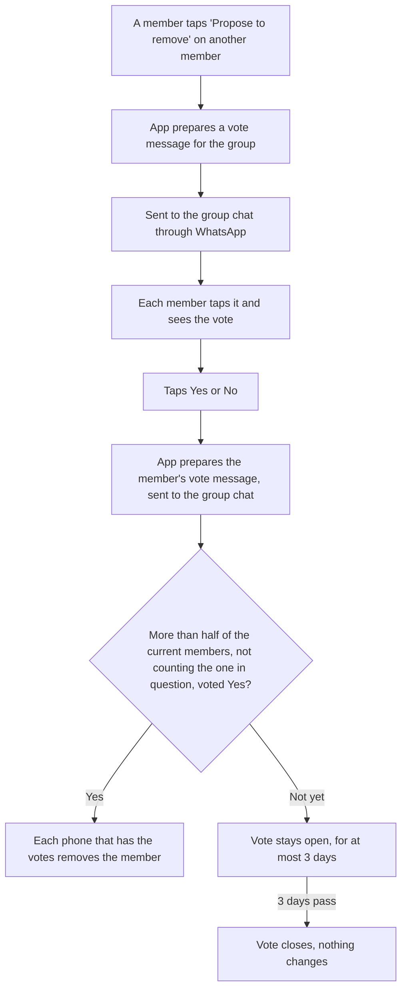

# Trip Map — App Design

"Trip Map" is a working name.

A phone-first web app that shows the sites of a trip on a real street map, with custom pins, several legends, site cards, and walking navigation. The app is not tied to any trip: each trip is a separate map file that is shared on its own.

Status: version 1 (basic map) is built. Everything below describes the version 2 design. All proposals and assumptions were approved by the app owner on 2026-11-15. Remaining open questions are listed in section 16. The build plan is in section 14. Group maps (sections 10.8, 10.9) are the last feature to be built, in release E.

Last updated: 2026-11-15

---

## 1. Goals

1. Show a trip's sites on a real map with every street named.
2. Group sites by more than one legend (for example Category and Day) and filter by them.
3. Tap a site to see its details and navigate to it.
4. Do as much as possible inside the app. Other navigation apps are a choice, not the default.
5. Make copying and sharing information with other apps easy.
6. Keep the app independent of any trip. Sites, legends, groups, and colors are configured in a JSON file. The app predefines none of them.
7. Make the JSON easy to update with an AI agent.
8. Let a user add new sites directly in the app, from an "Add site" menu.
9. Keep sites added in the app on that phone only, until the user chooses to send them.
10. Let a user send changes to a map without knowing GitHub. The map's owner approves every change. After approval, all users of the map see the update, with a notice of what changed, the next time they open the app.
11. Keep a locked map open only to the users it was shared with. Those users can read it and make local changes. Changes to the map follow the approval process (goal 10).
12. Let advanced users contribute public maps, readable by everyone, and keep control of their own maps.
13. Share the app and the maps separately. One user can have the app with map 1, another the app with map 2.
14. Update the app automatically for users who already have it, with no installation steps.
15. Free to build, host, and run.
16. Require nothing preinstalled for simple users. A simple user needs only the phone's browser, with no GitHub account, no other app, and no technical steps. Using the app is like opening a web page.
17. Let a user move a map file in and out of the app, so that it can be designed and edited with outside tools such as an AI agent or a JSON editor.
18. Let a user open a map file directly in the app, without GitHub. The app checks that the file follows the format.
19. Provide a checking tool, available from GitHub, where anyone can verify a map file.
20. Let users send feedback and problem reports easily, without exposing private information.

## 2. Main concepts

| Concept | Meaning |
| --- | --- |
| App | The program. One public address, the same for everyone. Contains no maps. |
| App owner | The single person who owns the app and its repositories, approves app changes, and publishes new versions (section 13). |
| Map | One trip: a JSON file with sites, pins, and legends. |
| Locked map | A map of the app owner, stored encrypted and readable only with its share link (section 10.2). |
| Public map | A map contributed by an advanced user, readable by everyone (section 10.7). |
| Local map | A map opened from a file. Stored on one phone only, with no owner on GitHub (section 11.2). |
| Map owner | Whoever approves changes to a map: the app owner for a locked map, the contributor for a public map. "Owner" in sections 10 and 12 means the map owner. |
| Contributor | An advanced user who published a public map (section 10.7). |
| User | Anyone who uses the app. Simple and advanced users are described in section 2.1. |
| My maps | The list of maps on one phone: locked maps the user received, public maps the user added, and local maps. |
| Local site | A site a user added in the app. Stored on that phone only. |
| Proposal | A user's local sites, and notes on existing sites (for example "closed"), sent to the map owner for approval (section 10.4). |
| Group map | A map that a group of users edits together, passing changes to each other through WhatsApp (sections 10.8, 10.9). Built last, in release E. |

### 2.1 Two kinds of user

| | Simple user | Advanced user |
| --- | --- | --- |
| Wants to | Use the app with ready-made maps | Contribute maps, and suggest fixes and features for the app |
| Needs | Only the phone's browser. No account, no keys. | A free GitHub account |
| Uses maps | Yes: locked maps from a share link, and public maps | Yes |
| Adds local sites and sends proposals | Yes | Yes |
| Contributes public maps | No | Yes (section 10.7) |
| Suggests app changes | No. Can report a problem from the app. | Yes, as a pull request to the App repository, which the app's owner approves |

- Nothing in the app requires a simple user to know that GitHub exists (goal 16).
- A user becomes an advanced user by choice, for example when they first publish a public map with their GitHub account (section 10.7).
- An advanced user's rights belong to their GitHub account, not to their phone. A lost or replaced phone loses nothing: the user sets up the app again with their GitHub account.

## 3. Platform, installation, and updates

| Item | Choice |
| --- | --- |
| App type | Web app, installable to the home screen (no app store) |
| Phones | Android and iPhone |
| Map display | OpenStreetMap tiles through Leaflet |
| Walking routes | FOSSGIS OSRM public server, foot profile |
| Hosting | GitHub Pages |
| Server of our own | None. Messages between users travel through WhatsApp or another messaging app (sections 10.4, 10.8). |
| Cost | Free |

### 3.1 Installation

- Opening the app link works immediately in the browser.
- "Add to home screen" gives the app its own icon and a full-screen view. Android offers this in one tap. On iPhone it takes two taps through the Share menu, and the app shows a short picture guide the first time.

#### What happens when a user taps a map link for the first time

1. The user receives a map link in a message, for example in WhatsApp, and taps it.
2. The phone's browser opens. The app loads from its address in a few seconds. Nothing is installed.
3. The app reads from the link where the map file is, and, for a locked map, the key that unlocks it. A public map's link has no key.
4. The app fetches the map file, unlocks it on the phone if it is locked, and checks it (section 11.3).
5. The map appears, with its pins and legends. The app saves the map in "My maps" on that phone.
6. A short welcome note explains the three basics: tap a pin for details, tap a chip to filter, and use the menu for more.
7. The app suggests adding itself to the home screen:
    - **Android:** an "Add to home screen" button. One tap, and the app's icon appears. The map is already inside.
    - **iPhone:** a picture guide with three steps: tap "Copy map link" in the guide, add the app to the home screen through the Share menu, then open the app from its new icon and tap "Add map", which pastes the copied link. The third step is needed because on iPhone the home-screen app does not share saved data with Safari.
8. The first time the user taps "My location" or starts navigation, the phone asks for permission to use location. The app does not ask earlier.

The user needs no account and no password at any step.

#### What happens on later visits

1. The user opens the app from its home-screen icon, or taps the map link again.
2. The app opens with the map that was last used. Other maps are in "My maps".
3. The app checks for a newer version of the map. If the map owner approved changes, it shows "Map updated" with the list of what changed.
4. If a new version of the app is available, it shows "New version available" with an Update button (section 3.2).

#### When something goes wrong the first time

This table covers a user who taps a map link for the first time, before the map is on the phone.

| Situation | What the user sees |
| --- | --- |
| No internet connection | "No connection. Connect to the internet and tap the link again." |
| The link is incomplete or damaged | "This map link is not complete. Ask the sender to share it again." |
| The map was removed, or its link was replaced by the map owner | "This map is no longer available at this link. Ask the owner for a new link." |
| The map needs a newer app | "This map needs a newer version of the app", with an Update button. |

#### When something goes wrong on a later visit

This table covers a user who already has the map on the phone.

| Situation | What the user sees |
| --- | --- |
| No internet connection | The saved copy opens, without the newest changes. A small "No connection" note is shown. |
| The map was removed, or its link was replaced by the map owner | The saved copy stays on the phone and keeps working, together with the user's local sites. The app shows "This map is no longer shared by its owner. You are viewing your saved copy from <date>." From then on it behaves as a local map (sections 10.2, 11.2). |
| A newer version of the map needs a newer app | The saved copy opens. The app shows "An update of this map needs a newer version of the app", with an Update button. |

#### Opening the app without a map link

The app's own address, without a map, opens an empty "My maps" list with two choices: "Add map" (paste a link or scan a QR code) and "Open map file" (section 11.2).

### 3.2 App updates

- The app updates itself. When a new version is published at the app's address, each user gets it the next time they open the app.
- If the app is open when an update arrives, it shows "New version available" with an Update button. Nothing changes during a walk.
- An update replaces only the app. The user's maps, local sites, and settings stay on the phone.
- The app's version number is shown in Settings.
- Each map file records its format version. Newer app versions continue to read older map files (section 12).
- Publishing a new version is the app owner's task. Claude can prepare a version, but only the app owner publishes it (section 13.4). Users do nothing.

## 4. Screen layout

- Full-screen map.
- Top: the map's title, which opens "My maps" (section 4.1), and a switch that chooses the active legend.
- Bottom: the active legend's groups as chips. Tapping a chip shows or hides that group's sites.
- Side: "My location" button, a "Search" button (section 9.4), and a menu with My maps, Create a map with AI, Add site, Add map, Open map file, Export map, Share my changes, Send my changes, Pending proposals (map owners only), Publish as a public map (advanced users), Copy AI instructions, Group (start, invite, leave), Send feedback, and Settings. Each item appears only once its release is built (section 14.3), and only where it applies: "Share my changes" and "Group" for group maps, "Send my changes" for maps with a map owner.
- Site card: slides up from the bottom when a pin is tapped.

### 4.1 Several maps: "My maps" and switching

A phone can hold several maps. The app shows one map at a time.

Switching:

1. The user taps the map's title at the top of the screen, or "My maps" in the menu.
2. The "My maps" list opens. The map on screen is marked.
3. The user taps another map. The app switches to it.

Each entry in "My maps" shows:

- The map's title and subtitle.
- Its kind: locked, public, or local (section 2).
- An "Updated" mark when the map owner has approved changes since the user last opened it.
- The number of the user's own local sites on that map that were not yet sent.

Behavior:

- The list is ordered by last use, with the most recent first.
- The app opens with the map that was used last.
- Each map remembers its own view: the active legend, which groups are switched on, and the map position. Returning to a map shows it as the user left it.
- Local sites belong to the map they were added to. They do not appear on other maps.
- Tapping a link to a map that is already on the phone switches to that map. It is not added twice.
- Switching maps during navigation first asks whether to stop the navigation.
- "Remove from this phone" takes a map off the list. If the map has local sites that were not sent, the app warns first and offers to export them.

## 5. Pins and legends

### 5.1 Pin icon and pin color

Decision: the icon comes from the site, and the color comes from the legend.

- Each site has its own location and icon. The icon says what the place is, and it is the same whichever legend is active.
- A pin has no color of its own. It takes the color of the legend group it is displayed under.
- Each legend group has a color, chosen by whoever defines the legend. The colors mean what the legend's author wants them to mean. A church can sit in "Architecture", or in a new "Famous buildings" group with its own color.
- Switching the active legend recolors the pins.
- A site that is in no group of the active legend shows a neutral grey pin, under an automatic "Other" chip.

A site in more than one displayed group (decision: pie-chart pin):

- The pin is divided like a pie chart, with one equal segment per displayed group, in each group's color.
- Up to three segments are shown. With four or more displayed groups, the pin shows the first three in legend order, plus a small count for the rest, such as "+2".
- Only groups of the active legend that are switched on are counted. When only one of the site's groups is displayed, the pin shows that group's color alone.
- The site card lists every group the site belongs to, each with its color.
- The "Add site" form shows a hint, without blocking, when a site is ticked into more than three groups of one legend.

### 5.2 Closed sites

- A site that is closed right now shows a red X mark on its pin.
- A site that closes within the next 30 minutes shows a yellow X mark, as a "closing soon" warning.
- In both cases the pin keeps its icon and its group color, so the site is still recognizable.
- Sites that are open, always open, or have unknown hours show the normal pin.
- The mark follows the same automatic open / closed status as the site card (section 6).

### 5.3 Legends

Principle: a map's legends and their groups are decided by the map's author, not by the app. The app has no built-in legends, groups, or colors. It displays whatever a map defines. "Category" and "Day" in this document are examples only.

| Decided by the app | Decided by each map's author |
| --- | --- |
| The icon set (section 5.4) | Which legends exist, and their names |
| How pins, chips, and cards look and behave | The groups in each legend, and their names |
| | Each group's color |
| | Which sites belong to which groups |

Designing a map's own legends and groups is part of designing the map. It is done outside the app, in the map file, by the map owner, usually together with an AI tool (section 11.1). Users can add local legends and groups of their own on top (below).

- A legend is a named list of groups, for example Category (Art, Architecture, …) or Day (Thu 10, Fri 11, …).
- Each group lists the sites it contains.
- A site can appear in several legends, and in more than one group of the same legend.
- A map can define any number of legends.
- A legend chip shows its group's color, the group name, and the number of sites in it. The chips are the color key of the map.

#### Adding legends and groups in the app

Decision (2026-11-15): users can also add legends and groups in the app, in the same way as they add sites.

- A user can add a new group to one of the map's legends, with a name and a color, for example "Famous buildings".
- A user can add a new legend of their own, with its groups, for example "Who wants to go", with a group per person.
- These are **local legends and groups**, like local sites (section 9.2). They stay on the user's phone and do not change the map itself. The user can rename, recolor, or delete them.
- They are included in "Export map", and in proposals to the map owner, who decides whether to add them to the map.
- In a group map, they are shared with the other members like any other change. Each member decides whether to take a new legend or group (section 10.8).


### 5.4 Icon set (version 1.0: 31 icons, maximum 50)

| # | Icon | Name | ID | Example |
| --- | --- | --- | --- | --- |
| 1 |  | Breakfast | `breakfast` | café, bakery |
| 2 |  | Lunch | `lunch` | restaurant |
| 3 |  | Dinner | `dinner` | restaurant |
| 4 |  | Architecture | `architecture` | notable building |
| 5 |  | Music | `music` | concert hall, jazz club |
| 6 |  | Market | `market` | food market, flea market |
| 7 |  | Shopping mall | `shopping-mall` | department store |
| 8 |  | Shopping | `shopping` | shopping street |
| 9 |  | Viewpoint | `viewpoint` | hilltop lookout |
| 10 |  | Sea | `sea` | boat trip, harbor |
| 11 |  | Promenade | `promenade` | seaside walk |
| 12 |  | Holy place | `holy-place` | church, cathedral |
| 13 |  | Museum / art | `museum` | art museum |
| 14 |  | History / monument | `history` | ruins, castle |
| 15 |  | Park / garden | `park` | city park |
| 16 |  | Bar / drinks | `bar` | cocktail bar |
| 17 |  | Airport | `airport` | airport |
| 18 |  | Tickets / booking | `tickets` | reminder pin |
| 19 |  | Ski lift | `ski-lift` | cable car, chairlift |
| 20 |  | Winery | `winery` | winery, wine cellar |
| 21 |  | Parking | `parking` | car park |
| 22 |  | Home / accommodation | `home` | where the group stays: apartment, hotel, or one's own home |
| 23 |  | Underground station | `underground` | metro stop (a train in a tunnel, so it differs from the railway station) |
| 24 |  | Bus station | `bus` | bus terminal, bus stop |
| 25 |  | Railway station | `railway` | train station |
| 26 |  | Beach | `beach` | beach |
| 27 |  | Gym | `gym` | gym, fitness club |
| 28 |  | Stadium / arena | `stadium` | football stadium, sports arena |
| 29 |  | Hospital | `hospital` | hospital, emergency room |
| 30 |  | Police station | `police` | police station |
| 31 |  | Ferry | `ferry` | ferry terminal, ferry crossing |

The icon set belongs to the app, so all maps share it.

Icon style (decision): solid, filled symbols in one uniform style, shown in white on the pin. The symbols come from the Material Design Icons collection by Pictogrammers, which is free and open source. The pictures in the table above are the files in the `icons` folder next to this document. The ID column is the value a map file uses in a site's `icon` field.

The icon set can be extended:

- The icon set is kept as its own file in the app's repository, with its own version number (section 12.4). It is not built into the app's code.
- Each icon has a fixed ID (for example `market`), a display name, a symbol, and the icon set version in which it was added (`since`). One icon file therefore holds the whole history, and no old icon files need to be kept.
- New icons are added by the app's owner and arrive with an app update.
- An icon's ID is never reused or deleted. A retired or renamed icon keeps working through an alias, so old maps are not broken.
- Each map file states the icon set version it was written for (`iconSetVersion`).
- Version 1.0 has 31 icons. The icon set has an upper limit of 50 icons.
- Decision: a map cannot carry private icons of its own, for now. Maps use only the shared icon set. If this is added later, a map would pick its extra symbols from a built-in symbol library.

## 6. Site card

A short tap on a pin opens the card. It shows these details:

1. **Icon title:** the name of the site's icon, for example "History / monument".
2. **Address:** or GPS coordinates when the site has no street address.
3. **Description:** free text.
4. **Webpage link:** the line is hidden when the site has no link.
5. **Opening hours:** for any site that has them, not only markets. The card shows the current status ("Open now, closes 19:00", "Closing soon, closes in 25 min", or "Closed, opens Tue 10:00") and the weekly hours. A site that never closes shows "Always open". The line is hidden when the hours are unknown.

Open or closed is worked out automatically from the site's hours and the current time at the map's location, not the time zone of the phone.

The card also lists the legend groups the site belongs to, each with its color (section 5.1), and has a Share button (section 7).

### 6.1 Interactions

| Action | Result |
| --- | --- |
| Long press on any text | Native phone behavior: select and copy all or part of the text |
| Long press on the link | The phone's own link menu (Copy link, Open, …) |
| Short tap on the address | Opens the navigation panel (section 8.1) |
| Short tap on the link | Opens the page in the phone's default browser |

Decision: copying uses the phone's native behavior. Each field is copied on its own.

## 7. Copying and sharing with other apps

- **Share button on every site card.** Opens the phone's share menu (WhatsApp, email, Notes, …) with the site's name, address, description, link, and a map location link as one message.
- **Copy per field,** as in section 6.1.
- **"Share a group"** (decided 2026-11-15). Sends the list of sites in one legend group, for example all of Friday's sites, as readable text through WhatsApp or another app: each site's name, address, link, and a map location link. For a locked map, the app first warns that the text will be readable by anyone in the chat.
- **"Share my location"** (decided 2026-11-15). See below.

#### "Share my location"

How it would work:

1. The user taps "Share my location".
2. The app shows the user's current position on the map, with the text "This shows where you are now", and asks to confirm.
3. The app prepares a link to the app itself, with the position after the "#" sign. The message travels only through WhatsApp. When a member taps the link, the phone loads the app's page from GitHub Pages, but the part after the "#" is never sent to GitHub (section 10.9).
4. WhatsApp, or another app, opens. The user picks the chat and taps Send.
5. A member who taps the link sees a temporary pin, "Noa is here", on their map. It is not saved, unless that member chooses "Add as site".

How it fits sections 15.2 and 15.3:

- It only happens when the user taps it, confirms, and sends. It is never automatic and never repeated.
- It is a single position at one moment, not live tracking.
- The position is never stored in a map file, in local sites, in "Export map", in proposals, or in feedback.
- A received link is checked like any other (section 15.3).

Risks:

- Sending it to the wrong chat. The confirmation step and the user's own choice of chat in WhatsApp reduce this.
- Pressing it at home reveals where one lives, to the people in the chat.

WhatsApp also has its own "Share location", including live location for a set time. The app's version adds the position directly to the map, next to the group's sites.

## 8. Navigation

### 8.1 Navigation panel

A short tap on the address opens a panel inside the app:

**"Navigate to <site>"**

- **In this app:** route, turn-by-turn directions, and voice on the app's map.
- **In another app:** Google Maps, Apple Maps (iPhone), or any installed navigation app (Android).
- **Cancel**

Both choices have equal prominence. The panel appears every time. There is no "Remember my choice" (decided 2026-11-15).

### 8.2 In-app navigation

- Walking route from the user's position, with distance and time.
- Follow mode: the map keeps the user centered while walking.
- Turn-by-turn banner ("In 80 m, turn left onto …") and a list of all steps.
- Spoken directions, with an on/off button.
- Re-routing when the user leaves the route.
- Arrival message, after which the site card opens.
- The screen stays on during navigation.

### 8.3 Limits of a web app

- Navigation pauses when the phone is locked or another app is in front.
- The map and routes need mobile data.
- It uses more battery than a native navigation app.

## 9. Adding sites in the app

### 9.1 Add site

- Choose the place: search for a place or address (section 9.4), long press on the map, or use the current location.
- Fill a short form: name, icon, description, link, opening hours, and the legend groups the site belongs to. A new group or legend can be added from the same form (section 5.3). The pin's color follows from the groups. The address is filled in from the location.

### 9.2 Local sites

- A site added in the app is stored on that phone only.
- The map shows the shared sites and the user's local sites together.
- The user can edit or delete their local sites. The map's own sites cannot be changed in the app. The map owner changes them by editing the map file (section 11.2).
- Local sites survive closing the app and app updates.
- Export: local sites can be saved as a small JSON file or shared as text, or exported together with the map (section 11.2). This is the backup. Clearing the browser's data, or opening the app in another browser, removes local sites.

### 9.3 Create a map with AI

Decision: simple users can create a whole map with AI from inside the app, without knowing about the AI toolkit's files (section 11.1).

1. The user taps "Create a map with AI" and answers a few questions: the place, the dates, their interests, and how to group the sites (for example by day, or by type of place).
2. The app builds a complete request for an AI, with the format rules written into it, and shows a Copy button.
3. The user pastes the request into any AI chat they use (Claude, ChatGPT, Gemini, …) and sends it.
4. The user copies the AI's whole answer and taps "Paste map" in the app.
5. The app finds the map in the answer, checks it (section 11.3), and opens it as a local map (section 11.2). Small mistakes are listed in plain words, with a ready request to paste back into the AI to fix them.

Checking what the AI made:

- An AI can get locations, addresses, and opening hours wrong. Every site made by AI is marked "not yet verified" on its card.
- The user can fix a location by dragging the pin or by searching the address (through OpenStreetMap's search, within its usage terms), and mark the site as verified.
- The request asks the AI to write descriptions in its own words and to leave out private information (section 15).

A built-in AI, where the user types into the app itself, is possible later. Someone must pay for every request, which conflicts with goal 15, so it is not part of this version.

### 9.4 Search

Decision (2026-11-15): the app can search the user's own map, and OpenStreetMap for places, streets, and addresses. The main use is choosing the place for a new site.

Two sources:

| | Search my map | Search OpenStreetMap |
| --- | --- | --- |
| Finds | Sites, groups, and addresses already in the map, including local sites | Any place, street, or address: "Sagrada Família", "pharmacy", "Carrer de Mallorca 401" |
| Works offline | Yes, on the phone | No, needs a connection |
| Service | None | OpenStreetMap's search service (Nominatim) |

#### Searching when adding a site (main use)

1. The user taps "Add site". The form opens with a field "Search a place or address".
2. The user types, for example "Sagrada Família", and taps Search.
3. The app shows a list of results, each with its name, address, type of place, and distance. Results near the area shown on the map come first.
4. The user taps a result. The map moves to it and shows a temporary pin.
5. The user taps "Use this place". The form is filled in with the name, address, and location, and, where OpenStreetMap has them, the website and opening hours. The app suggests an icon from the type of place.
6. The user checks the details, chooses the legend groups, and saves. The site becomes a local site (section 9.2).

If the place is not found, the user can still long press on the map or use the current location (section 9.1).

#### Searching from the map

- The "Search" button opens a search field over the map.
- Results from the user's own map come first. A "Search OpenStreetMap" line below them searches more widely.
- Tapping a result moves the map to it. A site from the map opens its card. A place from OpenStreetMap shows a temporary pin with a small card: name, address, "Add as site", and "Navigate" (section 8.1).

#### Rules for the OpenStreetMap search service

- **No search on every letter.** The user types and taps Search. The free service does not allow search-as-you-type.
- **At most one search per second** for the whole app. Without a server, the app cannot count across phones, so each phone waits at least one second between searches and keeps recent results so that the same search is not sent twice. With light use (a few groups), the total stays far below the limit. The app's own address is sent with each search, so the service can contact the app owner.
- **The app identifies itself** to the service, as its usage policy requires.
- **Credit:** search results show "Search by OpenStreetMap".
- **Larger use:** if the app grows beyond light use, another search provider is needed (section 14.6).

#### Data taken from OpenStreetMap

- Name, address, location, and, when present, website and opening hours.
- Fields filled from OpenStreetMap are marked "from OpenStreetMap" in the form, and the user can change them. Descriptions are written by the user (section 15.1).
- Opening hours in OpenStreetMap's format are converted to the app's format (section 11) when they are simple. Complex hours are shown to the user to enter by hand.
- A site added this way carries the OpenStreetMap credit (section 15.1).

#### Privacy

- The words searched, and the area shown on the map, are sent to OpenStreetMap's search service. Nothing else is sent (section 15.2).
- Searching the user's own map sends nothing.

## 10. Maps: sharing and sync

### 10.1 Sharing a map

- Each locked map has its own share link, containing a long code that cannot be guessed. Public maps have a plain link, and can also be found in the app's list of public maps (section 10.7).
- Opening the link adds the map to "My maps" on that phone.
- The app also has an "Add map" button, where a user pastes a map link or scans a QR code. This is needed on iPhone, where a link tapped in a messaging app opens in Safari and not in the home-screen app.
- A user sees only the locked maps that were shared with them.
- A user who has a map can read it and add local sites to it (section 9). Changing the map goes through the map owner's approval (section 10.4).

### 10.2 Locked maps: privacy

Decision: a locked map can be read only by the users it was shared with.

- Files on free GitHub hosting are public, so each locked map file is stored encrypted. Without the key it is unreadable.
- The key is part of the map's share link. The app unlocks the map on the phone. The key is never sent to GitHub.
- Anyone who has the share link can read the map. Forwarding the link gives the next person the same access.
- To withdraw access, the owner creates a new link for the map, which locks it with a new key, and shares the new link with the users who should keep access.
- Withdrawing access, or deleting the map from GitHub, stops future updates. It does not remove the copy that is already saved on a user's phone. That copy keeps working as a local map (section 11.2): it receives no more updates, and proposals can no longer be sent from it.
- The app owner's app holds the readable version of each locked map. "Export map" gives the readable file, for editing with an AI tool or a JSON editor (section 11.2). Publishing locks it again as the last step, both when the owner approves a proposal in the app and when the owner opens an edited file and publishes it.
- Decision: there is no separate repository for readable originals.

### 10.3 Getting changes (GitHub → phone)

- The app fetches the latest version of each map when it opens, and on request.
- No setup, account, or key is needed.

### 10.4 Sending changes to the map owner

Decision (2026-11-15): the app uses no server of its own. Proposals travel to the map owner through WhatsApp or another messaging app, in the same way as group changes (section 10.8).

For the user:

1. The user taps "Send my changes". The app packs the user's local sites, local legends and groups, and any notes on existing map sites ("Report a problem with this site" on a site card, for example "closed for renovation"), into a link. For a locked map, the link is locked with the map's key. A proposal too large for a link is sent as a small file instead.
2. The phone's share menu opens. The user picks the map owner's chat in WhatsApp, or another app, and taps Send.
3. The local sites do not change the map directly. They wait for the map owner's decision.

For the map owner:

1. The map owner taps the link. The proposal appears in "Pending proposals" in the app.
2. Each proposal shows the proposed sites on the map. The owner taps Approve or Reject, for each site or for all.
3. On approval, the owner's app adds the sites to the map and publishes it (section 10.6 for locked maps, section 10.7 for public maps).
4. Everyone gets the change the next time their app fetches the map.
5. An approved site keeps the ID it had as a local site. When any phone fetches the updated map, it removes its local copy with the same ID, so there are no duplicates. This covers the sender, and, in a group map, the other members who received the site. From then on it is a regular map site. Changing it later means sending a new proposal.
6. A note on an existing site is handled by the map owner, by editing the map file (section 9.2) or by marking it done.

Rules:

- The privacy checks (section 15.2) run before a proposal is sent, and again when the owner opens it.
- Member numbers and other group details are removed from a proposal before it is sent (section 10.9).
- The map owner's approval is the final gate.

Limit:

- The sender must be able to reach the map owner in a messaging app. For a locked map, the users know the owner. For a public map made by a stranger, a simple user may have no way to reach the contributor. See section 10.7.

### 10.5 Notifying users after approval

After the map owner publishes a change, the users of that map learn about it in two ways:

- **In-app notice:** when the app opens, it shows "Map updated", with the list of what changed. Always on.
- **Group message:** after publishing, the owner's app offers "Tell the group": a ready message with what changed, to send to the users' WhatsApp group.

Without a server, the app cannot send phone notifications when it is closed. This can be added later with a server (section 16.1).

### 10.6 App owner's setup for locked maps

- The app owner creates an access key in their GitHub account, limited to the Locked maps repository, and enters it once in the app's Settings.
- The key is stored only on the app owner's phone, never in the app's code.
- Contributors of public maps use their own access key, limited to their own copy of the Public maps repository (section 10.7).
- When approving, the app first fetches the newest map file and then adds the approved sites, so that changes made elsewhere (for example a map file edited with an AI tool and published) are not overwritten.

### 10.7 Public maps

Decision: any advanced user (section 2.1) can contribute a map to the Public maps repository. A contributed map is readable by everyone.

| | Locked map | Public map |
| --- | --- | --- |
| Maintained by | The app's owner | The map's contributor |
| Readable by | Only users who received the share link | Anyone |
| Stored | Locked maps repository | Public maps repository |
| Found by | The share link | A list of public maps in the app, or a link |

Rules:

- **The contributor controls the map's content.** Only the contributor can change its sites, pins, and legends, or approve changes to it.
- **Proposals from other users.** Any user can add sites to a public map in the app and send them as a proposal, if they can reach the contributor in a messaging app (section 10.4). The map's contributor approves or rejects it.
- **Adapting to a new app version.** When a new app version needs a newer map format, the map is converted with the adaptation tool. Either the contributor or the app owner can run it and propose the result. The contributor approves it.
- **The app owner keeps a safety role.** The owner can hide or remove a map that breaks the rules (for example, private information or offensive content), but does not edit its content.

#### Contributors

Decision: a contributor is an advanced user (section 2.1) with a free GitHub account. Their rights belong to that account, not to a phone. Contributions arrive as pull requests, with no server of our own.

Publishing a public map:

1. The user taps "Publish as a public map" on one of their maps.
2. The app checks the map (section 11.3). Errors must be fixed first.
3. The app shows what publishing means: the map becomes readable by anyone, copies cannot be taken back, and it must not contain private information. The app shows all of the map's text and the checker's privacy findings (section 15.2), and the contributor confirms that they have the right to share the content (section 15.1).
4. The first time, the contributor creates an access key in their GitHub account, with a picture guide in the app, and enters it in the app's Settings. The key allows changes only to the contributor's own copy of the Public maps repository.
5. The app sends the map to the Public maps repository as a pull request in the contributor's name.
6. An automatic check on GitHub checks the map, and records the contributor's GitHub account as the map's contributor in the registry file.
7. The first map from a new contributor waits for the app owner's approval (decided 2026-11-15). Later maps and updates are merged automatically once the check passes.

Changes and proposals:

- From then on, a change to the map is accepted only in a pull request from the contributor's GitHub account. The automatic check rejects pull requests that change someone else's map.
- Contributors can also send pull requests directly on GitHub, without the app.
- Proposals from users who know the contributor arrive through a messaging app (section 10.4). The contributor approves them in the app, which sends the result as a pull request.

Notes:

- Contributors never receive write access to the Public maps repository. Their changes always arrive as pull requests, so no contributor can change another contributor's map.
- Accepted limit (2026-11-15): a simple user who does not know a public map's contributor cannot send them a proposal, since there is no server to pass it on. The user can still add local sites and share them with friends.

### 10.8 Sharing changes with a group through messages

Decision: members of a group map (section 10.9) share their local sites with each other through WhatsApp, or any other messaging app. No server and no GitHub are involved.

How it works, in two steps for the sender:

1. The user taps "Share my changes". The app packs the user's new and changed local sites into a link, with a short text such as "Noa added 3 sites: …".
2. The phone's share menu opens. The user picks the trip's group chat in WhatsApp, or another app, and taps Send.

For the others:

- Each member taps the link in the chat. The app opens and merges the changes into that member's copy of the map.
- The app shows what arrived, for example "Noa shared 3 new sites", using the name this user keeps for that member on their own phone (section 10.9). The shared sites are marked the same way.

Rules:

- Shared changes are local sites (section 9.2) and local legends and groups (section 5.3): new ones, changes to them, and their removal. The map's own sites and legends are not changed this way.
- New or changed sites are merged automatically. A new or changed legend or group is offered to each member, who chooses to take it or skip it. If a member skips a group, its sites appear on that member's phone under the "Other" chip of that legend.
- Every change has its own ID, its author's member number, a time, and its author's signature (section 10.9). The same change is never added twice.
- When two people changed the same site, the latest change wins.
- The privacy checks (section 15.2) run before a change is shared, and again when it is received.
- For a locked map, the link is locked with the map's key, so only people who have the map can read the changes.
- A share that is too large for a link is sent as a small file instead, through the same share menu. Members open it with "Open map file", which recognizes it as group changes.
- The app shows, for each map, which of the user's local sites have not been shared yet.

Limits:

- The app cannot send the message by itself, or choose the chat. The user taps Send in the messaging app. Sending automatically is possible only through WhatsApp's paid business service, which does not fit goal 15.
- The app cannot read the chat. Each member has to tap the link to receive the changes.
- Changes are not live. They arrive when someone shares them and the others tap the link.

Later, shared local sites can still be sent to the map owner as a proposal (section 10.4), so they become part of the map itself. The member numbers of who added them are removed first (section 10.9).

### 10.9 Group maps

A group map is a map that a group of app users edits together, passing their changes to each other through WhatsApp (section 10.8). It needs no server and no GitHub. (Live group maps through a server are a separate idea, postponed: section 16.1.)

Release: group maps are the last feature to be built, in release E (section 14.3), after everything else works. Until then, members pass maps as files (section 14.3, release A).

Decisions (2026-11-15):

- A group belongs to exactly one map. A map can have at most one group on each phone.
- Joining is by an invite link. The link joins this specific map, and opens the app in the browser like any map link (section 3.1).
- Any member can invite others.
- **No phone numbers are stored.** Members choose who receives a message in WhatsApp itself, which already has their contacts.
- **No names leave the phone.** Members are identified in the group's messages only by a member number. Each person can give the numbers names of their own, which stay on their own phone.
- Group details are kept in the app's internal database on each phone, separate from map files.

#### What a group map stores

On each member's phone, in the app's internal database:

| Item | Example | Leaves the phone? |
| --- | --- | --- |
| Group name | "Barcelona Dec 2026" | Yes, inside the group's locked messages |
| The map | The Barcelona map | Yes, in the invite link, as for any map share |
| WhatsApp group link | The group chat's invite link | Optional. Yes, inside the group's locked messages. Holds no personal data. |
| Members | Member 1, Member 2, Member 3, … | Only the member numbers, inside the group's locked messages |
| For each member: when they joined | 2026-11-20 | Yes, inside the group's locked messages |
| My own member number | Member 2 | Yes, attached to my shared changes |
| My names for members | Member 3 = "Noa" | **No.** Kept on my phone only. |
| Shared sites | Sites added by members | Yes, with the member number of who added each one, and when (section 10.8) |
| Group key | (hidden) | Yes, inside invite links, and in a new-key message after a member leaves (item 11 below) |
| My key pair | (hidden) | Only its public part, shared when joining. Used to sign my changes and votes, and to receive a new group key. |

Not stored anywhere: phone numbers, real names, email addresses, or any other contact details.

The internal database:

- It is the app's own storage on the phone, separate from map files.
- "Export map", proposals to the map owner, publishing a map, and feedback never read from it.
- When a shared site leaves the group (in "Export map", a proposal, or publishing), its member number is removed.

#### Member numbers

- The member who starts the group is Member 1. Each new member gets the next number, given by the member who invites them.
- Everyone in the group sees the same number for the same person, so "Member 3" means the same person on every phone.
- Member numbers are used only inside the app's messages. People never need to see them.
- Each user keeps the members' names on their own phone. When a new member number appears, the app asks "Who is Member 3?", and the user types the name, for example "Noa". From then on the app shows "Noa" everywhere on that phone. These names are never sent (decided 2026-11-15).
- A rare clash: two people invited at the same time by different members could receive the same number. Each member also has a hidden random code, so the app notices the clash. It keeps the number for whoever joined first and gives the other person the next free number. All phones apply the same rule, so they end up with the same numbers.

#### Starting a group map



- The app cannot create a WhatsApp group. If the members want one, they create it in WhatsApp as usual, and any member adds its link to the group details.
- For a locked map, the invite link also carries the map's key, so whoever joins receives the map. This is the same access as receiving the map's share link.

#### Inviting and joining



People who decline:

- Nothing about them is stored, on any phone. The inviter chose them in WhatsApp, and the app never saw their details.
- They may tell the inviter with a ready "No, thanks" message, or say nothing.
- They can still join later, within the link's 7 days, or with a new invite.

Invite links (decided 2026-11-15):

- An invite link is valid for joining for 7 days from when it was made. After that, the app shows "This invite has expired. Ask a member for a new one."
- One link can be used by several people, for example posted once in the group chat. Each person who joins gets their own member number.

#### Sharing changes



#### Members are equal, and decide by voting

Decision (2026-11-15): there is no group manager. The member who started the group is Member 1, with no extra rights. Decisions that affect another member are made by voting.

Removing a member by vote:



Rules:

- A vote is open for at most 3 days.
- The member in question does not vote, and is not counted. Members who have left are not counted either.
- Every phone counts the same votes in the same way, so all phones reach the same result once they have tapped all the vote messages.
- After a removal, the other phones ignore new changes from that member number.
- A removed member still has the map and the old messages. The group then gets a new key, so they cannot read new messages (item 11 below).
- Votes are signed by each member's own key, so that nobody can vote in another member's name (item 10 below).

A simpler alternative, which needs no voting: the other members start a new group from the same map, and invite everyone except that person.

#### Leaving, catching up, and a new phone

- **Leaving:** a member taps "Leave group". The group is removed from that phone. The app prepares a "left the group" message, and members who tap it mark that member number as having left.
- **Catching up:** any member can tap "Send everything", which sends the whole current state of the group, for example to a new member or to someone who missed messages.
- **A new phone:** the member taps an invite link again, from any member, and receives everything shared so far. They join with a new member number. The app offers to send an "old number" message, signed with the new key and naming the old number; members who tap it mark the old number as having left, so it is no longer counted in votes.

How group messages travel (checked against section 15.2):

- **Only inside members' messages,** sent through WhatsApp or another messaging app chosen by the member.
- **Locked twice:** with the group key, and by WhatsApp's own end-to-end encryption.
- **Never seen by a web server:** the data sits in the part of the link after the "#" sign, which browsers do not send to any server. GitHub, which hosts the app, never receives it, and neither does a link preview.
- **Nothing personal inside:** the messages contain sites, member numbers, times, the group name, and keys. No names, phone numbers, or contact details.
- **Chat history:** the messages stay in the WhatsApp chat, like any message, and in WhatsApp's backups if a member uses them. Since they contain nothing personal, the remaining exposure is the map and its sites, which members already have. A former member who keeps the chat can still read later messages unless the group gets a new key (item 11 below).

Limits:

- The 7-day limit on invite links is enforced by the app. Someone who gets hold of an old invite link still holds the group key in it. If an invite link may have reached the wrong person, any member can give the group a new key (item 11 below).
- Without a server, the app cannot change data on another person's phone by itself. Marking someone as having left works only when the others tap the message.
- Members' copies can differ if someone missed messages. "Send everything" brings them back in step, and the match code shows when it is needed (item 7 below).

#### Decided items

All items raised for group maps were decided on 2026-11-15:


1. ~~Phone numbers~~: decided, none are stored.
2. ~~Invite links~~: decided, valid for joining for 7 days, and one link can be used by several people.
3. ~~Removing a member~~: decided, by a vote of the other members, with the rules above (more than half, at most 3 days).
4. ~~The starter's role~~: decided, all members are equal. The starter has no extra rights.
5. ~~Ending a group~~: decided, there is no "end group" for everyone. Each member keeps the map, or leaves whenever they like. When a member leaves, the map stays on their phone as a local map.
6. ~~Group size~~: decided, up to 20 members.
7. ~~Checking that copies match~~: decided, each phone shows a short code for the group's current state, such as "K7P2". The same code means the same map. If codes differ, a member taps "Send everything".
8. ~~Locked maps~~: decided, acceptable. Inviting to a group built on a locked map gives the same access as forwarding the map's share link.
9. ~~Release~~: decided, group maps are built last, in release E (section 14.3).
10. ~~Signed changes~~: decided, each member's app has its own signing key, created when joining. Every change and vote is signed, and changes or votes with a wrong signature are rejected (section 15.3).
11. ~~New group key~~: decided, after a member leaves or is removed, a remaining member's app creates a new group key. It locks a copy separately for each remaining member, with that member's public key, and sends them all in one message to the group chat. The former member cannot unlock any copy, so they can still read old messages, but not new ones. Any member can also start a new key at any time.

## 11. Map file format

One JSON file per map.

```json
{
  "formatVersion": "2.0",
  "iconSetVersion": "1.0",
  "revision": 7,
  "id": "barcelona-2026",
  "title": "Barcelona Trip",
  "subtitle": "Dec 10–15",
  "timezone": "Europe/Madrid",
  "start": { "lat": 41.3905, "lng": 2.1735, "zoom": 14 },
  "sites": [
    {
      "id": "sagrada",
      "name": "Sagrada Família",
      "lat": 41.4036,
      "lng": 2.1744,
      "icon": "architecture",
      "address": "Carrer de Mallorca 401, 08013 Barcelona",
      "desc": "Booked Fri Dec 11 at 11:15, tower included.",
      "url": "https://sagradafamilia.org",
      "hours": {
        "mon": "09:00-18:00", "tue": "09:00-18:00", "wed": "09:00-18:00",
        "thu": "09:00-18:00", "fri": "09:00-18:00", "sat": "09:00-18:00",
        "sun": "10:30-18:00",
        "closedDates": ["2026-12-25"]
      }
    }
  ],
  "legends": [
    {
      "id": "category",
      "name": "Category",
      "groups": [
        { "id": "arch", "name": "Architecture", "color": "#7F77DD", "sites": ["sagrada"] }
      ]
    },
    {
      "id": "day",
      "name": "Day",
      "groups": [
        { "id": "d11", "name": "Fri 11", "color": "#E8590C", "sites": ["sagrada"] }
      ]
    }
  ]
}
```

Rules:

- `formatVersion`, `iconSetVersion`, and `revision` follow section 12.
- `id` values are unique, lowercase, with no spaces.
- `icon` must be an icon ID from the icon set version named in `iconSetVersion` (section 5.4).
- Every legend group has a `color`. Sites have no color of their own.
- Every site listed in a legend group must exist in `sites`.
- `address` empty: the card shows `lat, lng`.
- `url` empty: the card shows no link line.
- `hours` is optional for every site. A day left out means closed that day. Two periods in one day are written `"09:00-13:00, 16:00-20:00"`. A period that ends earlier than it starts runs past midnight: `"19:00-02:00"` on Friday means open until 02:00 on Saturday morning. `closedDates` lists single closed days. `"hours": "always"` marks a site that is always open, such as a viewpoint or a promenade, and the card shows "Always open". Without `hours`, the hours are unknown and the card shows no hours line.
- `timezone` is the time zone of the map's location. Open or closed is worked out in that time zone.
- `verified` is optional. `false` marks a site whose details were made by AI and not yet checked; the card shows "not yet verified" (section 9.3). Left out, the site counts as checked.
- `source` is optional. `"osm"` marks a site whose details came from OpenStreetMap; the card shows the OpenStreetMap credit (sections 9.4, 15.1).
- The order of sites inside a group is the display order. In a Day group it is the visiting order.

### 11.1 AI toolkit

The App repository contains an AI toolkit: the files that let an AI tool help with maps and with the app.

Requirements:

- **Any AI tool.** Creating and editing maps with AI works with any AI tool, not only Claude.
- **Public, at a fixed address.** Everything an AI tool needs is public and can be reached by one address.
- **A map guide** that explains the map format in plain words, with examples and common mistakes. It is written for people and AI tools alike, and states the current format version.
- **A machine-readable description of the format** (a schema), so that editors and AI tools can check a file while writing it.
- **The icon set** as a file, with each icon's ID, name, and the version it was added in (section 5.4).
- **Complete example maps.**
- **The map checker** (section 11.3) and **the format converter** (section 12), usable by people, AI tools, and the automatic checks.
- **An entry point for AI coding tools** in each repository, stating what the repository is, where things are, and the working rules: changes arrive only as change requests, the checks must pass, and only the owner merges and publishes (sections 13.2, 13.3).
- **A description of how the app is built,** for anyone changing it. This document says what the app does. That one says how.
- A "Copy AI instructions" item in the app's menu copies a ready-made text with the toolkit's address and a short explanation, for pasting into any AI chat.

The toolkit's file names and layout are described in the App repository itself, in its README and architecture description, so that they stay in step with the files.

How an AI tool gets a map's readable JSON:

| Situation | How |
| --- | --- |
| A public map | Read it directly from the Public maps repository |
| A locked map, or a user's own map | "Export map" in the app, then give the file to the AI tool |
| A new map | The AI tool writes it from the map guide. The user checks it and opens it in the app. |

### 11.2 Moving map files in and out of the app

Export:

- "Export map" saves the current map as a readable JSON file, or passes it to another app through the phone's share menu.
- The user chooses what to include: the map only, or the map together with their local sites.
- The exported file follows the format in section 11, so an AI tool or a JSON editor can work on it directly.

Open a map file:

- "Open map file" loads a JSON file from the phone into the app. GitHub is not involved.
- The app checks the file first (section 11.3). A file with errors is not opened, and the app lists what is wrong.
- A map opened from a file is a **local map**. It is stored on that phone only and appears in "My maps".
- A local map can be passed on by sending the file itself, for example through a messaging app. The receiver opens it the same way.
- A local map has no owner on GitHub, so it has no proposals, approvals, or update notices. An advanced user can publish it as a public map (section 10.7). The app owner can also publish it as a locked map.

| | Local map | Locked map | Public map |
| --- | --- | --- | --- |
| Comes from | A file opened in the app | A share link | The list of public maps, or a link |
| Stored | On the phone | Locked maps repository, encrypted | Public maps repository, readable |
| Passed on by | Sending the file | Sending the link | Anyone can find it |
| Updates for everyone | No. Each copy is separate. | Yes, after the app owner approves | Yes, after the contributor approves |

### 11.3 Checking a map file

One set of rules is used everywhere, so that a file accepted in one place is accepted in all.

What is checked:

- The file is valid JSON and has a format version the app can read.
- Required fields are present and of the right kind.
- IDs are unique.
- Every icon ID belongs to the icon set version the map names in `iconSetVersion`.
- Every site listed in a legend group exists.
- Every group has a valid color.
- Coordinates, opening hours, time zone, and links are well formed.
- No private information appears in text fields or links, and in a public map, "Home / accommodation" sites have an approximate location (section 15.2).

The report lists each problem with its location in the file and a plain explanation, for example: group "Fri 11" lists site "sagarda", which does not exist.

Where the check runs:

| Place | Use |
| --- | --- |
| In the app | Automatically, whenever a map is opened from a file or a link, and before a map is published |
| "Check a map" page | A page of the app, hosted on GitHub, where anyone can paste or open a map file and get the report. Nothing is uploaded: the check runs on the phone or computer. |
| The schema | Part of the AI toolkit (section 11.1). JSON editors and AI tools use it to check a file while editing it. |
| Automatic check on GitHub | In the Public maps repository, every change to a map file is checked before it is accepted. In the App repository, the example maps are checked with every change. |

A locked map is checked in its readable form, before it is locked (section 10.2).

## 12. Versioning

Four separate numbers are used. Each answers a different question.

| Number | Where | Answers | Changes when |
| --- | --- | --- | --- |
| Format version | `formatVersion` in each map file | Can this app read this file? | The file format changes |
| Icon set version | In the app's icon set file, and as `iconSetVersion` in each map file | Does this app know all the icons this map uses? | Icons are added or changed |
| Map revision | `revision` in each map file | Has this map's content changed? | A change to the map's content is published |
| App version | Shown in the app's Settings | Which app release is this? | Every app release |

### 12.1 Format version

Written as `major.minor`, for example `"2.0"`.

- **Major** (2.0 → 3.0): a breaking change. An app that does not know the new format would show the map wrongly or fail. Examples: a field is renamed or removed, the legend structure changes, a field's meaning changes.
- **Minor** (2.0 → 2.1): an addition that older apps can safely ignore. Example: a new optional field.

New icons do not change the format version. They change the icon set version (section 12.4).

The test for deciding: would an app that does not know about this change show the map wrongly? If yes, the change is major. If no, it is minor.

How the app behaves:

| Map file compared with the app | Behavior |
| --- | --- |
| Same major, same or older minor | Opens normally |
| Same major, newer minor | Opens. Unknown fields are ignored. |
| Older major | Opens. The app converts the file to the current format when loading. |
| Newer major | Does not open. Shows "This map needs a newer version of the app", with an Update button. |

Process:

- The format changes only when an app feature needs it. The change is decided as part of designing that feature.
- Every change is recorded in the format history below.
- The map guide (section 11.1) states the current format version. An AI tool always writes the current format.

Format history:

| Version | Date | Change | Why major or minor |
| --- | --- | --- | --- |
| 1.0 | 2026-11-14 | First format: sites carry `category` and `day`; legends hold colors | First version |
| 2.0 | 2026-11-14 | Sites own an `icon`; legends are lists of groups, each with a `color`, that refer to site IDs; `id`, `iconSetVersion`, `revision`, `timezone`, `start`, `address`, `url`, `hours` added | Major: the legend structure changed |

### 12.2 Map revision

- A whole number that starts at 1 and goes up by one with every change to the map's content.
- The app compares it with the revision it last saw, to detect "this map was updated" and show what changed.
- When the map owner approves a proposal, the newest file is fetched, the approved sites are added, and the revision is raised by one.
- It describes the map's content only. It is unrelated to the format version.

### 12.3 App version

- Written as `major.minor.patch`, for example `2.1.0`.
- Major: a redesign, or a new format major. Minor: a new feature. Patch: a fix.
- Each app release states the highest format version it reads and the icon set version it carries.

### 12.4 Icon set version

Written as `major.minor`, for example `"1.0"`.

- **Minor** (1.0 → 1.1): icons are added. Existing maps are not affected.
- **Major** (1.0 → 2.0): an icon's meaning changes, or the set is reorganized. This should be rare, because icon IDs are never reused or deleted.

A map's `iconSetVersion` is the icon set version the map was written for. The map may use any icon that existed in that version.

Example: an old map written for icon set 1.2 and a new map written for icon set 2.6 are both opened in an app that carries icon set 2.6.

- The old map shows correctly. Every icon from 1.2 still exists in 2.6, directly or through an alias. The old map does not need to be changed.
- The new map can use every icon up to 2.6.
- If the old map is later edited to use an icon added after 1.2, its `iconSetVersion` is raised at that time. The checking tool reports an icon that is newer than the version the map names.

| Map's icon set version compared with the app's | Behavior |
| --- | --- |
| Same or older | Opens normally. Retired icons are shown through their aliases. |
| Newer minor | Opens. An icon the app does not know shows a default pin, and the app suggests an update. |
| Newer major | Opens with default pins for unknown icons, and the app asks for an update. |

Icon set history:

| Version | Date | Change |
| --- | --- | --- |
| 1.0 | 2026-11-15 | First set: 31 icons |

The checking tool (section 11.3) checks a map's icons against the icon set version the map names.

## 13. Repositories, roles, and access

### 13.1 Repositories

Decision: the app and the maps live in separate GitHub repositories.

| Repository | Visibility | Contains | Who approves changes |
| --- | --- | --- | --- |
| App | Public | The app, the icon set, the "Check a map" page, the AI toolkit (section 11.1), this document | The app's owner only |
| Locked maps | Public, files locked | The app owner's own maps. Readable only with a share link (section 10.2). | The app's owner only |
| Public maps | Public, readable | Maps contributed by any user, readable by everyone (section 10.7) | Each map's contributor, for their own map |

- The app does not contain a list of locked maps. A share link carries the map's address.
- The app owner's access key, used by the app to publish locked maps, is limited to the Locked maps repository. It gives no access to the app.

### 13.2 Who can change the app

Decision: the app has a single owner. Only the owner approves and merges changes, and only the owner publishes a new version. There are no other maintainers.

| Role | Who | Can do |
| --- | --- | --- |
| Owner | The app's owner | Approve and merge changes, publish a new version |
| Anyone else | Any person, including advanced users and map contributors | Propose a change as a change request. Cannot merge. |
| AI agent (Claude) | Works for the owner | Prepares a change and opens a change request. Does not merge (section 13.4). |

Rules for the app's repository:

- Nothing is changed directly. Every change arrives as a change request (a GitHub pull request).
- A change request is merged only after the owner approves it.
- Automatic checks must pass before merging: the app's tests, and the check of the example map and the icon set.
- Merging is not publishing. The version that users receive is published separately, by the owner, as a deliberate step. A merged change therefore cannot reach users by accident.

### 13.3 Access control

Access is controlled in two places: GitHub's own settings on each repository, and the automatic checks. There is no server of our own.

| Who | App | Locked maps | Public maps |
| --- | --- | --- | --- |
| App owner | Approve, merge, publish | The only writer: approves proposals and publishes from the app | Hide or remove a map that breaks the rules. Approve a new contributor's first map. |
| Contributor | Propose (pull request) | No access | Own maps only: change, approve proposals |
| Simple user | Report a problem from the app | Read with a share link, send proposals | Read, send proposals to a contributor they can reach, "Report this map" |
| Claude | Prepare changes and propose (pull request). Review. | No access to the locked files. Works on a readable copy that the app owner exports and gives it. | Run checks and the adaptation tool, and propose |

Settings on GitHub:

- **App repository:** a rule on the main branch requires a pull request, and passing checks (once they exist) before anything is merged. Only the owner can merge: the rule's "Restrict updates" allows changes to main only for the organization admin (the owner). Required approvals are 0, because GitHub does not let anyone approve a pull request that counts as their own; the owner's merge is the approval. Direct changes, deletions and force-pushes are blocked.
- **Test repository:** deletions and force-pushes are blocked; Claude publishes test versions to it directly, without a pull request (section 14.2).
- **Locked maps repository:** only the app owner has write access. The app owner's app publishes to it directly with an access key limited to this repository (section 10.6).
- **Public maps repository:** only the owner has write access. Contributors send pull requests from their own copy. An automatic check accepts a pull request only if it changes the author's own maps, and merges it when the check passes. A new contributor's first map waits for the owner.
- **Access keys and tokens** are limited to the one repository they are for, and to the permissions they need.
- **The owner's GitHub account** uses two-step sign-in, with recovery codes kept safe.

### 13.4 Claude as a working tool

- Claude is connected through the Claude GitHub App, installed on the organization with access to the selected repositories only (today `trip-map` and `trip-map-test`). Its commits carry a "Co-Authored-By: Claude" line, and its pull requests say they were made with Claude, so its work is always recognizable.
- Claude can prepare changes on a branch, open pull requests, review pull requests, run the map checks and the adaptation tool, and answer questions about the code.
- Claude cannot merge into the App repository's main branch or publish. The branch rule in section 13.3 lets only the owner update main.
- Claude has no access to account, organization or repository settings, and no keys or tokens.
- Emergency stop: uninstalling the Claude GitHub App in the organization's settings removes all of Claude's access at once.
- Claude is not a maintainer. It works for the owner, and the owner decides.

### 13.5 GitHub setup as built (2026-11-21)

The setup steps, with every setting and its reason, are in the separate "Trip Map: GitHub setup plan (new account)" document.

| Part | As built |
| --- | --- |
| Owner's account | A personal GitHub account on the owner's private email, used only on the owner's private laptop and phone, with nothing connecting it to work. Two-step sign-in with an authenticator app; recovery codes printed. |
| Organization | `projects-rs`, on the GitHub Team plan, owned by that account. Membership private, two-step sign-in required, members cannot create, delete or change the visibility of repositories, only GitHub's own and our own Actions may run. |
| App repository | `projects-rs/trip-map`, public, MIT. Ruleset `Protect main` (section 13.3). Squash merging only. Published at `https://projects-rs.github.io/trip-map/`. |
| Test repository | `projects-rs/trip-map-test`, public, MIT. Ruleset `Protect test`. Published at `https://projects-rs.github.io/trip-map-test/`. |
| Claude | Claude GitHub App on `projects-rs`, only these two repositories. |
| Not yet created | Locked maps repository (build step 6), Public maps repository (release C) |
| Optional later | "Require signed commits" on `trip-map`, kept only if squash merging still works with it. "Require status checks" once the Check workflow exists (build step 2). |

## 14. Implementation plan

This section describes how the app is built and tested, in small steps that can each be tried on a phone.

### 14.1 Roles while building

| Who | Does |
| --- | --- |
| Claude | Writes the code, the automated tests, the map guide, and the documentation. Converts the Barcelona data to the map format. Fixes reported problems. Opens a change request for every step. |
| App owner | Makes the decisions, does the setup steps that need the owner's identity (accounts, repositories, keys), tests each step on a real phone, approves and merges, and publishes. |
| Testers | The trip group. Try the test version on their own phones and report what they find. At least one Android phone and one iPhone. |

What sets the pace is not writing code but decisions, setup, and testing on real phones.

### 14.2 How each step works

1. Claude builds the step and opens a change request in the App repository.
2. The automated tests run (section 14.4). They must pass.
3. The step is published to the **test address**, a separate address used only for testing.
4. The app owner, and testers where useful, try it on real phones, using the step's "Try on the phone" list.
5. Problems are reported to Claude, with a screenshot where possible, and fixed in the same change request.
6. The app owner approves and merges. Publishing to everyone is a separate decision (section 13.2).

A step is done when its automated tests pass, it works on the test address on both an Android phone and an iPhone, and this document is updated where the step changed a decision.

### 14.3 Steps

#### Release A: trip-ready version

Target: ready and field-tested before the Barcelona trip (December 10, 2026). Rough effort with Claude building: one to two weeks, if the app owner can test every day or two.

| Step | Build | Try on the phone |
| --- | --- | --- |
| 0. Setup (done 2026-11-21) | The app owner creates a GitHub account with two-step sign-in, the organization, the App and test repositories, and the test address (section 13.5). The Locked maps repository follows in step 6. The notices file (section 15.1) is added with the first code. Claude is connected to the two repositories. | The test address opens on both phones. |
| 1. App and map | Full-screen map with street names, "My location", the app's icon and name for the home screen | The map loads and moves smoothly. The blue dot appears after allowing location. The app can be added to the home screen. |
| 2. Map files and the checker | Loading a map file, the map checker with its report and privacy checks, a first short map guide, an example map. The Barcelona map converted to format 2.0. | "Open map file" opens the Barcelona map. A file with a deliberate mistake shows a clear report. |
| 3. Pins and legends | The icon set file, pin color from the group, pie-chart pins, the "Other" chip, the legend switch, filtering by chips | Switching legends recolors the pins. A site in two groups shows a split pin. Turning a chip off hides its sites. |
| 4. Site card and opening hours | The site card (text shown only as plain text, links limited to https), opening hours with open, closing-soon, and closed marks, native copying, the Share button and "Share a group", the navigation panel with "In another app" (Google Maps, Apple Maps). The "In this app" choice is added in release B. | Status text and pin marks are right at different times of day. Copying and sharing work. Navigation opens in Google or Apple Maps. |
| 5. My maps and local sites | Several maps and switching between them, each map's saved view, Add site, search (section 9.4), local sites, local legends and groups, Export map | Searching "Sagrada Família" in Add site fills in its name, address, and location. A search of the user's own map works offline. Two maps can be switched without losing each one's view. An added site survives closing the app. Export produces a file that opens again. |
| 6. Locked maps and share links | Locking and unlocking, publishing from the app owner's app to the Locked maps repository, share links, the first-visit and later-visit flows, the iPhone "Add map" flow, saved copies for offline use, "Share my location" | A share link sent to each tester opens the Barcelona map on their phone, also from the home-screen app on iPhone. The map opens without a connection after the first visit. A shared location appears as a temporary pin on another phone. |
| 7. Updates, feedback, and field test | The browser security policy (section 15.3). Automatic app updates with the "New version available" notice. Settings → About with the notices list. "Send feedback" in its first form: a prepared message through the phone's share menu (section 14.5). A walk-through of the whole app. | An update reaches all phones. The app owner walks a route in their own city with the app, on both phone types. |

Not in release A: in-app turn-by-turn navigation, proposals to the map owner, error reports, public maps, "Create a map with AI", the full AI toolkit, and group maps.

Fallback: the trip is 25 days after this plan was approved, and setup finished on November 21, leaving 14 days. If release A is not field-tested by December 5, 2026, the trip uses version 1 and the map already published for it, and release A continues after the trip.

On the trip, each member adds sites locally. To pass them on, a member uses "Export map" with their local sites and sends the file through WhatsApp. The others open it with "Open map file", as a separate local map (section 11.2). Putting sites from several members into one shared map is an open gap, for later (section 16, open question 11).

#### Release B: in-app navigation

| Step | Build | Try on the phone |
| --- | --- | --- |
| 8. Route | Walking route on the app's map, with distance and time, from the "In this app" choice | A route is drawn from the blue dot to a site. |
| 9. Turn by turn | Follow mode, the turn-by-turn banner and step list, re-routing, the arrival message, keeping the screen on | On a real walk, the banner gives the right turns, and leaving the route triggers a new one. |
| 10. Voice | Spoken directions with an on/off button | Directions are spoken on both phone types, with the screen on. |

#### Release C: proposals, reports, and public maps

| Step | Build | Try on the phone |
| --- | --- | --- |
| 11. Proposals for locked maps | "Send my changes" through WhatsApp, "Pending proposals", approval and rejection in the app owner's app, publishing after approval, "Tell the group" | A tester sends a site through WhatsApp. The app owner approves it. All phones show the site and the "Map updated" notice. |
| 12. Reports | Error reports with consent, sent through the share menu (section 14.5) | An error report reaches the app owner. |
| 13. Public maps | "Publish as a public map" with the contributor's access key, pull requests from the app, the registry, the automatic checks and merging in the Public maps repository, the list of public maps, "Report this map" | A second person publishes a public map, and updates it. A report of a map reaches the app owner. |

#### Release D: AI toolkit

| Step | Build | Check |
| --- | --- | --- |
| 14. Toolkit and "Create a map with AI" | The full map guide, the schema, the entry-point files for AI tools, the architecture description, the Claude skill, "Copy AI instructions", the format converter, the "Create a map with AI" wizard with "Paste map" and the "not yet verified" mark (section 9.3) | A new map made by an AI tool other than Claude, from the toolkit alone, passes the checker and opens in the app. A simple user makes a map with the wizard and a free AI chat. |

#### Release E: group maps

Decision (2026-11-15, confirmed by the app owner): group maps (sections 10.8, 10.9) are the last feature to be built, because they are the most complex part of the app. Release E starts only after releases A to D are published.

| Step | Build | Try on the phone |
| --- | --- | --- |
| 15. Starting and joining | "Start a group", invite links (7 days, several people), joining and declining, member numbers, names for members kept on each phone, each member's key pair, the internal database for group details | A group of four is started. Each member joins with an invite link and gets the same member numbers on every phone. A person who declines leaves no trace. |
| 16. Sharing changes | "Share my changes" through WhatsApp, signed changes, merging, taking or skipping new legends and groups, "Noa shared 3 new sites" with the names kept on each phone, privacy checks on both sides, the match code | A site shared in the group chat appears on the other phones after tapping the link. The same link tapped twice adds nothing twice. |
| 17. Leaving, voting, and catching up | "Leave group", removal by signed vote, the new group key, "Send everything", a new phone with its "old number" message | A member who leaves disappears from the others' lists after they tap the message, and cannot read messages sent after the new key. A vote with a faked signature is rejected. A new phone gets everything shared so far. |

Rough effort for releases B to E together: about four to five weeks, mostly set by testing on real phones. These are planning estimates, not promises.

### 14.4 Testing

Automated tests run on every change request and must pass before merging:

- **Unit tests** for the logic that is easy to get subtly wrong: the map checker, opening hours (time zones, daylight saving time, hours past midnight, closed dates), pin colors and pie-chart segments, legend filtering, the format converter, the icon set version rules, and locking and unlocking a map.
- **Browser tests** that walk through the main screens at phone size, in both Chrome's engine and Safari's engine: open a map, switch legends, filter, open a card, add a site, export.
- **Map checks:** the example maps and the icon set file are checked with every change.
- **Security tests** (section 15.3): harmful content in every field, broken and oversized links and messages, and the browser security policy.
- **A security review before each release** (section 15.3).

Testing on real phones is required for each release, because GPS, voice, home-screen install, sharing to WhatsApp, and iPhone's storage rules only behave truly on a device:

- Each release has a short checklist, run on at least one Android phone and one iPhone.
- Each release is used first on the test address, and published to everyone only after the checklist passes.

Usability:

- Give the app to someone who was not involved, without explanation, and watch where they hesitate.
- Check large tap targets, text that is readable in bright sunlight, and one-handed use while walking.
- Check the app with the phone's larger text setting.

### 14.5 Feedback and error reports

- **"Send feedback" in the menu.** The user writes a message. The app adds technical details: the app version, the phone type, and the browser. The user sees everything that will be sent before sending it.
    - The message opens in the phone's share menu, ready to send to the app owner by WhatsApp or email. The app owner's feedback address is shown in the app: a dedicated email address for the app, not the owner's personal one.
    - Advanced users can also report a problem directly as an issue in the App repository.
- **Error reports, with consent.** When something fails, the app records the error on the phone and offers to send it, through the same share menu. Without a server, sending is never fully automatic: the user sees the report and taps Send.
- **Privacy.** Feedback and error reports never include the user's location, their local sites, or the content of a locked map.
- **Map problems are not app problems.** A report such as "this restaurant has closed" is sent to the map owner as a proposal (section 10.4). The feedback screen points users to the right place.

### 14.6 Documentation

Every part of the project is documented, so that the app owner, testers, contributors, and AI tools can understand it without asking.

| Document | Where | Explains |
| --- | --- | --- |
| README | App repository, first page | What the app is, who it is for, how to open it, how to make a map, how to contribute, the license, and links to the other documents |
| This design document | App repository | What the app does, and why |
| Architecture description | App repository | How the app is built, and how its parts work together (section 11.1) |
| Dependencies and notices | App repository, and Settings → About in the app | Everything the app relies on, as listed below, with each license and credit (section 15.1) |
| Map guide | App repository | How to write a map file (section 11.1) |
| Contribution guide | App repository and Public maps repository | How to propose a change or contribute a map, and the rules that apply (sections 10.7, 13) |
| Help in the app | Inside the app | Short, plain explanations on the screens where they are needed, such as the welcome note and the iPhone install guide (section 3.1) |
| Comments in the code | Every code file | See below |

Comments in the code:

- Every code file starts with the license notice (section 15.1), and a short comment that says what the file is for.
- Every function has a short description of what it does, what it receives, and what it returns. JavaScript uses the standard JSDoc form, which editors and AI tools can read.
- Where the code follows a rule from this document, the comment names the section, for example "Pie-chart pins, DESIGN.md section 5.1".
- Comments explain why, not only what, wherever a choice is not obvious.
- The automated checks warn when a function has no description.

#### Everything the app relies on

This list is kept up to date in the dependencies document. An item marked "to be chosen" is decided in the step that first needs it.

| Kind | Item | Used for | Cost | License or terms |
| --- | --- | --- | --- | --- |
| Library | Leaflet | Showing the map, pins, and routes | Free | BSD-2, open source |
| Icons | Material Design Icons (Pictogrammers) | The icon set | Free | Apache 2.0 (a few icons under their own licenses) |
| Map data | OpenStreetMap | Streets, names, and the data behind routes | Free | ODbL, credit required |
| Online service | OpenStreetMap tile server | Map images | Free | Tile usage policy: light use only |
| Online service | FOSSGIS routing server (OSRM) | Walking routes | Free | Usage terms: one request per second, no heavy use |
| Online service | OpenStreetMap search service (Nominatim) | Searching places, streets, and addresses (section 9.4) | Free | Usage policy: at most one request per second for the whole app, no search-as-you-type, credit required. Fallback: another search provider. |
| Online service | GitHub and GitHub Pages | Storing the code and maps, hosting the app | Free | GitHub terms of service |
| Other apps | WhatsApp, or another messaging app | Carrying group changes, proposals, invites, and feedback (sections 10.4, 10.8, 10.9) | Free | Used through the phone's share menu. The app's messages are locked before they leave the phone. |
| Other apps | Google Maps, Apple Maps, and other navigation apps | "Navigate in another app" (section 8.1) | Free | Opened by a link only. No data is copied from them. |
| Browser features | Location, speech, keeping the screen on, encryption, offline storage, the share menu | GPS position, spoken directions, navigation, locked maps, saved maps, sending messages | Built in | Standard web features of the phone's browser |
| Development tool | Automated browser testing tool, for example Playwright | Browser tests (section 14.4) | Free | Apache 2.0 |
| Development tool | JSON Schema checker | The map checker (section 11.3) | Free | To be chosen in step 2, with a permissive license |
| Development tool | Claude | Writing code, tests, and documents | Paid subscription | Anthropic's terms |

Rules:

- Nothing is added to this list without a reason, and every item has a known license or terms of use.
- Each online service has a known fallback, so that the app is not stuck if a free service changes its terms. For example, another map image provider, or running a routing server of one's own.

## 15. Licensing, rights, and privacy

This section is a design guide, not legal advice. Before the app and the Public maps repository are opened to people outside the trip group, the app owner should have it checked by someone qualified.

### 15.1 Respecting other people's rights

Principle: the app uses only components and data whose licenses allow it, follows every condition of those licenses, and gives visible credit.

| Component | Used for | License or terms | What the app must do |
| --- | --- | --- | --- |
| OpenStreetMap data | The street map | Open Database License (ODbL) | Show "© OpenStreetMap contributors" on the map, with a link to OpenStreetMap's copyright page |
| OpenStreetMap tile server | Map images | OpenStreetMap tile usage policy | Light use only. No bulk downloading or pre-loading of areas for offline use; only the browser's normal caching. Heavy use may be blocked without notice. If the app grows beyond light use, switch to another tile provider. |
| FOSSGIS routing server | Walking routes | FOSSGIS usage terms | At most one request per second, no heavy use, credit with a link to report map errors. The app limits how often it asks for a new route, including when re-routing. |
| OpenStreetMap search service (Nominatim) | Searching places and addresses | Nominatim usage policy | At most one request per second for the whole app, no search-as-you-type, identify the app, show credit. Results kept on the phone to avoid repeated searches. |
| Leaflet | Map display code | BSD-2 | Keep its license notice |
| Material Design Icons (Pictogrammers) | The icon set | Icons under Apache 2.0, a few under their own licenses | Keep the license text and notice. Check the license of each icon in the set before each release. |

Rules:

- **A notices file.** The App repository has a dependencies and notices file (section 14.6) listing every outside component, its source, its license, and its license text. The app shows the same list under Settings → About.
- **New components only with a compatible license.** A new outside component is added only if its license is permissive and compatible with the app's own license. An automatic check on every change request lists the licenses of all components and stops the merge if an unknown or incompatible license appears.
- **No copied code.** Code is written for this project, or taken from a component under its license. Claude is instructed not to copy code from other projects.
- **The app's own license.** Decision (2026-11-15): the app is published under the **MIT license**. The license file is added before the App repository becomes public.
- **A license notice in every file.** Every code file of the app starts with a short notice: the copyright line, "Copyright (c) 2026 The Trip Map authors", and the license name, in the standard short form `SPDX-License-Identifier: MIT`. The automated checks stop a merge if a code file has no notice. Files from outside components keep their own notices (section 14.6).
- **Contributions to the app.** Anyone who sends a change request agrees that it is published under the app's license. This is stated in the repository's contribution guide.
- **The name.** Before the app is announced publicly, check that "Trip Map", or the final name, is not a registered trademark of someone else.

Data in maps:

- **Write in your own words.** Descriptions are written by the map's author. They are not copied from websites, guidebooks, or review sites.
- **Never copy from Google Maps.** Its place data, descriptions, reviews, opening hours, and photos may not be copied into maps.
- **OpenStreetMap data.** Facts such as addresses and opening hours may be taken from OpenStreetMap. A map that does so must credit "© OpenStreetMap contributors", and a public map built substantially from OpenStreetMap data may have to be shared under the ODbL. The map guide explains this.
- **No photos** are part of the map format, so no image rights arise.
- **Public map content.** When publishing, the contributor confirms that they have the right to share the map's content, and that it is published under the **CC BY 4.0** license: anyone may reuse it, with credit to the contributor.

### 15.2 Keeping private information out of maps

Principle: no map, locked or public, contains private information. A locked map is protected from outsiders, but its share link can be forwarded, so the same rule applies to both. The one exception, decided by the app owner, is the location of a "Home / accommodation" site in a map only the group sees (layer 2 below).

Private information includes:

- People's home addresses, and the exact location of someone's home.
- Phone numbers, email addresses, and names of private people. (Group maps store no phone numbers, and members' names never leave their phone: section 10.9.)
- Booking and confirmation codes, ticket numbers, door, key-box, and safe codes, and Wi-Fi passwords.
- Payment card numbers, bank details, and passport or identity numbers.
- Links that carry personal tokens, such as a link to a personal booking page.

No single measure can guarantee this, because descriptions are free text. The app therefore uses several layers:

| Layer | What it does |
| --- | --- |
| 1. The format | The map format has no fields for personal data: no phone, email, or people's names. |
| 2. Home locations | A site with the "Home / accommodation" icon may have its exact location in locked maps, group maps, and local maps, which only the group sees. Because a locked map's link can be forwarded, the review before publishing (layer 4) reminds the owner that the exact location is included. In a public map, it is always stored with an approximate location, rounded to about 150 m, and the checker blocks an exact one. |
| 3. The checker | The map checker (section 11.3) scans every text field and link for private information: email addresses, phone numbers, card and bank numbers, identity numbers, codes next to words such as "booking", "door", "code", or "password", and links with personal tokens. A finding is either an error, which blocks publishing, or a warning, which the person publishing must confirm one by one. |
| 4. Review before publishing | Before any map is published, locked or public, the app shows all of its text and the checker's findings, and the person publishing confirms. |
| 5. Proposals | Sites proposed by other users pass the same checks before they reach the map owner, and again before approval. |
| 6. The AI toolkit | The map guide tells AI tools never to include private information, and to run the checker before handing a map back. |
| 7. Public map oversight | The app owner reviews a new contributor's first map (section 10.7). Anyone can tap "Report this map". The app owner can hide a map at once. |
| 8. Reports and feedback | Feedback and error reports never include the user's location, local sites, or map content (section 14.5). |

Location and other data sent to outside services:

- The user's GPS position stays on the phone, with four exceptions that the app explains when location is first used:
    - **In-app walking routes** send the start point (the user's position) and the destination to the routing server (section 15.1), which keeps the request in its log.
    - **Map images** are requested from the map image server for the area being viewed, which reveals roughly where the user is looking.
    - **Searching OpenStreetMap** sends the search words and the area shown on the map to OpenStreetMap's search service (section 9.4).
    - **"Navigate in another app"** hands the destination, and the app's own location access, to Google Maps, Apple Maps, or the chosen app, under that company's privacy terms.
- Nothing else about the user, their maps, or their group is sent anywhere, except what the user chooses to send themselves through a messaging app: a shared site or group, a shared location, a proposal, group changes, or feedback (sections 7, 10.4, 10.8, 14.5).

Limits of removal:

- **Prevention is the main protection.** Once something is published, it may already have been seen or copied.
- **Public maps.** GitHub keeps the history of every file. Removing private information that was published means rewriting the repository's history and asking GitHub to clear its cached copies. Copies that others made cannot be recalled. The app owner has a written procedure for this.
- **Locked maps.** Old versions stay encrypted in the repository's history, and anyone with an old share link could read an old version. Decision: the Locked maps repository keeps only the latest published version of each map, so old versions cannot be read later. Exports serve as backups (section 11.2).

### 15.3 Security

Principle: the app must be safe to use. Nothing a user receives, whether a map, a link, a shared change, or an app update, may harm the user's phone or expose their data.

What the app can and cannot reach:

- The app runs inside the phone's browser, in the browser's protective sandbox. It cannot read the phone's files, photos, contacts, messages, or other apps, and it cannot install anything.
- It can reach only what the browser allows: location, after the user agrees, and its own storage on the phone.
- So the worst case of a successful attack on the app is limited to the app's own data on that phone, such as maps, local sites, group details, and keys. That data is still worth protecting, and the measures below do so.
- WhatsApp protects messages while they travel. It does not protect the app from harmful content inside a message. The app protects itself, whatever way the content arrives.

Threats and protections:

| Threat | Protection |
| --- | --- |
| A harmful map, link, or shared change that tries to run code inside the app | Everything received is checked against the format before use (section 11.3). Text is always shown as plain text, never as code. A strict browser security policy forbids running any code that is not part of the app. Size limits on everything received. |
| A link on a site card that leads somewhere harmful | Only ordinary web links (https) are allowed. The card shows the link's address before it is opened. |
| Someone outside the group reading or faking group messages | Every message is locked and sealed with the group key. A message that fails the seal is rejected. |
| A member sending changes or votes under another member's number | Each member's app has its own key pair, whose public part is shared when joining. Every change and vote is signed, and those with a wrong signature are rejected (decided 2026-11-15, section 10.9). |
| A harmful app update reaching all users | Only the app owner can publish (section 13.2). Two-step sign-in on the owner's GitHub account. Every change is reviewed and tested before merging. Outside libraries are stored in the App repository at fixed versions, not loaded from other websites. |
| A known weakness in an outside component | Automatic alerts for known weaknesses in the components the app uses, and prompt updates. |
| Someone using an unlocked phone | The app relies on the phone's own screen lock. An optional app lock with the phone's fingerprint or face check, where the browser supports it. |
| Keys or messages kept in WhatsApp chat history or WhatsApp backups | Members are told this when joining. A group can be given a new key, which stops former members, or anyone holding an old invite link, from reading new messages (item 11 in section 10.9). |
| Data lost or damaged on a phone | Saved data is checked when it is loaded. Export gives a backup (section 11.2). |

Process:

- **Security tests** are part of the automated tests: harmful content in every text field, broken and oversized links and messages, and checks that the security policy is in place.
- **A security review before each release,** by a reviewer who did not write the code: a separate Claude session with only this section and the code. Its findings are fixed before publishing.
- **A human security expert** reviews the app once before it is opened to the public. This may cost money (decided 2026-11-15).
- **Reporting a weakness:** the App repository says how to report a security problem privately to the app owner, and promises a reply.
- **No absolute guarantee.** No app can promise to be completely safe. These measures make an attack hard and limit the damage if one happens.

### 15.4 Security checklist

For the app owner, when setting up (once):

1. **GitHub account:** a strong, unique password kept in a password manager, and two-step sign-in with an authenticator app, not text messages.
2. **Recovery codes:** GitHub's recovery codes kept somewhere safe and offline.
3. **Email account** linked to GitHub: two-step sign-in, since it can reset the GitHub password.
4. **Repository settings:** branch rules, security alerts for outside components, and warnings for keys pushed by mistake, turned on with Claude's step-by-step guide.
5. **Claude account:** a strong password. Every few months, check which apps have access to GitHub, and remove those no longer used.

For the app owner's devices:

6. **Phone:** screen lock with a PIN, fingerprint, or face, since it holds the key for publishing locked maps. Phone and browser kept updated.
7. **Computer** used for GitHub: updated, with a screen lock.

For every change:

8. Merge only when the automated tests pass.
9. Read Claude's summary of the change. Ask for an explanation of anything that touches security (keys, links, the security policy) before merging.
10. Never turn off the branch rules, not even once.
11. Never put a password or key in the repository.

For every release:

12. Test on the test address, on an Android phone and an iPhone.
13. Run the security review (section 15.3), and fix what it finds.
14. Publish deliberately, at a time when problems can be watched and fixed.

Ongoing:

15. Act on GitHub's security alerts: ask Claude to update the component and publish a fix.
16. Answer reports of weaknesses.
17. Keep backups of the repositories and exported maps.
18. Never give anyone, including Claude, the GitHub password or the publishing key.

If something goes wrong, follow a one-page plan kept in the App repository:

19. Change the GitHub password and sign out all sessions.
20. Replace the access keys.
21. Publish the last good version again.
22. Tell the users through WhatsApp.

For users (shown in the app's help):

- Open the app only from its official address. A look-alike address may be a fake copy.
- Tap map and group links only from people you know.
- Turn on two-step verification in WhatsApp.
- Keep the phone locked and updated.

## 16. Open questions

1. ~~Navigation panel~~: decided, the app always asks (section 8.1).
2. ~~Icon 14~~: decided, it stays "History / monument" and also covers archaeological sites.
3. ~~After approval~~: decided, an approved site becomes a regular map site, and the sender's local copy is removed (section 10.4).
4. ~~Sharing extras~~: decided, both "Share a group" and "Share my location" are included (section 7).
5. ~~New groups~~: decided, users can add local legends and groups in the app (section 5.3).
6. ~~New contributors~~: decided, a new contributor's first map waits for the app owner's approval (section 10.7).
7. ~~App license~~: decided, MIT, with a license notice in every code file (section 15.1).
8. ~~Public map content license~~: decided, CC BY 4.0 (section 15.1).
9. ~~Accommodation location~~: decided, "Home" and "Accommodation" are one icon, "Home / accommodation". Its exact location is fine in maps that only the group sees, and approximate in public maps (section 15.2).
10. ~~Locked map history~~: decided, keep only the latest version of each locked map (section 15.2).
11. **Combining members' sites during a trip (open gap):** release A has no way to put sites added by several members into one shared map. Members pass whole maps as files instead. Later options: proposals to the map owner (release C) or group maps (release E).
12. ~~Icon details~~: decided, the underground station shows a train in a tunnel. Decided: the transport icon became "Airport" (airplane, now icon 17), and a new icon "Ferry" (boat, now icon 31) is added. "Home" and "Accommodation" are merged into one icon (open question 9). After the merge the set has 31 icons, numbered as in section 5.4.
13. ~~Members' display names~~: decided, member numbers are used only inside the app's messages. Each user keeps the members' names on their own phone (section 10.9).
14. ~~Security review~~: decided, a separate Claude session before each release, and a human security expert before the app is opened to the public (section 15.3).
15. ~~Security checklist~~: decided, section 15.4. The copyright line is "The Trip Map authors" (section 15.1).

Approved: simple users can add local sites and send proposals (section 2.1).

### 16.1 Ideas raised on 2026-11-15

Three ideas raised during the design, and what was decided about each.

**A. "Create a map with AI".** Accepted on 2026-11-15. Now section 9.3.

**B. Live group maps: editing together through a server.** Postponed on 2026-11-15. Group maps that share changes through messages (sections 10.8, 10.9) are used instead. Live group maps may be added later, only if they turn out to be needed. The full proposal is kept in the file `group-maps-proposal.md` next to this document.

**C. A server of our own (relay service).** Removed on 2026-11-15. The app works without one: proposals, invites, and feedback travel through WhatsApp or another messaging app, and public map contributions arrive as pull requests. A server would be needed only for: live group maps, phone notifications when the app is closed (not needed, decided 2026-11-15), fully automatic error reports, and proposals to contributors the user does not know (not needed, decided 2026-11-15). If one of these becomes necessary, a server can be added later (for example Cloudflare Workers, free plan; see `group-maps-proposal.md`).

## 17. Version history

| Version | Date | Change |
| --- | --- | --- |
| 1 | 2026-11-14 | Built: basic map, two legends, GPS position, walking route, buttons to Google and Apple Maps |
| 2 (design) | 2026-11-14 | Site-owned pins, icon set, site card, in-app navigation |
| 2 (design) | 2026-11-14 | App separated from trips; sharing, Add site, local sites, map sync with owner approval, automatic app updates |
| 2 (design) | 2026-11-14 | Notifications after approval; versioning (format version, map revision, app version) |
| 2 (design) | 2026-11-14 | Decided: maps readable only by the users they were shared with (locked map files) |
| 2 (design) | 2026-11-14 | Decided: nothing preinstalled for users; proposals through a relay service with one-tap approval in the app |
| 2 (design) | 2026-11-14 | Opening hours for all sites, with closed and closing-soon marks; pin color comes from the legend group, with pie-chart pins |
| 2 (design) | 2026-11-14 | Legends belong to the map, not the app; map files can be exported, opened directly in the app, and checked |
| 2 (design) | 2026-11-14 | Icon set extendable and versioned; grown to 31 icons (maximum 50) in a solid style; no private icons per map |
| 2 (design) | 2026-11-14 | First-visit and later-visit flows; switching between maps; saved copies of removed maps; single app owner |
| 2 (design) | 2026-11-14 | Repositories for the app, locked maps, and public maps; public maps controlled by their contributors |
| 2 (design) | 2026-11-14 | Two kinds of user; contributors sign in with GitHub; access control; Claude as a working tool; AI toolkit; "Map sources" removed |
| 2 (design) | 2026-11-14 | Coherence review: terms defined (locked, public, local map; app owner, map owner); goals updated; governance moved to section 13; contradictions resolved |
| 2 (design) | 2026-11-14 | Implementation plan with testable steps and a trip-ready release; testing; feedback and error reports (section 14) |
| 2 (design) | 2026-11-14 | Licensing and rights of others; keeping private information out of locked and public maps (section 15) |
| 2 (design) | 2026-11-14 | Documentation plan, code comments, and the list of everything the app relies on (section 14.6) |
| 2 (design) | 2026-11-15 | Decided: "Create a map with AI" wizard for simple users (section 9.3).  |
| 2 (design) | 2026-11-15 | Decided: group members share local sites through WhatsApp or another messaging app, with no server (section 10.8). Live group maps on the relay postponed. |
| 2 (design) | 2026-11-15 | Group maps: details stored, starting, inviting, joining, declining, sharing, leaving, with flowcharts (section 10.9) |
| 2 (design) | 2026-11-15 | Privacy check of group maps: no phone numbers in invite links, data only after the '#', author names removed when sites leave the group. Location data sent to outside services listed. Security section added (section 15.3). |
| 2 (design) | 2026-11-15 | Group maps: no phone numbers stored; members identified by member numbers, with personal names kept on each phone only; group details in the app's internal database (section 10.9) |
| 2 (design) | 2026-11-15 | Decided: no server of our own (no Cloudflare). Proposals and feedback through WhatsApp; public map contributions as pull requests; phone notifications dropped (sections 10.4, 10.5, 10.7, 13.3, 14) |
| 2 (design) | 2026-11-15 | Group maps moved to the last release (release E). Proposals to strangers' public maps and phone notifications not needed. |
| 2 (design) | 2026-11-15 | Release A keeps proposals out: members pass maps as files (Export map, Open map file). Combining members' sites left as an open gap (open question 11). |
| 2 (design) | 2026-11-15 | Decided: users can add local legends and groups in the app; in group maps each member chooses whether to take them (sections 5.3, 10.8) |
| 2 (design) | 2026-11-15 | Icons: underground station as a train in a tunnel, icon 18 renamed Airport, new icon 32 Ferry. Decided: "Share a group" through WhatsApp (section 7). |
| 2 (design) | 2026-11-15 | Decided: "Share my location"; "Home" and "Accommodation" merged into one icon, exact location allowed in maps only the group sees (sections 5.4, 7, 15.2) |
| 2 (design) | 2026-11-15 | Search added: the user's own map, and OpenStreetMap places, streets, and addresses, mainly for Add site (section 9.4). Navigation panel always asks. |
| 2 (design) | 2026-11-15 | Group maps: approved sites replace the sender's copy; first public map waits for approval; names kept on each phone; invite links valid 7 days; all members equal, removal by vote (sections 10.4, 10.7, 10.9) |
| 2 (design) | 2026-11-15 | Decided: signed changes and votes; MIT license with a notice in every code file; new group key after leaving, match code, CC BY 4.0 for public maps, latest-only locked map history. |
| 2 (design) | 2026-11-15 | Decided: security review by Claude before each release and a human expert before going public. Security checklist added (section 15.4). |
| 2 (design) | 2026-11-15 | All proposals approved by the app owner. Confirmed: group maps are the last feature (release E). Second coherence review: new group key locked per member; proposals can carry notes on existing sites; `verified` and `source` fields; every feature placed in a release step; trip fallback; search limit per phone; home-location exception stated in section 15.2; icon numbering in open question 12; hours past midnight defined (section 11). First test map: `maps/barcelona-2026.json` |
| 2 (design) | 2026-11-21 | GitHub setup as built: new private account, organization `projects-rs` on Team, `trip-map` and `trip-map-test` repositories, "Restrict updates" so only the owner merges, Claude on two repositories only (sections 13.3, 13.4, 13.5). Step 0 done. This document moves to `docs/DESIGN.md` in the App repository. |
