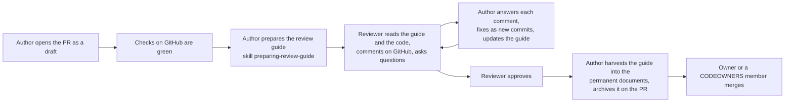

# Reviews

How pull requests are reviewed in Trip Map (DESIGN.md section 13.6; AGENTS.md, "Review").

## The flow

- **The review guide** is a temporary document for one pull request: what to read, in which order, what each part does, and where to look hardest. It is linked from the PR description during review, and archived as a comment on the PR at merge. Guides are not stored in the repository, because their line numbers and code maps go stale.
- **What lasts** is harvested before merging: decisions into DESIGN.md, the code's organization into `docs/ARCHITECTURE.md`, general explanations into [background.md](background.md), and open points into issues.
- **Independent review:** a pull request that touches security, privacy, or publishing is also reviewed by a separate agent session that did not write it, before the human review.

## Files here

| File | What it is |
| --- | --- |
| `README.md` | This page: the flow, and the list of reviews |
| [background.md](background.md) | Explanations shared by all reviews: TypeScript for C, C++, and Python readers, the browser and the phone, events, classes, styles, performance, the tests, Leaflet and the map |

## Reviews so far

| PR | Plan step | What it reviewed | Guide |
| --- | --- | --- | --- |
| [#4](https://github.com/projects-rs/trip-map/pull/4) | Step 1, PR 1 | The map and My location, TypeScript and the build, publishing with the owner's approval, the project rules | Linked from the PR; archived on the PR at merge |
