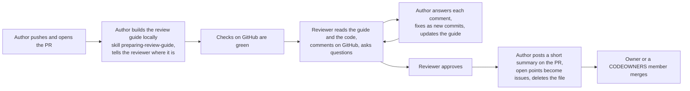

# Reviews

How pull requests are reviewed in Trip Map (DESIGN.md section 13.6; AGENTS.md, "Review").

## The flow

- **The review guide** is a temporary document for one pull request: what to read, in which order, what each part does, and where to look hardest. It is a local file, `review-guides/pr-<number>-review-guide.md`, in a folder `.gitignore` keeps out of the repository, because its line numbers and code maps go stale. The author builds it when the PR is pushed and tells the reviewer where it is.
- **What lasts** goes into the documents during the review, by its own commits: decisions into DESIGN.md, the code's organization into `docs/ARCHITECTURE.md`, general explanations into [background.md](background.md). Nothing is copied from the guide. At merge, open points become issues and a short summary of the guide (at most about 60 lines) is posted on the PR.
- **Independent review:** a pull request that touches security, privacy, or publishing is also reviewed by a separate agent session that did not write it, before the human review.

## Files here

| File | What it is |
| --- | --- |
| `README.md` | This page: the flow, and the list of reviews |
| [background.md](background.md) | Explanations shared by all reviews: TypeScript for C, C++, and Python readers, the browser and the phone, events, classes, styles, performance, the tests, Leaflet and the map |

## Reviews so far

| PR | Plan step | What it reviewed | Guide |
| --- | --- | --- | --- |
| [#4](https://github.com/projects-rs/trip-map/pull/4) | Step 1, PR 1 | The map and My location, TypeScript and the build, publishing on merge and releases, the project rules and CONTRIBUTING.md | A Claude Doc (before guides became local files); summary on the PR at merge |
