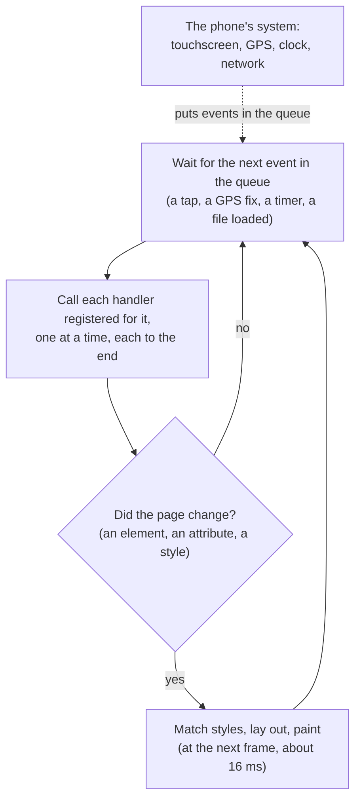
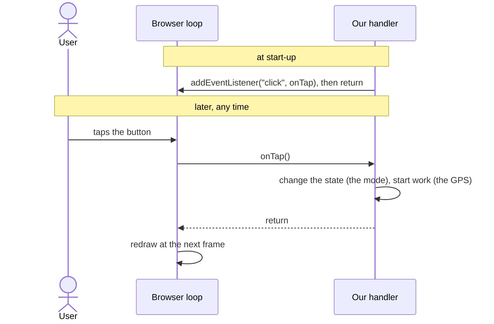
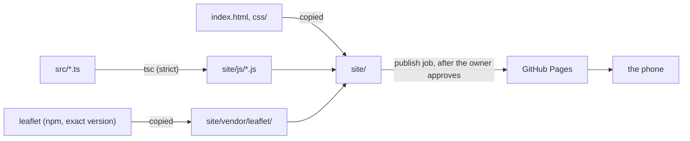

# Background for reviewers

Explanations shared by every review, for reviewers who know C, C++, or Python but not TypeScript or the browser. Each pull request's review guide links only the sections its reviewer needs (skill `preparing-review-guide`). First written during the review of PR #4 (step 1).

## Contents

1. [TypeScript next to C++](#1-typescript-next-to-c)
2. [The browser and the phone](#2-the-browser-and-the-phone)
3. [Modules and imports](#3-modules-and-imports)
4. [Events](#4-events), with the browser loop and how one tap travels
5. [Classes](#5-classes)
6. [The page: HTML and CSS](#6-the-page-html-and-css)
7. [Performance](#7-performance)
8. [The build and publishing](#8-the-build-and-publishing)
9. [The tests](#9-the-tests)
10. [Leaflet and the map](#10-leaflet-and-the-map)

## 1. TypeScript next to C++

TypeScript is JavaScript with types written in the code, checked by a compiler before anything runs. The phone runs the compiled JavaScript: the same code with the types removed. Classes and types feel like C++; objects, strings, and functions as values feel like Python.

| C++ | TypeScript | Note |
| --- | --- | --- |
| `int timer;` / `std::optional<int>` | `let timer: number \| undefined;` | The type follows the name. `\|` means "or". One number type: a 64-bit double |
| `const int X = 5;` | `const X = 5;` | `const` fixes the name, not the object it refers to |
| `void show(const std::string& text)` | `function show(text: string): void` | The return type follows the parameters |
| `enum Mode { Off, Waiting }` | `type Mode = "off" \| "waiting";` | Allowed values, checked by the compiler |
| `struct Marker { Dot dot; Circle circle; };` | `type Marker = { dot: Dot; circle: Circle };` | A struct type for plain data |
| `template<class T> T* f(…)` | `function f<T extends HTMLElement>(…): T` | A generic |
| `dynamic_cast<Button*>(e) != nullptr` | `e instanceof HTMLButtonElement` | A real check while the app runs; after it the compiler knows the type |
| `(Button*) e` | `e as HTMLButtonElement` | A cast. Not used in our code (AGENTS.md) |
| `NULL` / `None` | `null`; `undefined` for "not set" | The compiler forces a check before use |
| `==` | `===` | JavaScript's `==` converts types implicitly; never used |
| f-string `f"…{x}…"` | `` `…${x}…` `` | A template string |
| `[this]() { … }` | `() => { … }` | A lambda (arrow function); captures what it uses, including `this` |
| `void (*f)(const char*)` | `(text: string) => void` | A function type |
| `-Wall -Werror` | `"strict": true` and the other checks in `tsconfig.json` | Any type error fails the build |
| `unknown`-like `void*` | `unknown` | "Could be anything": must be checked before use. `any` turns checking off; not used |
| `decltype(x)` | `typeof x` in a type | In code, `typeof x` is instead a run-time operator returning `"object"`, `"string"`… |

**Type guards:** a function returning `value is SomeType` is a check whose `true` result tells the compiler the type, so no cast is needed (`isLeaflet` in `src/leaflet.ts`).

**Types in the browser:** `document`, `navigator`, `HTMLButtonElement`, `setTimeout` are built into every browser, like the C library and the operating system's API. Their types come with TypeScript (`"lib": ["DOM"]` in `tsconfig.json`), so no file imports them. Their reference is [MDN Web Docs](https://developer.mozilla.org/en-US/docs/Web/API), the "header file" for browser APIs, with a compatibility table on each page.

## 2. The browser and the phone

Think of the browser as the operating system:

- **A sandbox:** the app cannot touch files, the GPS, or the camera without asking the browser, which asks the user.
- **The screen is hardware:** many sizes, touch instead of a mouse, reserved areas for the notch and home bar (the `safe-area` values in the CSS).
- **Battery and radio are scarce:** high-accuracy GPS costs power, so it starts only after a tap.
- **The phone can suspend the app at any time,** like a power-down state, so nothing important lives only in memory.

The browser runs only two kinds of code: JavaScript and WebAssembly (compiled C, C++, or Rust, for heavy computation, which still needs JavaScript to reach the page). Java is an unrelated language, not used here.

## 3. Modules and imports

Each `.ts` file is a module. A name at the top of a file is private to it, like a `static` global in C; `export` makes it reachable from other files, which must `import` it:

| Python | TypeScript |
| --- | --- |
| `from map import create_map` | `import { createMap } from "./map.ts";` |
| `import map` then `map.create_map()` | `import * as map from "./map.ts";` |

- A path starting with `./` is relative to the importing file. A plain name (`"leaflet"`) is an installed package, found in `node_modules/`, which `npm install` creates from `package.json` and git never stores.
- Each module runs once, the first time it is imported; every importer shares it.
- All imports run before the importing file's first line; a missing name fails before anything runs, like an undefined symbol at link time.
- `import type` brings types only: erased from the output.

## 4. Events

The browser works like a Win32 message loop, or a single-threaded `epoll` loop: one thread, a queue, and handlers that never interrupt each other. No locks are needed, but a slow handler freezes the app. The app's start-up code registers handlers and returns; it never loops or waits.

| Win32 | The browser |
| --- | --- |
| `GetMessage` / `DispatchMessage` loop | The browser's own loop, hidden |
| `WM_LBUTTONDOWN`, `WM_TIMER` | `"click"`, a timer callback |
| `wParam`, `lParam` | The event object passed to the handler |
| One `WndProc` with a big `switch` | A small handler per element and event type |
| `SetTimer` | `setTimeout` |

Events come in layers: the phone's system reads the hardware; the browser turns it into standard events (one tap gives `pointerdown`, `pointerup`, `click`) and callback APIs (the GPS's `watchPosition`, timers); libraries such as Leaflet build their own (`"dragstart"`); the app can define its own (`CustomEvent`).

| Registers | Unregisters |
| --- | --- |
| `element.addEventListener("click", handler)` | `removeEventListener` with the same function |
| `navigator.geolocation.watchPosition(onPosition, onError, options)` | `clearWatch(id)` |
| `map.on("dragstart", handler)` (Leaflet) | `map.off(…)` |

An object whose handlers are registered stays alive even if no variable holds it: the browser holds the handlers, and they refer to the object.

### The browser loop

The browser runs one loop, like `while (1) { wait for an event; dispatch it; redraw }`. The app never writes this loop: its code runs only inside the handlers the loop calls, each to the end, one at a time.

### An example: how one tap travels

The pattern every feature follows: start-up registers handlers and returns; an event arrives; the browser calls the handler; the handler changes some state and returns; the browser redraws. Here with the "My location" button (the app's current flows, one drawing per event, are in `docs/ARCHITECTURE.md`, "How the app runs"):

- **Nothing in our code waits.** Each step is a handler that runs and returns; between steps, only the browser's loop runs.
- **The order of events is not ours to choose.** A tap can arrive while a GPS fix is on its way; the state machine is what makes every order safe, as checked in each review's state × event table.
- **For the map, Leaflet comes first:** a finger on the map reaches Leaflet, which then fires its own events, such as `dragstart`.

## 5. Classes

TypeScript classes work like C++ classes, with three differences:

- Members are **public by default**, as in a C++ `struct`. Write `private` (checked by the compiler), `protected`, `readonly` (a `const` member).
- **`this.` is required** inside the class, like Python's `self.`, but never declared as a parameter.
- **A method handed to the browser as a callback forgets its object,** like a C++ member-function pointer without the object. So callbacks are written as arrow-function fields, `onTap = (): void => { … };`: a member holding a lambda that captured `this`. They behave like any other member.

A constructor parameter marked `private readonly` is also stored as a member: TypeScript's member initializer list. `new` allocates, runs the constructor, and returns a reference; there is no `delete`: the garbage collector frees an object once nothing refers to it.

When to use a class is decided by the four questions in AGENTS.md: a class when a library requires one, or for an entity whose state evolves through its behavior; plain objects for data saved as JSON; plain functions for calculations.

## 6. The page: HTML and CSS

A web app uses three languages, one per kind of file: **HTML** (`.html`) says what is on the screen and which files to load; **CSS** (`.css`) says how it looks; **TypeScript**, compiled to JavaScript (`.js`), says what it does.

- `index.html` is the only page: a `<head>` (settings, style files, not shown) and a `<body>` (what is shown). The `viewport` setting makes the page use the phone's real width.
- **Elements** have an `id` (unique name), a `class` (shared style group), and attributes; `data-…` attributes are the app's own, like extra struct fields.
- **The DOM** is the tree of elements in memory. Writing an element's property (`box.hidden = false`) changes the screen at once, like a memory-mapped register.
- **CSS rules** are *selector → properties*: `#id` picks one element, `.class` a group, `[data-mode="follow"]` only when that attribute has that value. When two rules set the same property, the more precise selector wins, then the later rule.
- **How styles are applied:** the browser builds the tree, reads the rules, matches them to elements, lays out, and paints; when a property the selectors look at changes, it matches again at the next frame. The code changes `data-mode`; the CSS picks the color, like writing a status register and letting a lookup table choose the LED.

## 7. Performance

The budget is one frame: about 16 ms, at 60 redraws a second, for all handlers plus styles, layout, and drawing. Past about 100 ms a tap feels slow.

| Linux interrupt rule | Browser rule |
| --- | --- |
| Keep the ISR short | Keep handlers short |
| Defer to a bottom half | `setTimeout(work, 0)`, `requestAnimationFrame`, or a Web Worker (a real second thread) |
| Never block | Most I/O is asynchronous (`await`); avoid `localStorage` for large data and huge `JSON.parse` |
| No heavy logging | No `console.log` in frequent handlers |
| Coalesce interrupts | Prefer `"moveend"` to `"move"`; never act on every `pointermove` |
| Avoid cache thrashing | Group reads of sizes, then writes |

Timers cost nothing while waiting. The phone's second budget is the battery: no polling, GPS only when needed, stop work when the app is hidden (`visibilitychange`).

## 8. The build and publishing

- `npm run build` compiles `src/` and assembles `site/`, exactly what the phone downloads; `site/` is never stored in git.
- A library's version is written only in `package.json`; the build checks everything else agrees. Dependabot proposes newer stable versions as pull requests.
- A pull request merges only if every check passes and a CODEOWNERS member approves it. After each merge, GitHub builds, tests that exact build, publishes it, and marks a new version as a release. Phones with "Try new versions first" get it at once; everyone else when the owner marks it ready, after trying it on real phones (DESIGN.md sections 12.2, 13.2, 13.7).

### Where the compiled app is

`site/` is a temporary folder: the build makes it whenever it is needed, and git never stores it (`.gitignore`). It exists in three places:

| Where | When | How long |
| --- | --- | --- |
| A computer, in the project folder | After `npm run build` | Until deleted; never committed |
| A GitHub machine | During each workflow run: built, tested, and, in the publish workflow, packed | Deleted when the run ends, with the machine |
| GitHub Pages' servers | After each merge into main | Until the next publish replaces it. This is the copy phones download, at `https://projects-rs.github.io/trip-map/` |
| A GitHub Release (repository → Releases) | When a merge brings a new app version | For good: the exact app of that version, as a zip |

The same path as a C++ release:

| C++ world | Trip Map |
| --- | --- |
| A build server compiles | The publish workflow's `build` job compiles `src/` into `site/` on a GitHub machine, and runs the phone tests on that exact build |
| A package (zip, installer) | `upload-pages-artifact` packs `site/` into an archive, the "Pages artifact", kept with the run only briefly |
| Upload to the download server | The `publish` job deploys that archive to GitHub Pages, GitHub's web hosting |
| A release, kept for good | The `release` job tags the commit `v<version>` and creates a GitHub Release with the built site attached as a zip |
| The user downloads and installs | The phone opens the address and downloads the files; the home-screen icon is the "install" |

The app's version is written in `package.json` and raised by each pull request that changes the app (DESIGN.md section 11.3); the built site carries it in `version.json`. GitHub keeps a history of every deployment (Settings → Environments → `github-pages`), and every version is a release. To go back to an earlier version: Actions → Publish → Run workflow, choosing that release's tag.

**To see the compiled app:** after a publish, open the address and use the browser's developer tools (F12 → Sources): `index.html`, `js/*.js` (with source maps, so the TypeScript shows too), `css/`, and `vendor/leaflet/`. Before that, on a computer: `npm install`, `npm run build`, `npm run serve`, then open `http://localhost:8000/`.

## 9. The tests

End-to-end interface tests (DESIGN.md section 13.4) drive the real, built app in a real browser engine set up as a phone, and check what the user would see: a hardware-in-the-loop bench, with a fake GPS, fake map images, and a simulated finger as signal generators. The tool is Playwright, like pytest or GoogleTest plus a remote control for a browser.

| Playwright | Familiar equivalent |
| --- | --- |
| `test("name", async ({ page, context }) => { … })` | `def test_name(page, context):`; `TEST(Suite, Name)` |
| `page`, `context` | Fixtures: a fresh phone (`context`) and the app's tab (`page`) |
| `page.locator("#my-location").tap()` | Find an element, tap it |
| `expect(…).toBeVisible()` | `assert`, but re-checked for up to 5 seconds |
| `await` | Wait for the step (the browser is another process) |

- Each test: Arrange (fake world), Act (what the user does), Assert (what the user sees).
- Every test runs on both phones (Android and iPhone), each time in a brand-new browser context, with no real network and no retries.
- A test fails at the first unmet check, error, or timeout; the run is green only if every test passes on both phones.

## 10. Leaflet and the map

- **The reference:** the [Leaflet API reference](https://leafletjs.com/reference.html) is the library's header file; check the version at its top. Each object has Creation (the factory, like `L.map(id, options)`), Options, Events, and Methods. `docs/ARCHITECTURE.md` lists every Leaflet call the app makes, with its place in the reference. Implementations are in Leaflet's source, `src/`, one file per class.
- **Factories:** `L.map(…)` is `return new L.Map(…)`. Most methods return the object itself, so calls chain: `L.map(…).setView(…)`, like returning `*this`.
- **Options** are objects of named settings, like Python `**kwargs`.
- **Map tiles:** the map is a mosaic of 256×256-pixel images. Leaflet works out which tiles cover the screen and requests each from `https://tile.openstreetmap.org/{z}/{x}/{y}.png`: zoom `z` (a grid of 2^z × 2^z tiles), column `x` from the west, row `y` from the north. No `{s}` subdomains: OpenStreetMap asks for one host name, since HTTP/2 makes them unnecessary.
- **Privacy:** OpenStreetMap's servers see each tile request: an IP address, the map area viewed, the time, the browser type, and our site's address; not a name, an account, or the GPS position. Someone intercepting the connection sees only that the phone talks to the tile server, not which tiles (HTTPS). Offline maps remove even the tile requests.
